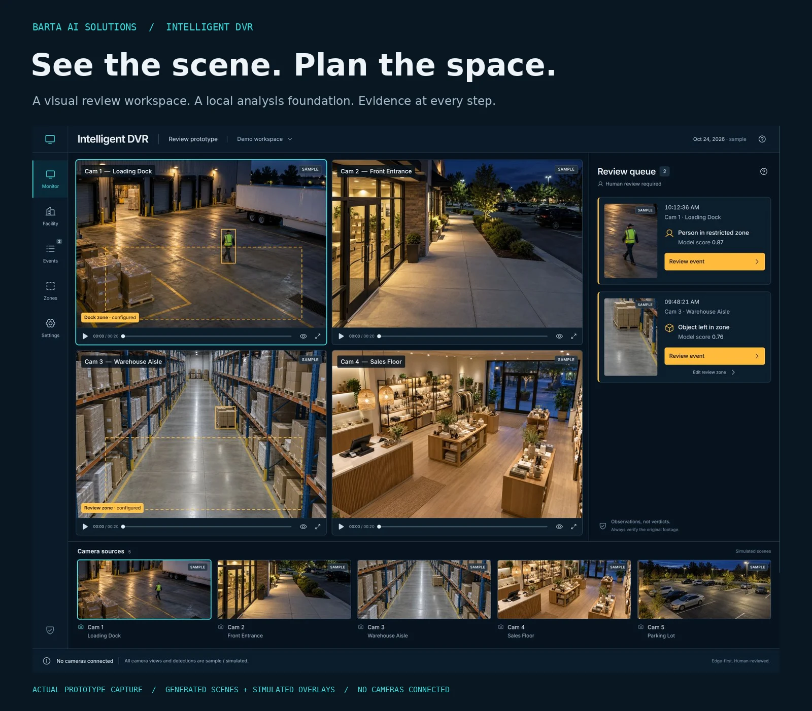
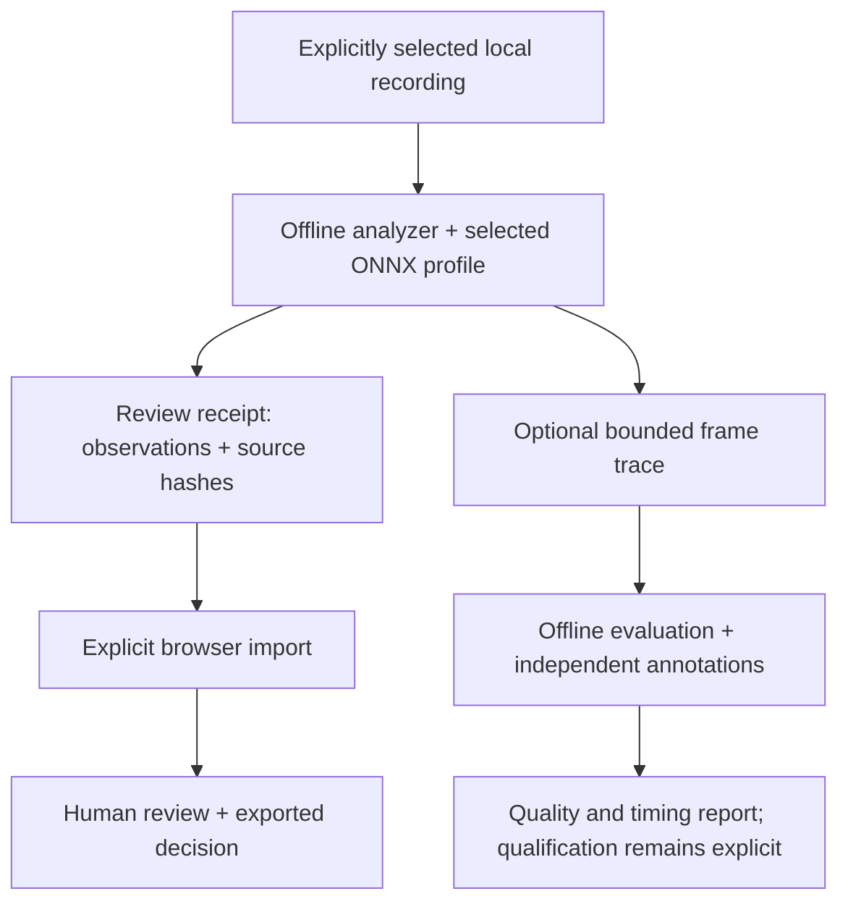

<div align="center">

# Intelligent DVR

**See the scene. Plan the space. Review the evidence.**

A local camera-analysis foundation and visual review prototype from BARTA AI Solutions.

[Visual tour](docs/visual-tour.md) · [Start here](docs/getting-started.md) · [Wiki](https://github.com/bartytime4life/Intelligent-DVR-Tool/wiki) · [Test evidence](docs/verification/2026-10-27/README.md)



</div>

> **Working prototype.** The interface below is real; its camera scenes, overlays and playback are simulated. Recording analysis is a separate offline CLI. Live camera operation, representative detection accuracy and the required **100-camera capacity remain unqualified**.

## Watch the workspace unfold


*Five actual browser views, edited into a looping walkthrough. [Still-image tour](docs/visual-tour.md#still-image-tour) · [Capture provenance](docs/media/README.md).*

| Observe | Make a decision | Plan the facility |
| --- | --- | --- |
| Four-view wall, five selectable sample scenes, overlay controls and expanded views | Review observations, add notes, confirm or dismiss, search history and export decisions | Editable buildings, floors, rooms, labels, camera placement and estimated coverage |
| [Explore the wall](docs/visual-tour.md#1-observe-the-scene) | [Follow a review](docs/visual-tour.md#2-review-the-evidence) | [Build a plan](docs/facility-builder.md) |

## Put the space in motion


*A planned route, scrubbed across 31 captured states and played faster for this illustration. Proposed camera transitions are simulated and unverified. [Static view](docs/media/route-15.webp) · [Visibility-model limits](docs/facility-builder.md#visibility-model-and-evidence-limits).*

- **Start from a map:** optional one-shot location suggestion, bounded search area, OpenStreetMap simple building drafts, dimensions and a review step before applying. An offline extract can be imported instead.
- **Start from a shape:** rectangle, L wing, T wing, U wing, cross, octagon or round, with editable dimensions and rotation.
- **Refine the plan:** add floors, rooms and labels; place and aim cameras; inspect estimated ground-plane visibility; undo edits and export the plan.

Footprints are approximate map geometry. Unknown heights/floors can be placeholders. Interiors are not inferred, and planning references do not establish code compliance. [Map and shape guide](docs/map-measurements-and-shapes.md).

## Set up a Linux or Windows machine

The new **System** workspace combines recording/retention sizing, RAM and VRAM budgets, GPU candidates, startup-power arithmetic and explicit resource-policy export. Applied browser limits control visible tiles, overlay pixel scale and background sample playback. The offline analyzer accepts exported OpenCV thread and decoded-frame caps.

[Hardware and drive shortlist](docs/hardware-guide.md) · [Linux setup](docs/setup-linux.md) · [Windows setup](docs/setup-windows.md) · [GPU planning](docs/gpu-planning.md) · [Control scopes](docs/resource-controls.md)

## Run the review prototype

Use Node.js 22 and npm. From the repository root:

```bash
npm ci
npm run dev -- --host 127.0.0.1 --port 4173
```

Open the address Vite prints. **Monitor**, **Facility**, **Events**, **Zones**, **System** and **Settings** are the workspace areas. Start with the [five-minute walkthrough](docs/getting-started.md).

The browser prototype needs no subscription, paid inference, API key, camera credentials or remote backend. Review decisions, rules and plans save in this browser's localStorage; they are editable and can be lost when storage is cleared. Export anything you need to keep. The optional Google Font and explicitly enabled online maps are external requests. [Data boundaries](docs/architecture.md#where-data-goes).

## Claims you can check

| Claim | Evidence | Boundary |
| --- | --- | --- |
| Earlier documentation-refresh review/zone/facility checks | **27 passed**, plus **4 packaging tests passed**, October 27, 2026 | Automated tests cover their assertions; browser checks are recorded separately |
| Earlier documentation-refresh Python checks | **CI: 55 passed, no skips.** Local: 47 passed, 8 skipped | [CI evidence](docs/verification/2026-10-27/README.md#ci-follow-through) records the tested commit and native dependencies |
| The production package builds | Fresh build completed | Vite reports a large lazy-loaded facility bundle; no load-time claim follows |
| A pretrained YOLOX-S artifact previously ran through compatibility probes | [October 26 model report](docs/model-qualification-20261026.md) and JSON receipts | Historical synthetic-input/recording smoke tests; no recognition-quality result |
| The scheduler can be exercised with 100 synthetic source IDs | [Fresh load-model reports](docs/verification/2026-10-27/README.md) | Virtual time, assumed service costs and synthetic payloads; no camera throughput measured |

The [machine-setup verification record](docs/verification/hardware-2026-10-27/README.md) adds 37 passing JavaScript tests, 4 packaging tests and a local Python run of 58 passes / 8 explicit skips. Its CI follow-through records native Linux/Windows results when available. **No detector weights or representative recordings are bundled.**

## From a recording to evidence



The browser does not run the detector. Imported observations never borrow the generated sample images. The evaluator's report is a different schema from the browser's review receipt. [Architecture](docs/architecture.md) · [Offline CLI](edge/README.md) · [Evaluation guide](docs/offline-evaluation.md).

## Build toward 100 cameras

**At least 100 simultaneously active cameras is the owner's requirement.** The bounded scheduler, fair dispatch, stale/drop accounting and deterministic load model prepare that work. Live ingest, recording services, accelerated inference and distributed workers still need implementation and qualification.

Connection count, recording continuity, analysis cadence and visible browser tiles are separate workloads. [Scaling plan](docs/performance-100-cameras.md) · [Evidence-led roadmap](docs/roadmap.md).

## Documentation map

| I want to… | Read |
| --- | --- |
| See what the program does | [Visual tour](docs/visual-tour.md) |
| Try the prototype and preserve my work | [Getting started](docs/getting-started.md) |
| Draw buildings and place cameras | [Facility builder](docs/facility-builder.md) |
| Use maps, dimensions and common shapes | [Map starter](docs/map-measurements-and-shapes.md) |
| Understand evidence, storage and trust boundaries | [Architecture](docs/architecture.md) |
| Analyze an approved recording locally | [Edge CLI](edge/README.md) |
| Evaluate quality and false alerts | [Offline evaluation](docs/offline-evaluation.md) |
| Reproduce the published checks | [Verification record](docs/verification/2026-10-27/README.md) |
| Understand implementation priorities | [Roadmap](docs/roadmap.md) |

## Checks and project terms

```bash
npm run build
npm test
npm run test:sites
python3 -m unittest discover -s tests -p 'test_*.py'
python3 scripts/check-docs.py
```

Install `edge/requirements-test.txt` in an isolated Python environment to enable synthetic native-inference integration tests. Without them, those cases are explicitly skipped. Restricted runners can use the [single-process Node commands](docs/verification/2026-10-27/README.md#reproduce).

This repository does **not** currently assign a software license. No open-source licensing grant is implied by public availability. [Third-party notices](docs/third-party-notices.md) cover separately licensed components and model sources; [SECURITY.md](SECURITY.md) describes the prototype boundary. Camera imagery is generated sample artwork, not a record of a real workplace.
