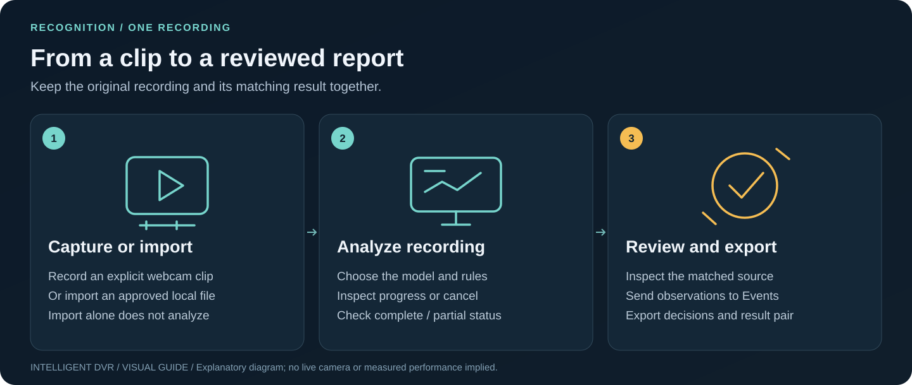

<div align="center">

# Intelligent DVR

**Connect deliberately. Review the evidence. Plan the space.**


A local-first camera-analysis and facility-planning project from **BARTA AI Solutions**.

[📖 Visual handbook](docs/how-to.md) · [🚀 First session](docs/getting-started.md) · [🍎 Mac setup](docs/setup-macos.md) · [🖥️ PC setup](docs/pc-testing.md) · [🧭 All guides](docs/README.md) · [Wiki](https://github.com/bartytime4life/Intelligent-DVR-Tool/wiki)

</div>

*The cover is an ImageGen illustration, not an application screenshot. The screenshots below are actual software with a clean local test session. [Image provenance](docs/media/guide/README.md).*

## Choose a launch path

| Your computer / task | Open this guide | Local address |
| --- | --- | --- |
| Apple silicon Mac, macOS 14+ | [Install → Check → Start](docs/setup-macos.md) | `http://127.0.0.1:4180/` |
| Linux or Windows PC | [Prebuilt kit or source setup](docs/pc-testing.md) | `http://127.0.0.1:4173/` |
| Browser-only interface development | [Source preview](#run-the-source-only-ui-preview) | Address printed by Vite |
| An installed system ready for real-device testing | [Field acceptance runbook](docs/field-acceptance.md) | Your chosen stable local origin |


## See the current workspaces

| Monitor — start with one source | Train — one guided task at a time |
| --- | --- |
|  |  |
| [Connect a source](docs/local-camera-feeds.md) | [Tune detection](docs/training.md) · [Enroll with consent](docs/person-enrollment.md) |

| Facility — build an editable plan | System — budget the workload |
| --- | --- |
|  |  |
| [Buildings, rooms, doors, windows and stairs](docs/facility-builder.md) | [Resources and supported controls](docs/resource-controls.md) |

*Controlled local captures from the merged PR #71 application source. The facility is a fictional built-in example. No private footage, enrolled people or surveyed site is pictured. [Full gallery and capture details](docs/visual-atlas.md).*

## From one clip to a useful review



1. **Monitor:** choose a source and explicitly connect. For a webcam clip, deliberately record and stop it.
2. **Recognition:** import/select an approved recording, choose the local model and rules, then **Analyze recording**.
3. **Inspect:** read complete/partial coverage, sampled detections and the exact matched source.
4. **Events:** send observations deliberately, review the evidence, add notes and confirm/dismiss.
5. **Export:** save the report and the recognition-result/recording pair for reopening.

[Complete walkthrough](docs/how-to.md#3-analyze-a-clip) · [Review desk](docs/review-and-events.md) · [Recording coverage](docs/recording-coverage.md).

**Live AI:** press **Start AI** on a Monitor tile to run the same local detector on that camera, with numbered short-lived tracks and rule observations you can send to Events. It never starts on its own and keeps no footage. [How live AI and tracking work](docs/live-detection.md).

Detection scores are model outputs. Track numbers follow one box across frames; they are not identities. Reports remain subject to human review.

## Make the tool fit your view

| Your goal | What to do | What the result means |
| --- | --- | --- |
| Reduce misses or false alarms for this camera | [Train → Start session](docs/training.md) | A threshold setting for this session; detector weights are not retrained |
| Review a possible enrolled-person match | [Get consent, enroll, then explicitly check a local job](docs/person-enrollment.md) | A local suggestion for human confirmation, not proof of identity |
| Watch a specific image region | [Draw a zone on the correct still](docs/zones.md) | A class-presence rule in that camera's image coordinates |
| Plan a building and cameras | [Facility: shell → floors → rooms/openings → cameras](docs/facility-builder.md) | Editable proposed geometry and estimated coverage |
| Inspect image details or a measured plane | [Diagnostics](docs/facility-image-diagnostics.md) · [Calibration](docs/facility-calibration.md) | Explicit pixel/ground-plane checks with stated limits |
| Preserve work before updating | [Browser exports + private-folder backup](docs/setup-macos.md#preserve-data-when-updating) | Separate copies of data that Git does not retain |

## Keep your work


Browser reviews, rules, plans and session choices belong to the exact browser and origin. Models, recordings, tuned rule files and enrolled-person templates live in the private local service folders. Export temporary results before stopping the service; back up both storage areas separately. Keep the same browser and port for everyday work.

[Updates and migration](docs/setup-macos.md#preserve-data-when-updating) · [Saved facilities](docs/saved-facilities.md) · [Troubleshooting](docs/troubleshooting.md).

## What is implemented and what still needs measurement

The current baseline includes explicit webcam/local DVR/approved public previews, bounded local recording analysis, human review and reports, guided threshold tuning, consent-based local face templates and possible-match suggestions, an editable facility planner and resource-planning controls. One configured LAN recorder has a separate explicit Start/Stop workflow.

**Physical-device endurance, independently measured detection/face-match quality, continuous multi-camera recording and 100-camera capacity remain unqualified.** Geometric coverage, sizing and route rehearsal are planning estimates. No subscription, paid inference or API key is required by the implementation; local hardware and storage still consume resources.

[Product status](docs/product-status.md) · [Verification records](docs/verification/README.md) · [Field acceptance](docs/field-acceptance.md) · [Data boundaries](docs/architecture.md).

## Run the source-only UI preview

Use Node.js 22 and npm from the repository root:

```bash
npm ci
npm run dev -- --host 127.0.0.1 --port 4173
```

This starts the browser interface preview. Use the platform launcher for the local camera bridge, recording import, analysis and training APIs. [Mac](docs/setup-macos.md) · [PC kit](docs/pc-testing.md).

## Build toward 100 cameras

At least **100 simultaneously active cameras** is the owner's requirement. Connection count, recording continuity, analysis cadence and visible tiles are separate workloads. The fair bounded scheduler and synthetic load model prepare the engineering; they do not measure physical camera throughput.

[Performance preparation](docs/performance-100-cameras.md) · [Workload scope](docs/pilot-scope.md) · [Hardware](docs/hardware-guide.md) · [GPU planning](docs/gpu-planning.md) · [Roadmap](docs/roadmap.md).

## Documentation map

Begin with the [visual handbook](docs/how-to.md), then use the [complete guide index](docs/README.md). The [screenshot atlas](docs/visual-atlas.md) distinguishes current controlled captures, explanatory graphics and the [historical visual tour](docs/visual-tour.md). The [GitHub Wiki](https://github.com/bartytime4life/Intelligent-DVR-Tool/wiki) has its own published history and image assets; checked source mirrors live in [docs/wiki](docs/wiki/README.md).

## Checks and project terms

```bash
npm run build
npm test
npm run test:sites
python3 -m unittest discover -s tests -p 'test_*.py'
python3 scripts/check-docs.py
python3 scripts/build-wiki.py --check
```

Use the platform's isolated dependencies for native checks; optional test fixtures require ONNX. [Verification](docs/verification/README.md) keeps historical and current test scopes separate. PR #71's tested head passed 16 reported GitHub checks, including Mac source installation, Linux/Windows validation, the PC kit and controlled browser regressions; these are software checks, not field acceptance.

This repository does not currently assign a software license. Public availability does not grant a software license. [Third-party notices](docs/third-party-notices.md) cover separately licensed components/models; [SECURITY.md](SECURITY.md) describes the prototype boundary. No pretrained weights, private recordings, templates or credentials are bundled.
