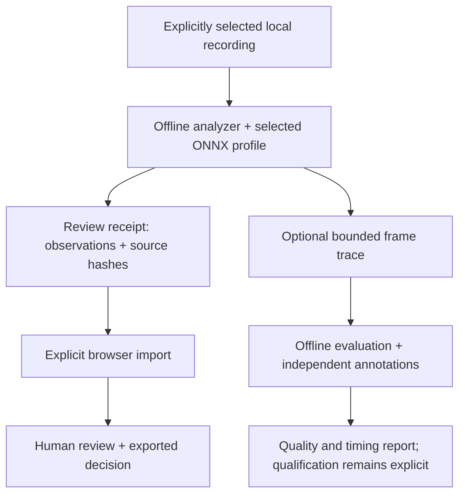

<div align="center">

# Intelligent DVR

**See the scene. Plan the space. Review the evidence.**

A local camera-analysis foundation and visual review prototype from BARTA AI Solutions.

[Visual tour](docs/visual-tour.md) · [Install for PC testing](docs/pc-testing.md) · [Start here](docs/getting-started.md) · [Product status](docs/product-status.md) · [Wiki](https://github.com/bartytime4life/Intelligent-DVR-Tool/wiki) · [Test evidence](docs/verification/README.md)

</div>

**Local previews and recording review.** Monitor starts empty and can explicitly
connect a browser webcam or a configured local DVR RTSP channel. Camera previews
do not run AI. Explicit webcam clip capture now connects Monitor to local recording
import, analysis, human review and downloadable reports. Recognition provides
progress, cancellation and source-matched results. [Complete recording workflow](docs/recording-workflow.md).

[Connect a webcam or DVR](docs/local-camera-feeds.md) · [Analyze a recording](docs/local-analysis-service.md)

Physical-device compatibility, independently measured recognition quality,
tracking and **100-camera capacity remain unqualified**. Earlier generated-camera
screenshots in the [historical tour](docs/visual-tour.md) document previous versions.

| Monitor | Review | Plan |
| --- | --- | --- |
| Explicit webcam / local RTSP previews, status, errors and disconnect | Source-matched recording results, human decisions, notes, export and Undo | Editable buildings, rooms and camera plans with estimated coverage |

## Put the space in motion


*A planned route, scrubbed across 31 captured states and played faster for this illustration. Proposed camera transitions are simulated and unverified. [Static view](docs/media/route-15.webp) · [Visibility-model limits](docs/facility-builder.md#visibility-model-and-evidence-limits).*

- **Start from a map:** submit an address/place search, use a one-shot location suggestion or enter coordinates; review a bounded area and supported OpenStreetMap exterior drafts before applying. Choose a disclosed public/local service or import an offline JSON file.
- **Start from a shape:** rectangle, L wing, T wing, U wing, cross, octagon or round, with editable dimensions and rotation.
- **Refine the plan:** add floors, rooms and labels; place and aim cameras; inspect estimated ground-plane visibility; undo edits and export the plan.

Footprints are approximate map geometry. Unknown heights/floors can be placeholders. Interiors are not inferred, and planning references do not establish code compliance. [Map and shape guide](docs/map-measurements-and-shapes.md) · [Address search and offline recovery](docs/facility-setup-reliability.md).

## Set up a Linux or Windows machine

The new **System** workspace combines recording/retention sizing, RAM and VRAM budgets, GPU candidates, startup-power arithmetic and explicit resource-policy export. Applied browser limits control visible tiles, overlay pixel scale and background sample playback. The offline analyzer accepts exported OpenCV thread and decoded-frame caps.

[Hardware and drive shortlist](docs/hardware-guide.md) · [Linux setup](docs/setup-linux.md) · [Windows setup](docs/setup-windows.md) · [GPU planning](docs/gpu-planning.md) · [Control scopes](docs/resource-controls.md)

## Run the review prototype

Use Node.js 22 and npm. From the repository root:

```bash
npm ci
npm run dev -- --host 127.0.0.1 --port 4173
```

Open the address Vite prints. **Monitor**, **Facility**, **Events**, **Zones**, **System** and **Settings** are the workspace areas. Start with the [five-minute walkthrough](docs/getting-started.md).

The browser prototype needs no subscription, paid inference, API key, camera credentials or remote backend. Review decisions, rules and plans save in this browser's localStorage; they are editable and can be lost when storage is cleared. Export anything you need to keep. The optional Google Font and explicitly enabled online maps are external requests. [Data boundaries](docs/architecture.md#where-data-goes).

## Owner-PC qualification follow-up

The [October 28 PC report](docs/verification/host-2026-10-28/README.md) records an isolated RTX 5080 trial, short public-feed loads up to 30 active sources and a 300-image person reference benchmark, including two rejected quality experiments. Recordings/images stayed local. This documents local experiments and unpublished work; it does not ship a GPU backend, establish field accuracy or qualify 100 cameras.

## Claims you can check

| Claim | Evidence | Boundary |
| --- | --- | --- |
| Review, facility and System logic checks | **46 frontend + 4 packaging tests passed** on each platform | [Audited baseline](docs/verification/facility-2026-10-27/README.md) binds results to commit `82c862c68735720b8840461fc624e8dbe148a53a` |
| Python rules, evaluation, resource policy and synthetic inference checks | **Linux: 66 passed. Windows: 63 passed, 3 Linux-only skips** | Synthetic native-inference checks do not establish recognition quality |
| Facility browser scenarios | **6 passed** in a separate Chromium job | Recorded geometry and mocked services; no live-provider or novice-user qualification |
| The production package builds | Passed on Linux and Windows at that baseline | Vite reports a large lazy-loaded facility bundle; no load-time claim follows |
| A pretrained YOLOX-S artifact previously ran through compatibility probes | [October 26 model report](docs/model-qualification-20261026.md) and JSON receipts | Historical synthetic-input/recording smoke tests; no recognition-quality result |
| The scheduler can be exercised with 100 synthetic source IDs | [Fresh load-model reports](docs/verification/2026-10-27/README.md) | Virtual time, assumed service costs and synthetic payloads; no camera throughput measured |

The [verification index](docs/verification/README.md) separates the latest audited application baseline (**116 passing tests on Linux; 113 on Windows with 3 skips**) from earlier dated runs. The six browser scenarios are reported separately. [Machine-setup evidence](docs/verification/hardware-2026-10-27/README.md) and [earlier documentation-refresh evidence](docs/verification/2026-10-27/README.md) retain their original revisions and counts. **No detector weights or representative recordings are bundled.**

## From a recording to evidence

**New: recording recognition review.** Add `--review-output` to the local analyzer,
then open **Recognition** to match the original recording by SHA-256, inspect
sampled person/object boxes and scene counts, and send rule observations to Events.
[Run the complete pilot](docs/recording-recognition.md). This is offline analysis;
physical-device compatibility and independent recognition-quality qualification remain open.



The browser does not run the detector. Imported observations never borrow the generated sample images. The evaluator's report is a different schema from the browser's review receipt. [Architecture](docs/architecture.md) · [Offline CLI](edge/README.md) · [Evaluation guide](docs/offline-evaluation.md).

## Build toward 100 cameras

**At least 100 simultaneously active cameras is the owner's requirement.** The bounded scheduler, fair dispatch, stale/drop accounting and deterministic load model prepare that work. Live ingest, recording services, accelerated inference and distributed workers still need implementation and qualification.

Connection count, recording continuity, analysis cadence and visible browser tiles are separate workloads. [Scaling plan](docs/performance-100-cameras.md) · [Evidence-led roadmap](docs/roadmap.md).

## Documentation map

| I want to… | Read |
| --- | --- |
| Check implemented, simulated and pending scope | [Product status](docs/product-status.md) |
| See what the program does | [Visual tour](docs/visual-tour.md) |
| Try the prototype and preserve my work | [Getting started](docs/getting-started.md) |
| Draw buildings and place cameras | [Facility builder](docs/facility-builder.md) |
| Use maps, dimensions and common shapes | [Map starter](docs/map-measurements-and-shapes.md) |
| Understand evidence, storage and trust boundaries | [Architecture](docs/architecture.md) |
| Analyze an approved recording locally | [Edge CLI](edge/README.md) |
| Evaluate quality and false alerts | [Offline evaluation](docs/offline-evaluation.md) |
| Reproduce the published checks | [Verification index](docs/verification/README.md) |
| Understand implementation priorities | [Roadmap](docs/roadmap.md) |

## Checks and project terms

```bash
npm run build
npm test
npm run test:sites
python3 -m unittest discover -s tests -p 'test_*.py'
python3 scripts/check-docs.py
```

Install `edge/requirements-test.txt` in an isolated Python environment to enable synthetic native-inference integration tests. Without them, those cases are explicitly skipped. Restricted runners can use the [single-process Node commands](docs/verification/2026-10-27/README.md#reproduce).

This repository does **not** currently assign a software license. No open-source licensing grant is implied by public availability. [Third-party notices](docs/third-party-notices.md) cover separately licensed components and model sources; [SECURITY.md](SECURITY.md) describes the prototype boundary. Historical documentation imagery is generated sample artwork; the current Monitor starts empty and uses explicitly connected sources.

### Local recording analysis

Use the [local analysis application](docs/local-analysis-service.md) to choose an approved recording, model and rules, start a bounded CPU job, follow progress, cancel and open source-matched results in Recognition. Inference and footage remain on the local computer; analysis starts only on request. This does not qualify live-camera operation, tracking, recognition accuracy or 100-camera capacity.
