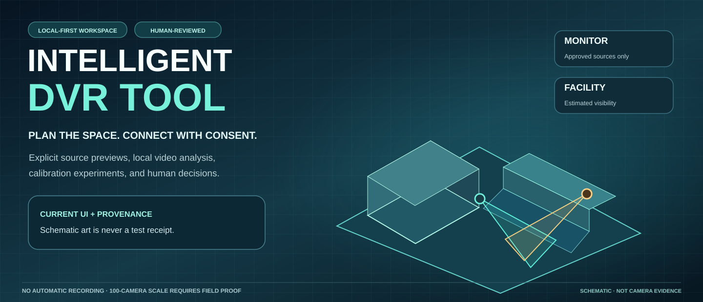
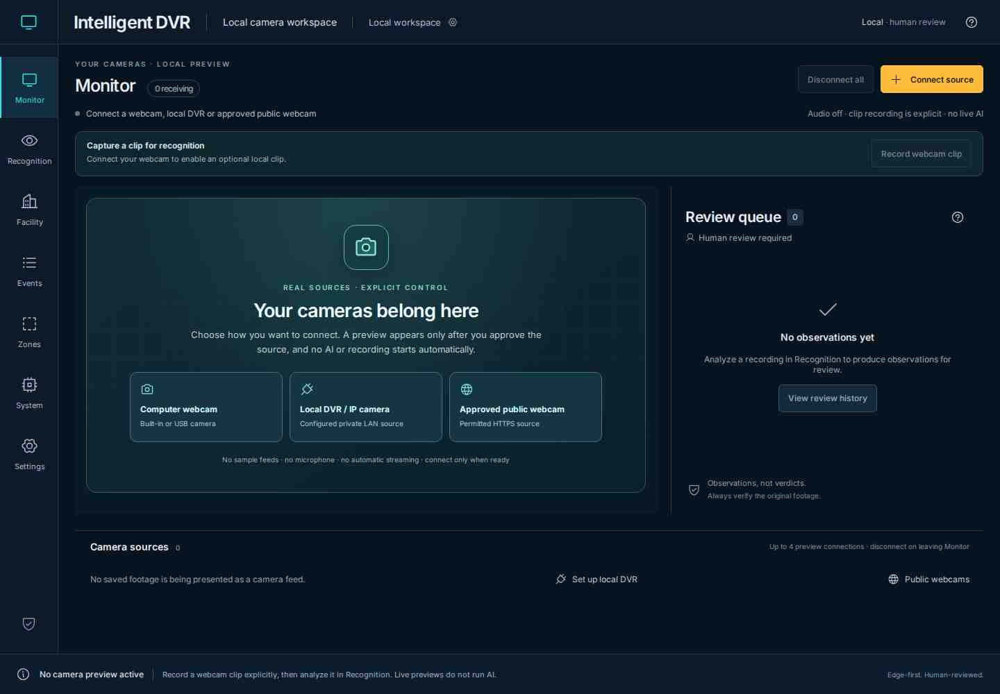
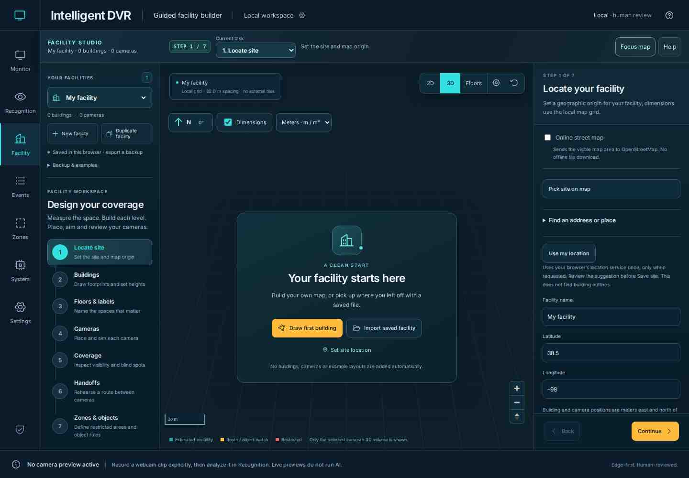
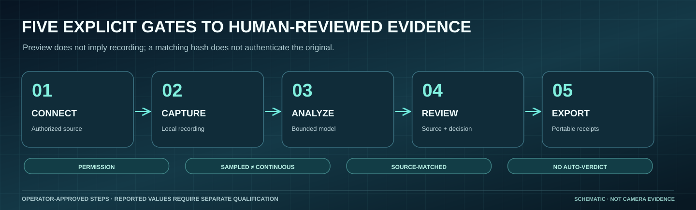
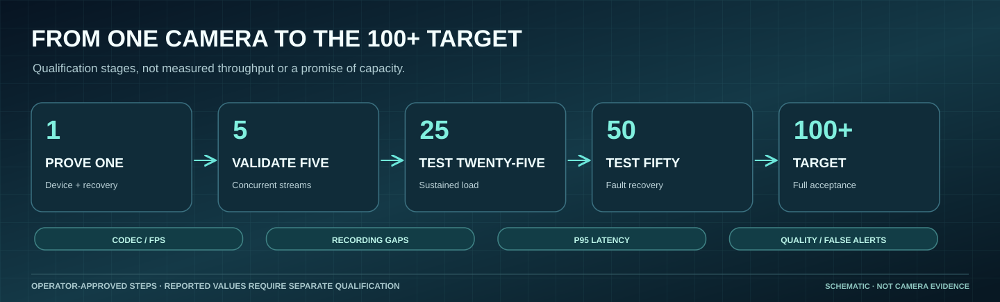

# Explore Intelligent DVR

[Home](../README.md) · [Visual atlas](visual-atlas.md) · [Install for PC testing](pc-testing.md) · [Current scope](product-status.md) · [Field acceptance](field-acceptance.md)

Documentation should help operators **see the tool, know the next action, and distinguish verified software from real-world qualification**. Every current-interface capture has a dated CI provenance record. The visual diagrams explain behavior; they do not demonstrate real cameras, physical accuracy or measured capacity.

## Take the visual tour

| The current Monitor | The current Facility Studio |
| --- | --- |
|  |  |
| [Connect sources](local-camera-feeds.md) · [Capture a clip](recording-workflow.md) | [Facility builder](facility-builder.md) · [Image diagnostics](facility-image-diagnostics.md) |

**Also see:** [All current desktop/mobile screenshots and illustrations](visual-atlas.md) · [Media source and integrity manifest](media/current/README.md) · [Historic prototype tour](visual-tour.md#historical-prototype-captures).

## Start your journey

| I want to… | Start with… | Then… |
| --- | --- | --- |
| Install and open the local app | [PC test kit](pc-testing.md) | [Five-minute guide](getting-started.md) |
| Connect a webcam or DVR/IP camera | [Camera-source guide](local-camera-feeds.md) | [Record and review](recording-workflow.md) |
| Analyze an approved recording | [Local analysis service](local-analysis-service.md) | [Recognition](recording-recognition.md), [human review](recording-workflow.md) |
| Record one configured LAN source | [LAN recorder](lan-recording.md) | [Report gaps and recovery](field-acceptance.md) |
| Build a facility from maps or shapes | [Facility editor](facility-builder.md) | [Maps/shapes](map-measurements-and-shapes.md), [saved facilities](saved-facilities.md) |
| Inspect real image pixels | [Image diagnostics](facility-image-diagnostics.md) | [Planar calibration](facility-calibration.md) |
| Size a Linux/Windows machine | [System controls](resource-controls.md) | [Hardware](hardware-guide.md), [GPU planning](gpu-planning.md) |
| Check if it is production ready | [Product status](product-status.md) | [Field acceptance](field-acceptance.md), [verification](verification/README.md) |

## Learn by subject

| Subject | Detailed guides |
| --- | --- |
| **Camera operation** | [Webcam/DVR previews](local-camera-feeds.md), [public webcam permissions](public-webcams.md), [one-camera LAN recording](lan-recording.md), [local analysis](local-analysis-service.md), [source-matched review](recording-recognition.md), [reporting](recording-workflow.md), [coverage integrity](recording-coverage.md) |
| **Facility design** | [Guided builder](facility-builder.md), [saved sites](saved-facilities.md), [map import and recovery](facility-setup-reliability.md), [local geographic services](facility-local-delivery.md), [shape and dimension controls](map-measurements-and-shapes.md), [science lab](facility-image-diagnostics.md), [calibration](facility-calibration.md) |
| **Machines and capacity** | [System planner](resource-controls.md), [hardware/drives/power](hardware-guide.md), [GPU planning](gpu-planning.md), [Linux](setup-linux.md), [Windows](setup-windows.md), [100+ source target](performance-100-cameras.md) |
| **Evidence and intelligence** | [Architecture](architecture.md), [offline evaluation](offline-evaluation.md), [qualification](offline-qualification.md), [sharpening comparison](enhancement-comparison.md), [product status](product-status.md), [pilot boundaries](pilot-scope.md) |
| **Historical and project records** | [Verification archive](verification/README.md), [October 30 review](review-2026-10-30.md), [October 31 UX audit](workspace-ux-audit-2026-10-31.md), [roadmap](roadmap.md), [historical demo media](media/README.md), [third-party notices](third-party-notices.md) |

## What has actually been demonstrated?

A merged [October 31 UI and navigation update](https://github.com/bartytime4life/Intelligent-DVR-Tool/pull/61) passed **14/14 reported CI checks**. Its controlled [Chromium workflow run](https://github.com/bartytime4life/Intelligent-DVR-Tool/actions/runs/41263964836) passed 92 scenarios and rendered the current desktop/mobile gallery. Browser tests are not a user study. The connected webcam/DVR bridge, CPU inference and one-channel recording still need representative field endurance, quality and recovery evidence before a production claim.

The historic October 27 baseline, earlier model tests and synthetic 100-source scheduler observations retain their original revisions, numbers and limitations in the [verification index](verification/README.md). They are not recalculated or represented as current-device acceptance.

## Key safeguards

Use cameras and recordings only with authorization. No live AI or identity recognition is started by Monitor preview. The interface's native source and model matching supports correspondence, not tamper-evident authentication. Locally stored rules, plans and decisions can be edited or lost; **export backups**. Offline, source-qualified operation remains the design goal. Read [SECURITY.md](../SECURITY.md) and the [field runbook](field-acceptance.md) before relying on the system.

[Repository Wiki](https://github.com/bartytime4life/Intelligent-DVR-Tool/wiki) is published separately; the checked source mirrors are in [wiki/](wiki/README.md).
