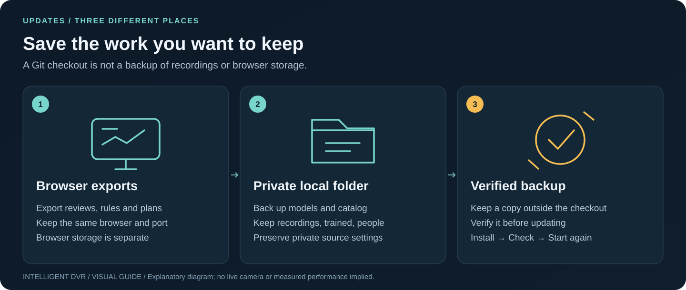
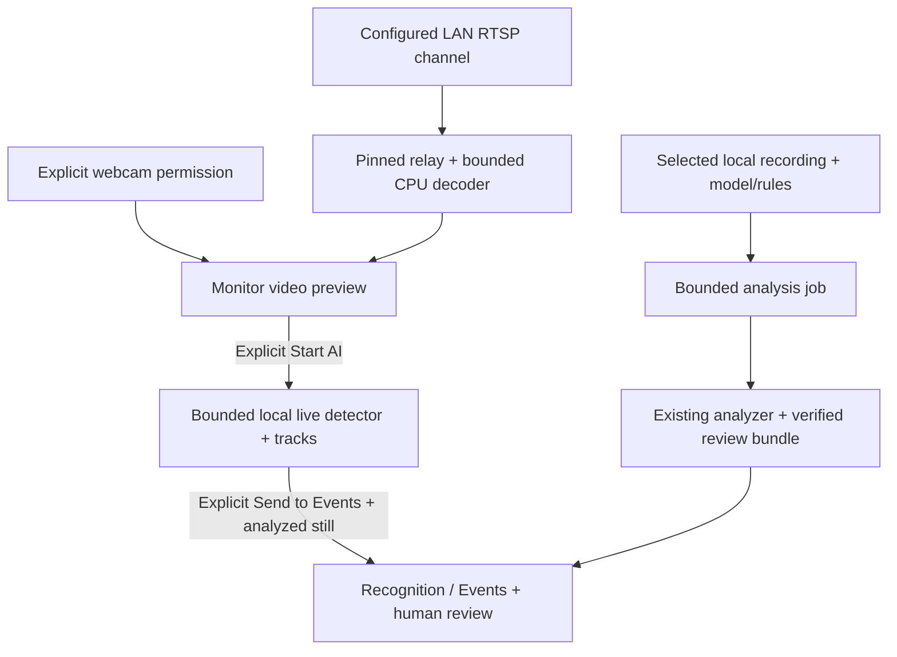
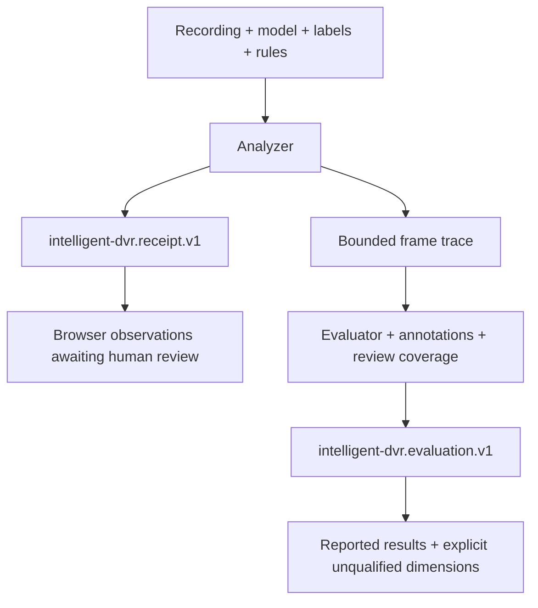
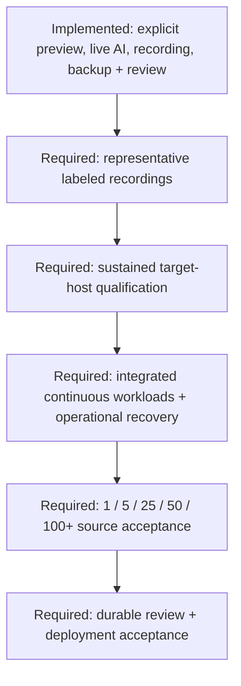

# Architecture, evidence and data

[Guide index](README.md) · [Visual handbook](how-to.md) · [Screenshot atlas](visual-atlas.md) · [Troubleshooting](troubleshooting.md)

**Quick path:** Browser preview → local service → human review → deliberate export. Follow the storage boundaries below before moving an installation.

[Home](../README.md) · [Product status](product-status.md) · [Edge CLI](../edge/README.md) · [Security boundary](../SECURITY.md)

## The current pieces

Webcam video remains in the browser. DVR previews use the optional same-computer
service and stop on disconnect, page exit, lease expiry or a processing limit.
The [feed bridge](local-camera-feeds.md) does not connect to the analyzer or record
video. The [local job service](local-analysis-service.md) separately connects
Recognition selections to the existing analyzer and opens source-matched results.
The optional [LAN recorder](lan-recording.md) uses the same relay/decoder and
feeds verified, finalized segments into that job service. It retains matching
source/results, has explicit Start/Stop and bounded storage, and exposes gaps
between connections. The scheduler/load model remains separate preparation;
tracking accuracy and 100-camera capacity are not implied. The separate
[OEM backup library](oem-backup.md) makes verified full-byte copies of finished
files without automatic deletion. Monitor's explicit
[live AI](live-detection.md) sends only its displayed frames to a bounded local
worker; preview alone never starts it. Facility plans are metadata,
not calibrated camera feeds. The browser performs no neural-network inference.

| Component | Source | Role |
| --- | --- | --- |
| Camera previews and clips | `src/LiveMonitor.jsx`, `src/clip-capture.mjs`, `edge/local_feeds.py`, `edge/feed_worker.py` | Explicit browser webcam, LAN RTSP and approved public HTTPS preview; optional video-only browser webcam clip capture; AI is a separate action |
| Live AI and tracks | `src/live-ai.mjs`, `edge/live_analysis.py`, `edge/live_worker.py`, `edge/tracking.py` | Explicit per-tile detection, short-lived tracks and unsent observations; at most two AI sessions; no recording or automatic Events handoff |
| LAN recording | `edge/lan_recorder.py`, `edge/segment_worker.py`, `src/LanRecorder.jsx` | Explicit one-source segment capture, automatic bounded retention and local job dispatch; no discovery or automatic startup |
| OEM backup library | `edge/backup_library.py`, `src/BackupLibrary.jsx` | Verified finished-file copies, optional local analysis and explicit review; no automatic deletion or OEM configuration changes |
| Workspace | `src/App.jsx`, `src/data.mjs` | Review, rules, local video preview, explicit receipt import |
| Recording recognition | `src/RecognitionReview.jsx`, `src/recognition.mjs`, `src/review-transfer.mjs` | Explicit review bundle, exact-file matching, sampled detections and Event handoff; shared opening intent prevents late results from replacing newer choices |
| Guided training | `src/TrainingWorkspace.jsx`, `src/training.mjs`, `edge/local_service.py` | Scripted webcam session, local analysis and opt-in rule-threshold saving; no detector retraining |
| Optional training assistant | `src/OllamaCoach.jsx`, `src/ollama.mjs`, `src/ollama-scorecard.mjs`, `src/lab-receipt.mjs` | Explicit browser-to-local-Ollama requests; checked score summaries and restricted review suggestions, separate from the detector and service |
| Person enrollment and suggestions | `edge/people.py`, `edge/faces.py`, `edge/face_worker.py`, `src/RecognitionReview.jsx` | Consent-gated local face templates and explicit possible matches for human review; no verified identity or automatic decision |
| Facility model | `src/facility.mjs` | Bounded plan validation, local-meter projection and forward centreline ranges |
| Ground visibility and metrics | `src/facility-visibility.mjs`, `src/facility-visibility-worker.mjs`, `src/facility-visibility-protocol.mjs`, `src/facility-coverage.mjs` | Revision-bound ground regions with holes/components, bounded worker transport, area/arclength metrics and sampled rehearsal |
| Facility renderer | `src/FacilityBuilder.jsx`, `src/facility-map.mjs` | Guided controls, MapLibre and selected-camera Three.js volume |
| Map starter | `src/FacilityStarter.jsx`, `src/facility-starter.mjs` | Common shapes, dimensions, reviewed simple ways/supported outer and inner relations and source records |
| Place search and services | `src/AddressSearch.jsx`, `src/facility-services.mjs` | Explicit submitted search, selectable public/local services and bounded responses |
| Local recording jobs | `edge/local_service.py`, `edge/analysis_worker.py`, `src/LocalAnalysis.jsx` | Loopback catalog, one isolated job, bounds, progress/cancel and source-matched opening; GPU-first service preference with CPU fallback |
| Runtime selection | `edge/acceleration.py`, `edge/live_backend.py` | One shared GPU slot for eligible Windows/Linux YOLOX-S jobs and live AI; actual CUDA execution must be verified; CPU override remains available |
| Analyzer | `edge/analyze.py`, `edge/model_profiles.py`, `edge/rules.py` | Explicit recording analysis and profile-bound decoding |
| Evaluation | `edge/evaluation.py`, `edge/evaluate.py` | Annotation matching, review coverage and timing summaries |
| Scaling preparation | `edge/scheduler.py`, `edge/capacity.py` | Fair bounded sample admission and virtual-time load simulation |

## Where data goes

| Action | Destination | Distinction |
| --- | --- | --- |
| Open an example facility | Browser memory/localStorage as a separate named facility | Fictional planning geometry; no camera connects and no generated footage is added |
| Preview a local video | Local browser object URL | Preview is not analysis; no upload is implemented |
| Open recognition results + matching recording | Transient browser memory and local object URL | SHA-256 match before attachment; metadata and video never uploaded; selected observations can be explicitly imported into localStorage |
| Start local analysis job | One explicit local folder, frozen input snapshots and same-computer HTTP result transfer; optional Linux private last-job recovery | Token/Host/origin checks; opt-in bounded same-computer recording import, no cloud inference; [restart storage](local-analysis-service.md#optional-linux-restart-recovery) is not continuous recording or a durable human-review database |
| Start live AI | Displayed JPEG frames sent to this computer's loopback service; bounded observations/stills retained in tab memory | No footage recording; unsent review is temporary; only explicit Send to Events saves its analyzed still in this browser |
| Start OEM backup | Separate `Intelligent-DVR-Backup/` tree, private file receipts/reviews and SQLite index | Originals stay unchanged; no automatic deletion; browser decisions and models need separate backups |
| Start LAN recording | Private `.lan-recorder/` beneath the recordings folder | Automatic age/count/space retention can delete completed and pending segments; export needed evidence separately |
| Apply guided training | New rule file under `trained/` beside the catalog; default selection/history in browser storage | Explicit apply and training-write permission; detector weights are unchanged; [storage](training.md#what-is-saved-where) |
| Ask the training assistant | Fixed `http://127.0.0.1:11434/api/` Ollama endpoint from a loopback-hosted app | Explicit requests with prompt-stage/count/threshold summaries; no video, embeddings or recording bytes; runtime installation/configuration is separate |
| Review a Training Lab receipt | Browser memory after bounded JSON/hash checks and held-out count recomputation | A distinct Lab contract, not an analyzer review bundle; assistant receives projected counts/scope/threshold, without operator strings, filenames, boxes or notes |
| Enroll or check a consenting person | Private `people/` templates beside the catalog; clips stay in the recordings folder | Face models and processing stay local; deleting a template does not delete clips; [deletion](person-enrollment.md#storage-and-deletion) |
| Check for enrolled people in Recognition | Pending embeddings in service memory for one local job; browser receives names, boxes and similarity only | Confirm may add a template view; Not this person hides the suggestion; no automatic Events/export handoff; [limits](person-enrollment.md#possible-matches-in-recognition) |
| Run analyzer | Explicit local output files | No camera capture or model download |
| Import receipt/plan | Browser memory/localStorage after validation | Bounds and declared fields are checked |
| Export reviews/rules/plan | Explicit browser download | User-controlled file copies |
| Enable online street map | OSM receives visible tile requests | Off by default; no bulk/offline tile downloads |
| Submit address/place search | Selected Photon public demo or configured same-origin local search receives submitted text | No request while typing; no device-position bias, camera plan or recordings sent |
| Load building drafts | Selected Private.coffee/OSM public Overpass or configured same-origin local service receives selected bounds | Explicit Load; no cameras, rooms, routes or recordings sent by the adapter |
| Open offline OSM JSON | Browser file/paste review | Does not contact a footprint provider; online tiles remain a separate choice |
| Use my location | Browser location service after a click | Review the suggestion; no continuous tracking |
| Load interface font | Bundled with the app | No external request |
| Send observations to Events from a matched recording or LAN segment | Small JPEG stills in this browser's IndexedDB | Drawn from the verified local recording; removed with their observations; never uploaded |
| Use a still for zones | A re-encoded JPEG per rule plan in this browser's IndexedDB | Captured only on an explicit click; never uploaded; remove it with Remove still |
| Choose a webcam | The device id in this browser's localStorage | Remembered for the next connection only; no frames stored |

Browser saves and IndexedDB stills belong to the current browser profile and
origin, including its port. Copying the checkout or a service store does not
copy those records. Review exports contain metadata and notes, not the local
observation images. Preserve browser exports and private service files
separately before moving or reinstalling. See [review storage](review-and-events.md).

Local analysis does not make every optional browser asset/provider offline. Default local paths are `/geo/search` and `/geo/overpass`; the operator must configure their fixed upstream services. The Sites Worker does not implement them. Same-origin routing does not certify downstream egress, and failure never silently switches to a public provider. See [service contracts](facility-setup-reliability.md#local-and-offline-delivery), [SECURITY.md](../SECURITY.md) and the provider disclosures.

## Evidence contracts

Source hashes bind files; they do not establish source truth, annotation correctness or signed custody. Human review confirms/dismisses an observation, not intent. Browser-local history is editable and lacks operational audit guarantees.

The YOLOX-S profile binds a selected model hash, COCO80 order and explicit preprocessing/decoding. Generic YOLOv8-style raw output is a different profile. An `.onnx` extension alone does not establish compatibility.

The current tracker is `bytetrack-style-iou-kalman-v3`. Its sparse component
matching, elapsed-time state updates and live detector scheduling are explained
in [science and algorithms](science-and-algorithms.md). Older review bundles stay
readable; current tracking evaluation requires traces from the current
implementation and hash. Guided training fits empirical score boundaries using
calibration sessions and reserves fresh checks for validation; it does not retrain
the model or establish a calibrated probability of presence.

Presence observations use the same bounded fractional-time comparison in
`edge/rules.py` and the browser training counter. The changed engine fingerprint
requires re-analysis for current evaluation, including tracking's shared
validation stage; historical review imports stay separate. The
[timing record](verification/rule-time-boundaries-2026-11-12/README.md) binds the
policy, generated CPU path and unchanged rational-oracle comparisons.

System/facility readouts format small nonzero values without changing their
stored numbers or calculation inputs. Coverage labels distinguish represented
fractions below one from exact completeness. [Presentation evidence](verification/planning-readouts-2026-11-12/README.md)
checks actual downloads separately from those labels.

The optional [training assistant](training.md#ask-the-local-training-assistant)
does not score detections or apply rules. The browser checks structured answers
against measured counts and permitted next steps. Assistant-response timings are
distinct from detector timings. A fixed local endpoint and metadata checks do
not certify the separately managed Ollama runtime’s network behavior.

Developers can use the [source map and check matrix](development.md) to locate
each validator and reproduce the appropriate software checks.

## Visibility is geometry

The [current integrated proposal](verification/coordinate-integrity-math-2026-11-12/README.md)
clips a tilted pinhole ground footprint to horizontal range and subtracts finite-
elevation opaque-wall shadows. It retains holes and separate visible pieces.
The selected-camera 3D rendering connects the mount to those ground regions;
it illustrates an estimated envelope, not calibrated visibility through a volume.
The merged baseline remains separately identified in [product status](product-status.md).

A disposable visibility worker produces one bounded, validated snapshot for the
exact displayed plan and attempt. Hooks suppress stale snapshots during render;
coverage workers reuse that geometry rather than recomputing a different model.
The map, DORI contours, zone areas, route metrics, rehearsal and installer share
its polygons and camera IDs. A saved-plan installer requires the exact accepted
saved-plan snapshot. Pending or incomplete views withhold conclusions and offer
recovery. Calculation adds no new editing, JSON backup or Undo restriction;
existing Save/Discard guards still apply.

Planned room doorway gaps and their opaque lintels affect the shadows;
exterior glazing stays opaque. The estimate omits floor/roof slabs, furniture,
terrain, lighting, lens distortion and recognition quality. Pixel density is a
separate planning calculation. Rehearsal follows a planned route and proposes
camera transitions; it performs no identity recognition or cross-camera person
matching. [Detailed limits](facility-builder.md#visibility-model-and-evidence-limits).

## Coordinate integrity

Site corrections and calibration queries have separate contracts. With **Keep
buildings at their map positions** selected, Save site applies one affine
local-grid change to stored anchors and geometry before ordinary validation and
saving; refusal retains the prior plan. Calibrated ruler/check membership uses
an exact BigInt determinant on the entered binary64 reference coordinates.
Neither operation activates a service or writes to private runtime folders.
The [algorithm guide](science-and-algorithms.md#keep-measured-plane-queries-inside-their-references)
and [source-bound integration checks](verification/coordinate-integrity-math-2026-11-12/README.md)
distinguish arithmetic integrity from surveying and optical accuracy.

## Path toward operation

Every box after the first is work needed for an operational capacity claim.
Bounded local workers and a one-camera recorder exist; they do not establish
continuous archival recording, multi-host inference, authenticated review or
qualified 100-camera operation. [Roadmap](roadmap.md).

## Local machine setup and resource policy

System adds explicit setup arithmetic and browser performance preferences. A read-only `edge.host` snapshot can be imported locally without exposing a privileged host API. Exported policies are consumed by the offline analyzer for OpenCV threads and frame caps, and by a separate scheduler adapter for retained bytes, slots and dispatch age. RAM, VRAM, disk and power estimates are not native quotas. Hardware presets do not select an execution backend or start inference; the local service's separate GPU preference and CPU override follow the [runtime policy](live-gpu.md). See [control scopes](resource-controls.md), [Linux](setup-linux.md), [Windows](setup-windows.md) and [GPU planning](gpu-planning.md).
