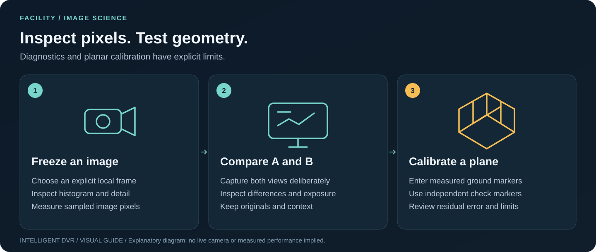

# Facility Studio: image diagnostics and capture comparison

[Guide index](README.md) · [Visual handbook](how-to.md) · [Screenshot atlas](visual-atlas.md) · [Troubleshooting](troubleshooting.md)

**Quick path:** Choose an explicit local frame → freeze it → inspect pixels or compare A/B. Ground-plane measurement needs a separate calibration.

The illustration distinguishes image sampling from optional measured-reference calibration. **Luma/edge metrics are image diagnostics; a ground-plane distance requires separately measured reference points and independent validation.**

The Facility Studio is a **map-first planning workspace**. The compact **Current task** selector and seven guided steps in the left rail navigate Site, Buildings, Floors, Cameras, Coverage, Handoffs and Zones without repeating seven buttons across the top toolbar. **Focus map** expands the editing canvas, stopping any hidden preview; **Show panels** returns to the inventory and properties without deleting unsaved edits. Reconnect the source explicitly if needed. Help is accessible from its toolbar or the `?` shortcut. Keys `1`–`7` switch tasks outside text inputs and dialogs. `Esc` cancels drawing. On a selected camera, Alt+Arrow nudges by 0.5 m; `[`/`]` rotates in 5° steps. **Save camera** still commits the pending draft; changes are not silently saved.

## Inspect an actual captured image

1. Enter **Cameras**, select a planned camera and expand **Image diagnostics** inside its source inspector.
2. Explicitly connect an approved browser webcam or local RTSP preview, then click **Freeze live frame into A**. Alternatively, **Open local image** (PNG, JPEG or WebP, maximum 12 MiB and 24 megapixels). No camera is activated by opening the laboratory.
3. For an approved recording, click **Open local video** (MP4 or WebM, maximum 128 MiB), scrub or pause the browser player to the desired time, and press **Freeze video frame into A/B**. Playback stays local; codec support depends on the browser. No automated frame scan, tracking or inference starts.
4. Select **Frame B** to freeze another moment or choose a second image. A and B stay **only in browser memory** until the panel is unmounted, cleared or the page is left. Neither frame is uploaded, used for AI inference, saved in facility plans, nor automatically added to Events.
5. Draw a rectangular **region of interest (ROI)** across a frozen frame, or edit its left/top/width/height as numeric percentages using the keyboard. Use **Full frame** to reset.
6. Switch to **Pixel ruler** and drag a line. The line reads the number of pixels in the **downsampled** image, never metres or feet. A/B comparison requires identical sampled pixel dimensions.
7. **Save frozen frame** or **Export metrics JSON** explicitly if the operator wishes to retain the work. Exports contain the image or measurements respectively; they do not create a signed chain-of-custody record.

The browser samples no more than 720 pixels on the longest image side. It draws incoming transparent pixels onto an **explicit opaque black background** before both computing statistics and generating the frozen image, so the analyzed and displayed colors agree. Frozen images export as **lossless PNG** rather than lossy JPEG. The metrics JSON records the black backing and image format. A frame may be reduced relative to the original camera resolution, so image analysis cannot establish native pixel density or calibrated optical performance. A cross-origin source without browser permission to read its pixels fails safely instead of bypassing origin restrictions.

## Metrics and proper interpretation

| Metric | Method | Important limits |
| --- | --- | --- |
| Mean luma, 0–255 | Mean of 8-bit channel-weighted sRGB brightness (0.2126R + 0.7152G + 0.0722B), composited over black for transparency | Approximate displayed luma, not linear luminance or lux |
| P05–P95 | Exact 5th/95th percentiles of selected image pixels | A histogram spread, not a camera dynamic-range measurement |
| Shadow/highlight clipping | Percent of pixels with luma at most 15 / at least 240 | Sensitive to gamma/exposure, not a proof of recoverable detail |
| Sobel edge energy | Mean normalized gradient magnitude for interior ROI pixels | Structural detail proxy, **not calibrated focus, blur, resolution or detection accuracy** |
| Luma histogram | 16 bins from darkest to brightest pixels | Display distribution; no identity or scene recognition |
| Two-frame difference | Mean absolute luma difference (0–255) and percent of selected pixels differing by at least 24 luma levels | **Pixel-aligned only**; lighting, JPEG artifacts, shadows or camera motion can look like object changes |
| Pixel ruler | Euclidean distance between two user-selected points in the sampled image | No spatial scale, perspective calibration or physical length |

These diagnostic tools make it easier to compare exposure, investigate glare and shadow, examine contrast, and spot **candidate visual changes** before human review. They do **not** replace independent calibration or an annotated test for human/object recognition. Changing a planned field of view on the map does not physically move a camera. Planned DORI/coverage and image-level metrics are separate measurements with separate limitations.

## Verification and operational boundary

The pure calculations have deterministic tests in `tests/image-science.test.mjs`, run by `npm test`. The browser scenario exercises focus-mode recovery, keyboard navigation, local-image ROI evaluation and frame comparison. These are software tests using generated pixels; they do **not** establish performance on any physical camera.

Images are opened explicitly and read in the local browser. Frame data remain in session memory, not IndexedDB or localStorage. Do not use the tool to obtain images without camera-owner consent. Human-reviewed reports and original evidence should follow the [recording workflow](recording-workflow.md) and [field-acceptance runbook](field-acceptance.md) for identity, storage and recovery checks.
