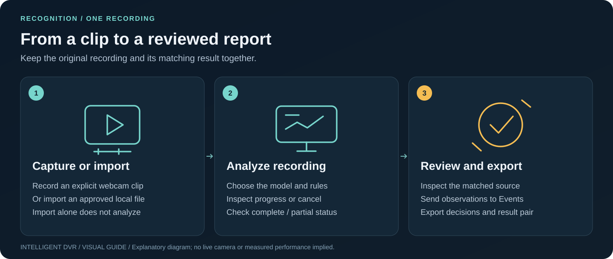
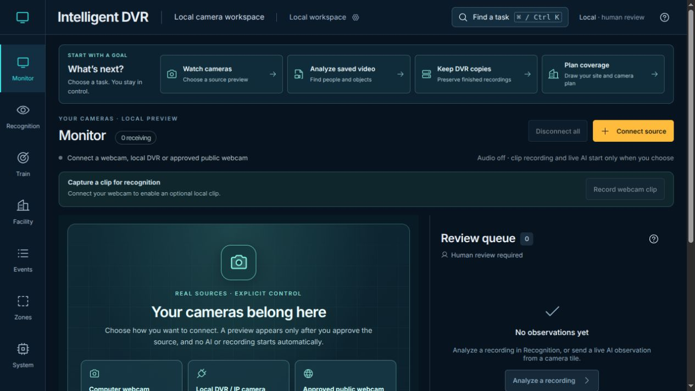
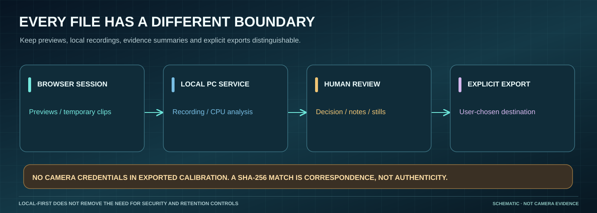

# Your first five minutes

[Home](../README.md) · [Visual handbook](how-to.md) · [Screenshot atlas](visual-atlas.md) · [Install for PC testing](pc-testing.md) · [Field acceptance](field-acceptance.md) · [Product status](product-status.md)

**Start with one task.** Monitor's **What’s next?** guide offers **Watch cameras**,
**Analyze saved video**, **Keep DVR copies** and **Plan coverage**. The first
focuses **Connect source**; the others open their existing task controls. No
video connects until you explicitly choose a source and complete its permission/setup step.

*Controlled November 11 application capture. No camera was connected.
[Capture provenance](media/guided-experience-2026-11-11/README.md). The older
[November 1 collection](media/guide/README.md) remains dated separately.*

Use **Find a task** (**Ctrl+K** on Windows/Linux, **Cmd+K** on macOS) for the
full task list. Search, use Up/Down and Enter, or Escape to close.
[Complete task map](how-to.md#find-the-next-task).

## Install, check and start

Use the [PC test kit](pc-testing.md) for a prebuilt Linux/Windows installation,
or use the same launch scripts from a source checkout. Install finishes without
starting a service. Check validates the software setup. Start opens the local
application at http://127.0.0.1:4298 with all cameras disconnected.

For an Apple silicon Mac source checkout, follow the [Mac Install / Check / Start](setup-macos.md). That launcher uses http://127.0.0.1:4180 by default; its prerequisites and worker limits differ from the Linux/Windows kit.

Running `npm run dev` alone only serves the browser preview. It does **not** start the local DVR preview, recorder or analysis service; use the matching Mac or PC launcher for those features.

A fresh Monitor has no stock photos or fake events. Existing historical review
records remain available without invented imagery.

## Try the workflows

| Workspace | First action | Expected result |
| --- | --- | --- |
| Monitor | Use the **Computer webcam** first-run card (or **Connect source**), then **Connect webcam** and allow browser permission | Live preview without automatic inference, visible status and explicit disconnect |
| Webcam clip | Record webcam clip → Stop recording → Open clip in Recognition | Opt-in bounded clip ready for a separately authorized local import and analysis job |
| Local DVR | Use the PC DVR Companion or an analysis-enabled service with camera setup enabled. Select **Add camera or DVR source** in Monitor's **Local DVR / IP camera** chooser; connect to this computer, save the channel, then return to Monitor to load/select and explicitly connect | Bounded RTSP/TCP preview; saving a source starts no preview or recording. [Supported setup and configuration alternatives](local-camera-feeds.md) |
| Existing OEM DVR | On Linux/Windows, open **Start-DVR-Companion-Windows.cmd** / **Start-DVR-Companion-Linux.sh**, then **Keep DVR copies → Connect to this computer**. Select separate folders, save, then **Start backup** | Verified finished-recording copies; copy-only mode needs no detector model. [Backup workflow and Mac path](oem-backup.md) |
| Recognition | **Analyze saved video** → **Connect local analysis**; select/import an approved recording, choose model/rules, then **Analyze recording** | Progress, cancellation and source-matched results using the existing analyzer |
| Train · detection tuning | Name the camera view, record calibration and confirm its prompts. Repeat sessions with that view name, then check a proposed threshold on fresh footage. [Guided session](training.md) | Matching confirmed sessions contribute together. A saved improvement must pass the fresh check and avoid regressions on earlier evidence. |
| Train: person enrollment | Enable [enrollment](person-enrollment.md), obtain consent and capture the guided baseline | A deletable face template stays in the local service; Recognition can explicitly request possible matches for local jobs |
| Events | Send a verified observation for review; add a note, confirm/dismiss and export | Decisions remain through workspace switches; no new simulated events |
| Zones | Use a still from a Monitor preview, a Recognition frame or an image file, draw the zone and **Export analyzer rules** | A rule file the local analyzer accepts, in full-frame coordinates of that camera's image; no live inference implied |
| Facility | Choose a task from **Current task** or the left guided steps; add a shape or import reviewed footprints, edit cameras and Undo | Estimated coverage and explicitly simulated route rehearsal |
| System | Start with recording/storage and camera-wall settings; expand **Advanced planning details** for processing/GPU/memory/power, then apply or export deliberately | Selected live feed stays visible within the applied 1/2/4-tile limit; other figures remain planning assumptions |

See [camera setup](local-camera-feeds.md), [recording analysis](local-analysis-service.md),
[Linux](setup-linux.md) and [Windows](setup-windows.md). Previews do not record.
The ordinary preview-only Start does not expose the companion's folder/source
setup service, even though the browser can show its task controls.
[Live AI](live-detection.md) with short-lived tracks runs only after **Start AI**
on a tile. Actual device compatibility, detection and tracking quality require
separate testing.

## Preserve your work

Use **Export reviews**, **Back up browser rules**, **Export plan** and **Export all facilities**. See the [update checklist](setup-macos.md#preserve-data-when-updating). Browser localStorage
belongs to the exact origin and browser profile; it is not a backup or shared
audit system. Keep your chosen origin stable across updates (PC kit default http://127.0.0.1:4298; Mac source launcher http://127.0.0.1:4180). Export before
changing the browser profile, port or installation. Keep credentials and footage
out of exported planning/review metadata.

Training rules and person templates live beside the local service catalog, while session clips remain in the recordings folder. Deleting a person template does not delete those clips. See [training storage](training.md#what-is-saved-where) and [enrollment deletion](person-enrollment.md#storage-and-deletion).

Combined training evidence stays in this browser, with room for 50 confirmed
sessions. Keep the same browser profile and origin across updates. Older
summary-only sessions stay in Past sessions; they cannot be pooled into the new
scored library. Downloaded count receipts do not restore that library.

Facility import validates before replacement, and Undo restores the previous
edit. The [facility guide](facility-builder.md) documents bounds and source fields.

Cancel a leave warning to keep an unfinished editor open. System's collapsed
advanced section retains edited values and shows **Unapplied advanced changes**;
errors and warnings remain visible. A loaded Recognition review survives ordinary
workspace switches, but opening a result is cancelled when Recognition or the
page is hidden. Return and explicitly retry the result or file opening. Background
analysis, backup and LAN recording have their own **Cancel**/**Stop** controls.

## Maps and location

Facility opens with a local grid. Address search, one-shot GPS, online street
tiles and building retrieval are explicit separate actions. Choose a provider,
submit an address or coordinates, review the bounded area and loaded footprints,
then apply selected drafts. Public services receive the submitted query/bounds;
offline OSM files and numeric coordinates avoid those requests.

Add to existing plan preserves cameras/rooms. Replace with a clean site explicitly
clears them; Undo restores the prior plan. Unknown heights/interiors remain
assumptions. See [map drafting](map-measurements-and-shapes.md) and
[recovery limits](facility-setup-reliability.md).

## Troubleshooting

Run the matching [Mac](setup-macos.md) or [PC readiness check](pc-testing.md) first. See [symptom-by-symptom troubleshooting](troubleshooting.md). Use the [field-acceptance runbook](field-acceptance.md) when recording physical webcam, DVR and recovery results. It reports missing dependencies,
config problems, native codec failures and occupied ports without probing devices.
Browser camera permissions, DVR credentials/channel paths and physical network
access still need testing on the actual PC. Facility requires working WebGL.
Export work before reset or reinstall. Historical [visual-tour screenshots](visual-tour.md)
show earlier generated scenes and are not the current startup experience.
