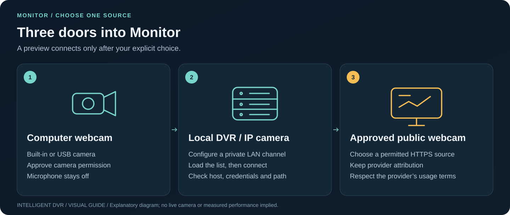
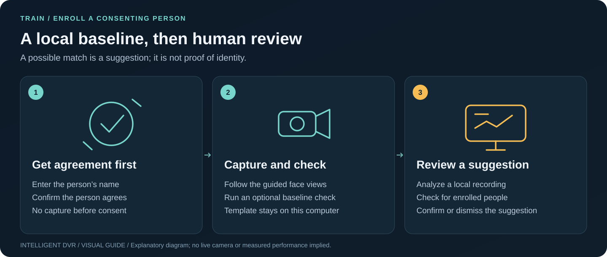
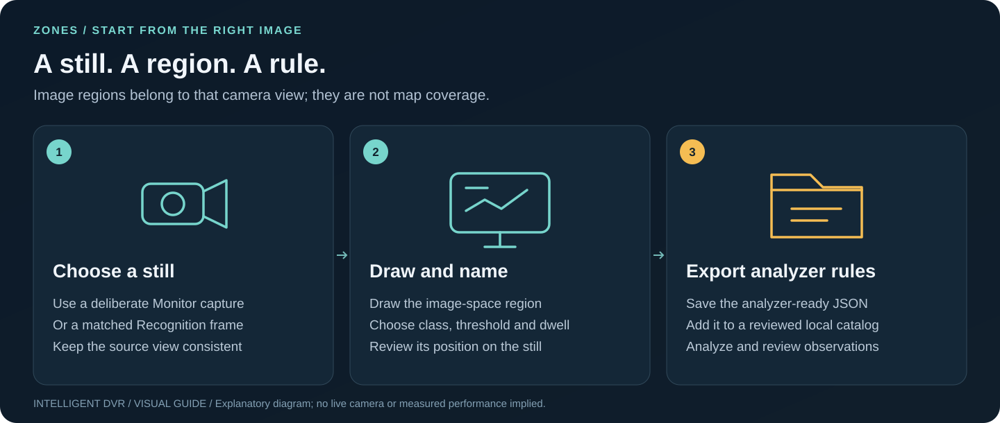

# The visual operator handbook

[Guide index](README.md) · [First five minutes](getting-started.md) · [Screenshot atlas](visual-atlas.md) · [Product status](product-status.md)

*Illustrated overview, created with ImageGen. The instruction screenshots below
show the actual application in a clean local test session; no private recordings,
people, camera credentials or real site are pictured. [Visual provenance](media/guide/README.md).*

Choose the job you want to finish:

| Your job | Go here | What you will have |
| --- | --- | --- |
| Open the app | [1. Get ready](#1-get-ready) | A checked local installation |
| See a camera | [2. Connect one source](#2-connect-one-source) | A deliberate preview |
| Review a recording | [3. Analyze a clip](#3-analyze-a-clip) | Results matched to their source |
| Make review decisions | [4. Review and export](#4-review-and-export) | Decisions, notes and an exported result pair |
| Tune detection | [5. Improve detection](#5-improve-detection) | A new threshold rule for this view |
| Set a person's baseline | [6. Enroll with consent](#6-enroll-with-consent) | A local, deletable template |
| Define an image region | [7. Draw zones](#7-draw-zones) | An analyzer-ready rules file |
| Plan a site | [8. Build a facility](#8-build-a-facility) | A named, exportable plan |
| Inspect pixels or ground geometry | [9. Inspect and calibrate](#9-inspect-and-calibrate) | Diagnostics and explicit calibration checks |
| Budget the machine | [10. Plan resources](#10-plan-resources) | A resource plan and supported limits |
| Update or move computers | [11. Preserve and update](#11-preserve-and-update) | Separate backups of browser and service data |

## 1. Get ready

Use [Mac Install / Check / Start](setup-macos.md), or the
[Linux/Windows PC kit](pc-testing.md). Run **Install**, then **Check**, then **Start**.
Keep the Start terminal open. Use the address it prints: the Mac default is
**http://127.0.0.1:4180/**; the PC kit default is **http://127.0.0.1:4173/**.

For recognition and training, prepare the verified local models and catalog
first. A browser-only preview can display the interface while the local analysis
service is unavailable. [Troubleshooting](troubleshooting.md) explains how to
tell the difference. A fresh install connects no source automatically.

## 2. Connect one source

1. Open **Monitor** and choose **Computer webcam**, **Local DVR / IP camera** or
   **Approved public webcam**. **Connect source** opens the same choices.
2. Complete the chosen setup and press its explicit connection control. Approve
   browser camera permission only for the source you intend to use.
3. Check the receiving status and moving image. Use **Disconnect** when done.

For a first test, use the computer webcam. No microphone is requested. Local DVR
channels need a reviewed private source configuration; public sources need
provider permission and attribution. A preview does not run live AI.
[Webcam and DVR setup](local-camera-feeds.md) · [Public webcams](public-webcams.md).

## 3. Analyze a clip

1. In Monitor, explicitly **Record webcam clip**, then **Stop recording** and
   **Open clip in Recognition**. Or begin with an approved recording already on
   this computer.
2. In **Recognition**, **Connect local analysis**. Import the selected file if
   needed, then choose the recording, model and rule set.
3. Press **Analyze recording**. Read progress and any complete/partial label;
   **Cancel analysis** stops an unwanted job.
4. Successful results open with the matching analyzed recording. A decoding,
   model, source or coverage error needs resolution before a usable result exists.

*The example above uses generated media and a constant-output test model to show
the controls. It demonstrates the workflow, not detector accuracy.*

Importing copies a recording locally; it does not start inference. Save both the
recognition JSON and its exact analyzed recording for later reopening.
[Complete recording workflow](recording-workflow.md) · [Coverage labels](recording-coverage.md)
· [Optional one-camera LAN recorder](lan-recording.md).

## 4. Review and export

*Controlled example: the boxes come from a synthetic constant-output model, not
recognition of a person in this image.*

Inspect sampled frames and boxes before sending observations to **Events**.
Review the original source, make a confirm/dismiss decision and add a useful
note. Use the queue filters and review shortcuts when helpful; keep **Undo**
available when correcting a decision. Return to Recognition to export a printable
report, JSON or CSV with the current review state.

*The six detections are repeated constant-output fixture samples, not a count of real people.*

Detection counts can include the same person repeatedly across samples. Scores
are model outputs, not probabilities or proof of identity. Imported results must
match the exact source file before overlays attach. See the
[review desk guide](review-and-events.md) and [Recognition details](recording-recognition.md).

## 5. Improve detection

Open **Train → Start session**. Check the camera, connect it deliberately, and
follow the on-screen sequence: in view, away, far across the room, partly hidden,
then back in view. Keep the window in front so the recording and prompts stay
together. The page imports and analyzes this session locally.

Inspect found/missed moments and false alarms, compare the proposed threshold,
then choose **Use … from now on** or **Keep current setting**. Applying saves a
new rule set; the detector weights are not retrained. Results describe this
session and room. [Training instructions and storage](training.md).

## 6. Enroll with consent

In **Train → Enroll a person**, enter the consenting person's name and confirm
their agreement before capture. Follow the short guided face views. An optional
baseline check reports how many usable views matched and can refine the template.

After analyzing a local job, Recognition's **Check for enrolled people** can
suggest possible matches inside sampled person boxes. **Confirm** accepts that
view for the template; **Not this person** hides that suggestion. Neither is an
automatic identity or access decision. Delete a template from Train when needed;
delete its retained clips separately. See [enrollment, consent and deletion](person-enrollment.md).

## 7. Draw zones

Open **Zones** with a deliberate still from Monitor or a matched Recognition
frame, or choose an approved image file. For an incoming capture, select the target plan and **Use for Plan …**. Draw the region, choose the class and
review threshold/dwell settings. **Export analyzer rules** produces rules for
that camera image. Add them to a reviewed local catalog before analysis.

These rectangles are image coordinates. A room polygon or estimated camera
coverage on the Facility map is a different kind of geometry.
[Zone-by-zone instructions](zones.md).

## 8. Build a facility

*This is a planning example. It is not a surveyed building or a real site's camera coverage.*

1. Start a **New facility**, give it a name, and use the local grid or explicitly
   choose a map origin. Review any imported footprints before applying them.
2. **Add first building**: choose a shape, adjust size, preview placement and save.
3. Select a floor and **Sketch rooms**. Use **Edit room walls** to refine shared
   divisions. Preview changes before saving; **Undo edit** reverses a saved edit.
4. Place a doorway on a shared wall, a window on an outside wall, or a stair
   reservation between levels. Openings, elevations and dimensions stay editable.
5. Place and aim planned cameras. Treat coverage, routes and planning measurements
   as estimates. Export the named plan and collection backup when finished.

[Full facility workflow](facility-builder.md) · [Maps and shapes](map-measurements-and-shapes.md)
· [Saved facilities](saved-facilities.md).

## 9. Inspect and calibrate

Facility's image diagnostics freeze a deliberately chosen local frame. Inspect
the histogram, exposure/detail proxies, A/B difference and sampled-pixel ruler.
For ground-plane calibration, enter measured reference markers, reserve
independent check markers and review the error against your chosen limits.

These tools do not recover a building interior, general 3D location, optical
quality or identity from an image. [Image diagnostics](facility-image-diagnostics.md)
· [Planar calibration](facility-calibration.md).

## 10. Plan resources

Use **System** to enter recording, retention and processing needs. Review storage,
RAM/VRAM and power arithmetic. **Apply workspace limits** applies supported
browser limits; **Export analyzer policy** is a separate action for supported
offline analyzer controls. Save the setup plan for future review.

The page does not provision drives, start recording, activate a GPU or benchmark
your machine. Test one authorized source before advancing toward 5/25/50/100.
[Control scopes](resource-controls.md) · [Hardware](hardware-guide.md)
· [GPU planning](gpu-planning.md) · [Field acceptance](field-acceptance.md).

## 11. Preserve and update

Export reviews, rules and facility plans from the browser. Export any temporary
last-job result before stopping its service. Back up the complete private
analysis folder and camera settings separately, keeping a verified copy outside
the checkout. Continue using the same browser and exact local address.

Update the source deliberately, rerun Install and Check, then Start. Reinstalling
preserves an existing catalog; preparing a fresh catalog deliberately refuses an
existing analysis folder. See [updates and migration](setup-macos.md#preserve-data-when-updating),
[saved facilities](saved-facilities.md) and [troubleshooting](troubleshooting.md).
