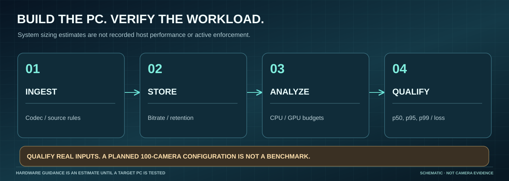

# Current documentation visuals

[Visual atlas](../../visual-atlas.md) · [Source documentation](../../README.md) · [Historical media](../README.md)

These are **current-software browser captures and original explanatory diagrams**, not artificial live-camera images. The screenshots were recorded by the [successful Chromium job](https://github.com/bartytime4life/Intelligent-DVR-Tool/actions/runs/41263964836) using source commit `9719eda31887ac5991a487f2107a9b31a93b14e3`, with no live camera, network provider, or pretrained detector. The app used a blank camera wall and a blank facility; System fields were browser planning defaults.

## Tested interface captures

| Surface | Desktop | Mobile (390 px) |
| --- | --- | --- |
| Monitor · empty / opt-in source chooser |  |  |
| Facility Studio · local plan editor |  |  |
| System · capacity planner | [System guide](../../resource-controls.md) |  |

Image provenance is bound to the [machine-readable manifest](manifest.json), including Git blob identities, dimensions, and the source CI job. JPEG captures are compressed documentation images, not pixel-faithful source recordings or detector output.

## Visual language

| Artwork | Teaches | Important boundary |
| --- | --- | --- |
|  | [Recording and review workflow](../../recording-workflow.md) | No automatic camera recording, AI or enforcement |
|  | [Calibration and image diagnostics](../../facility-calibration.md) | Plane-only estimation; not optical/physical accuracy |
|  | [Architecture and data ownership](../../architecture.md) | Source match is not authenticated origin |
|  | [Staged performance qualification](../../performance-100-cameras.md) | Scale is a goal, not a capacity result |
|  | [Resource controls](../../resource-controls.md) | Planning estimates are not system quotas |

The diagrams are original, static SVGs with no scripts, external fonts, remote images or tracking beacons. Labels are intentionally conservative. SVGs remain legible at desktop width and have descriptive Markdown alt text. Readers who need textual alternatives can use the linked guides. The historic animation assets remain in `docs/media/` with their own untouched October 27 provenance.

## Reproduce and audit

1. Check out the screenshot's exact source commit; run the [Facility browser configuration](../../../playwright.facility.config.mjs) with Chromium and offline fixture routing. See the [workspace audit](../../workspace-ux-audit-2026-10-31.md).
2. Compare the saved `qa-local/workspace-audit` PNGs in the linked GitHub Actions artifact against these compressed JPEGs. They are reference thumbnails; crop, text antialiasing and compression can differ.
3. Run `python3 scripts/check-docs.py` from the repository root. Its current-media checks verify each asset's exact Git blob hash and size, and enforce an independent visual-asset budget.
4. Only claim real camera, storage, detector, map-source or physical-mobile readiness after the [field acceptance runbook](../../field-acceptance.md) has recorded actual operator and device results.
