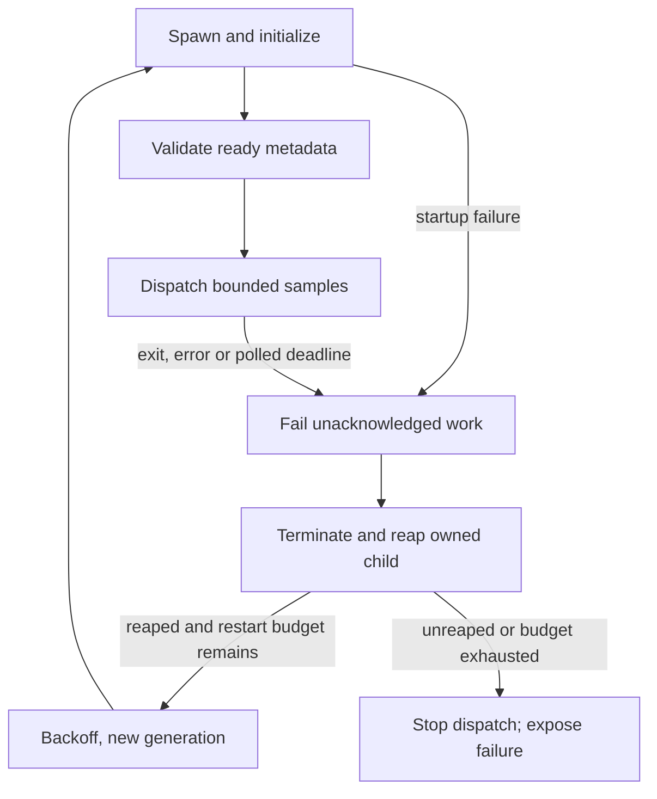

# Performance preparation for at least 100 simultaneous cameras

[Evidence-led roadmap](roadmap.md) · [Fresh 100-source model results](verification/2026-10-27/README.md#100-source-load-model) · [Architecture](architecture.md)

Owner requirement, 2026-10-27: **at least 100 concurrently active cameras** in a
locally deployed system without subscriptions or paid inference services. Five
generated scenes are UI fixtures, not a product capacity limit. The
[capacity target](../edge/capacity-target.json) records this decision separately
from workload values still requiring pilot decisions.

Current state: a single-recording analyzer with an explicit optional CUDA backend,
hash-bound YOLOX profile, evaluation harness, reusable sample scheduler, bounded
thread execution, optional Linux process supervision/local outcome journal and a synthetic load model. The
[CUDA record](verification/cuda-2026-10-28/README.md) and
[worker record](verification/workers-2026-10-28/README.md) retain measured scope.
The [recovery record](verification/recovery-2026-10-28/README.md) covers the optional
process boundary. Live ingest, a recording service, distributed workers and
100-camera hardware acceptance remain open.

## Separate the workloads

| Workload | 100-camera requirement | Qualification needed |
| --- | --- | --- |
| Connections | At least 100 simultaneously active admitted sources | Protocol/codec compatibility, reconnects, stable per-source health |
| Recording | Concurrent recording when required by the accepted pilot | Aggregate network/disk rate, retention, gaps, crash recovery |
| Analytics | Every enabled camera receives its configured analysis cadence | Measured per-camera service rate, missed samples, delays and quality |
| Human review | Source-linked observations, decisions and failures | Durable review storage, per-camera state, operator workflow |
| Browser views | Navigate all cameras; render a bounded selected subset | Search/grouping/pagination and preview budgets on desktop/mobile |

Connecting 100 streams, analyzing 100 streams at an agreed cadence and rendering
100 full-resolution videos are different capacity tests. The first two form the
core system target; the browser should use selected layouts and low-cost previews.
No analysis FPS, codec/resolution, maximum delay or hardware purchase is silently
selected. Those fields remain null in the capacity target until qualified.

## Implemented scheduling foundation

`edge.scheduler.CameraScheduler` accepts an explicit inventory, including 100 or
more IDs (up to 10,000 for this component). It offers:

- One newest pending sample per camera; replacements keep the waiting position.
- A shared, bounded worker-slot count and at most one in-flight sample per
  camera, preserving ordered results for later per-camera rules integration.
- Fair FIFO dispatch: a busy camera's next sample goes behind cameras already
  waiting. High-rate sources cannot repeatedly cut the queue.
- Individual sample-size and total retained-payload byte ceilings, counting
  both pending and in-flight samples; budget rejection is explicit.
- Sample-age checks before dispatch, explicit source admission, monotonic
  sequence/time validation and completion/failure token accounting.
- Per-camera counters for received, accepted, replaced, stale, budget-dropped,
  dispatched, completed and failed work, plus queue/worker/payload high-water marks.

The scheduler is thread-safe and creates no capture, inference or worker threads.
The local adapter below executes returned `Work` items in bounded threads and
returns each token. Omit explicit
`now` in threaded use so the shared monotonic clock is read inside the lock.
The default payload bound fits 640×640×3 byte images, not raw 1080p buffers or
float32 model tensors. Decoders, preprocessing, workers, results and copies
outside the scheduler need separate memory budgets. A retained-payload limit is
not a process-memory ceiling or native-code sandbox.

Expiry is checked at dispatch. The scheduler itself cannot terminate a hung
native call; optional process supervision below supplies a polled fault boundary. The
scheduler is deliberately not wired into the recording analyzer: dropped or
skipped samples can change dwell behavior and detection quality, so that
integration needs its own ordered, per-camera trace and gap/reset tests.

## Bounded local execution adapter

`edge.workers.LocalWorkers(scheduler, processors)` adds 1–4 explicit local
processors. Each callable receives one immutable `Sample`; give each native
processor its own model session. Processor count must match scheduler slots.
Construction rejects an already busy scheduler. The adapter exclusively owns
dispatch/completion; producer threads may continue submitting samples.

One controlling thread calls `step()` to collect completed `Outcome` records
and dispatch into free slots. There is at most one active call per processor,
no additional executor backlog, and no concurrent calls for one camera. The
scheduler continues counting active payloads against its retained-byte budget.
Results remain associated with their original camera, sequence and token.

An exception is returned in `Outcome.error`, marks that token failed and stops
new dispatch. Other active calls may finish; pending work is retained in the
scheduler counters. There is no retry, substitution or CPU fallback.
`close()` waits for active calls, returns their remaining outcomes and does not
dispatch pending work. It is idempotent. The caller constructs/cleans up its
processors and must consume all outcomes, including those returned by `close()`.
The context manager closes workers but does not return remaining outcomes;
call `close()` explicitly when those results are needed.

Thread execution cannot kill a hung native GPU call. The optional process
adapter below adds deadlines/restarts and encoded result-size limits. Its optional
journal persists dispatched outcomes. Per-camera rules and live recording remain
separate work. Neither adapter changes analyzer CLI
defaults or the browser's planning controls. Four sessions are an explicit
tested candidate on one PC, not a new universal/default worker count. See the
[dated comparison and limits](verification/workers-2026-10-28/README.md).

## Optional Linux process supervision

`edge.supervision.ProcessWorkers(scheduler, factory, ...)` starts one owned
**spawned** child containing 1–4 independent processors. It requires a matching
scheduler with no in-flight work. It is enabled only on Linux; it neither changes
`LocalWorkers` nor selects a new analyzer/browser default. The parent must not
dispatch/complete this scheduler elsewhere. Producer threads may submit normally.

The trusted, importable `factory(slot, generation)` constructs each processor
inside the child. Factories are small application objects, never receipt/browser
input. Only the factory uses Python's trusted spawn serialization. Samples and
results use a versioned, length-bounded bytes/JSON protocol over an anonymous
local pipe, with no listening network service. Processor results must be finite
JSON; the caller sets `max_result_bytes` (512 bytes–4 MiB; default 1 MiB).
The factory configuration cap is 64 KiB. Callbacks may expose JSON `runtime`
metadata and an optional `close()` method.

One controlling thread calls `step()` frequently. Returned `ProcessOutcome`
records preserve `work`, `result` and `error`, and add an authoritative
`generation`, successful `processor` slot and optional committed `journal_id`. Snapshot metadata binds each
generation/slot to the supplied processor's startup metadata. The parent rejects
unknown/duplicate tokens, wrong generations, invalid framing and late results.
The scheduler's sequence, fair routing, retained-payload budget and one in-flight
sample per camera remain in force. IPC adds bounded copies beyond that budget;
native models, decoder caches, parsed results and caller-held outcomes need
separate memory accounting.

`startup_timeout` (default 30 seconds) covers initialization/proof;
`task_timeout` (default 5 seconds) covers dispatch, transport, execution and
collection. Deadlines are enforced **when the caller polls**, not by an OS-level
watchdog. A busy or blocked parent must not present this as a hard real-time
deadline. A failed generation is terminated/reaped before replacement. Every
unacknowledged in-flight token receives an explicit `ProcessFailure`, even if
the child computed a result that the parent had not received. Accepted results
are retained. Failed samples are never retried; newer pending samples remain
eligible under age/byte checks. Rule/dwell state after a failed or skipped sample
requires separate caller integration.

`max_restarts` is **0 by default** (range 0–3 for the entire adapter lifetime).
An explicitly chosen budget permits replacement generations after
`restart_delay` (default 0.25 seconds). Startup failures consume the same budget;
successful work does not reset it. An exhausted budget or unreaped child stops
dispatch. Snapshot events expose generation, PID, failure reason, ready/reap
times and current state. These diagnostics remain in memory; the optional journal
below persists sample records, not the full lifecycle event log. Parent-side
admission/allocation errors remain ordinary caller exceptions.

Each spawned child arms Linux parent-death `SIGKILL` before constructing its
processors, then rechecks the parent PID to cover death during spawn/bootstrap.
A failed arm aborts child startup. This applies to the owned child and its threads;
trusted factories must not fork descendants or change this signal setting. Linux
tracks the creating parent thread: create/control workers from a long-lived thread.
This does not restart a dead parent, retain pending samples or promise immediate
cleanup of a task stuck in the kernel. Service supervision remains separate work.



`close(timeout=1)` stops new dispatch and restarts, drains for the selected
0–30-second interval, then accounts for remaining work as shutdown failures and
terminates its child. Termination uses bounded waits and escalates to kill;
an unreaped OS task remains visible and blocks restart. OS scheduling or an
uninterruptible kernel task can exceed requested waits. Consume every outcome
returned by `step()` and explicit `close()`; context-manager exit cleans up but
cannot deliver its returned outcomes to the caller.

Processors must perform local, side-effect-free computation. This component is
fault isolation, not a permission or memory sandbox. It does not install a
network filter, enforce host RAM/VRAM quotas, authenticate APIs, connect cameras
or record video. Results remain in memory unless the explicit journal below is used. The qualification runner separately denied
IPv4/IPv6 for the parent and descendants. Full methods, actual fault injection,
recovery measurements and limits are in the
[dated recovery record](verification/recovery-2026-10-28/README.md).

## Optional local outcome journal

`edge.journal.OutcomeJournal` is a Linux-only SQLite outbox on an explicit private
**local-disk** directory. Pass it to `ProcessWorkers(..., journal=journal)`; it is
off by default. Each open journal owns a fresh UUID run and an exclusive file
lock. One controlling thread and one worker adapter may use that open run. The version-1
row schema and single-record `finish()` API remain compatible; an additive unread
index is created on explicit open, without erasing or migrating rows.
The lock file stays in place; do not delete it while an owner may be running.

The directory must have owner-only permissions (new directories use 0700), and
files must be owner-owned private regular files. Symlink final paths and shared
files are rejected. SQLite uses WAL and `synchronous=FULL`; failed queries/commits
stop worker dispatch/restart, terminate owned computation and expose
`journal_error`. Memory-only failure outcomes have no `journal_id`. Preserve the
directory for recovery/inspection after a storage error. Process-exit tests are
not power-loss, failing-disk, network-filesystem or backup qualification.

| Boundary | Durable behavior |
| --- | --- |
| Before sending a dispatch batch | Commit camera/sequence, run-scoped token, generation, monotonic sample/dispatch times, payload size and SHA-256. Frame bytes are absent. |
| Before returning an outcome | Commit its terminal result or failure code and processor slot. A returned `journal_id` identifies the committed row in this database. |
| Reopen after interrupted ownership | Keep committed terminal outcomes; convert every unresolved dispatch to `failed / parent-interrupted`, without claiming whether computation occurred. Never retry it. |
| Read with `pending(limit=100)` | Return terminal unacknowledged records in stable ID order, at most 1,000 per call. Reading never acknowledges. |
| Explicit `acknowledge(ids)` | Persist acknowledgment of specified terminal rows. Repeating an acknowledgment before pruning is harmless. |
| Explicit `prune()` | Remove only acknowledged terminal rows. Unread results and in-flight reservations are retained. IDs are not reused. |

`finish_many(completions)` commits 1–4 terminal records atomically and returns IDs
in input order. Each record has `token`, `result`, `error` and `processor`. The
whole batch is validated before writing; a failed SQL statement rolls back the
group. Existing `finish(token, ...)` delegates a one-row group.

With an explicit journal, `ProcessWorkers` collects validated responses from one
bounded IPC pump and commits those available together before releasing scheduler
slots or returning outcomes. It adds no timer, sleeping or cross-poll batch wait.
At most four parsed results are staged, still associated with in-flight payloads;
encoded result limits remain per message and parsed Python overhead is additional.
`received_uncommitted` exposes staging. A parent exit before commit can interrupt
the whole received group; it does not turn reception into a durable success.

A protocol/worker fault first commits already validated responses, then commits
failures for remaining work as a group. If storage fails, dispatch/restarts stop,
RAM-only failures have no journal ID, and unresolved rows remain for inspection/
reopen recovery. No partial group is presented as durably delivered. The nonjournal
path continues returning responses directly.

Journal snapshots add `terminal_commits`, `terminal_rows` and
`largest_terminal_batch`, covering successful terminal API commits in the current
open run. They reset on reopen and exclude initialization/recovery, reservations,
acknowledgments and pruning. They are not total SQLite transactions or fsync counts.
The unread partial index keeps acknowledged history out of delivery scans.

Delivery is **at least once**. A consumer can crash after acting on a read and
before acknowledgment; the same IDs will be offered again. Use persisted
`(run_id, token)` as an idempotency key in a durable consumer. Acknowledgment is
not atomic with an external action or another database. This outbox does not
supply exactly-once alerts or durable human-review/rule state.

```python
# Application-owned Linux integration, under if __name__ == '__main__':
# scheduler and trusted_factory are explicitly constructed by the application.
from edge.journal import OutcomeJournal
from edge.supervision import ProcessWorkers

with OutcomeJournal('/private/local/dvr/outbox') as journal:
    workers = ProcessWorkers(scheduler, trusted_factory, journal=journal)
    try:
        outcomes = workers.step()  # Call frequently while producers submit.
        # Consume outcomes and/or journal.pending(). Acknowledge explicit IDs
        # only after durable consumer handling; prune acknowledged rows explicitly.
    finally:
        remaining = workers.close()  # Consume these outcomes too.
# Reopen the same directory to recover unread terminal records.
```

The example's parent directory must already exist; choose a private owner-local
location outside Git. Reopening is explicit, not an automatic background service.
Never acknowledge merely because a result was read. Terminal records contain
finite JSON results, failure codes, wall-clock commit times and sample hashes/
metadata. Results can contain sensitive object locations: keep the database, WAL,
SHM and exports local and private. No frame payloads, source credentials or URLs
are added by the journal itself. Trusted processors remain responsible for their
result JSON. Monotonic times belong to the originating process/boot; they are
not a cross-restart freshness clock. Wall time is diagnostic and can change.

Bounds are explicit: 1–1,000,000 rows (default 100,000), 512 bytes–4 MiB per result
(default 1 MiB), and a logical reservation budget (default 64 MiB, up to 4 GiB).
Each dispatched row reserves the result bound plus 2 KiB metadata; terminal
commit replaces that with actual encoded result bytes plus 2 KiB. The configured
budget must cover every worker slot. Historical rows, including acknowledged
rows, count until pruning. When free slots cannot be reserved, dispatch pauses
and `journal_blocked` is visible. Pending samples still replace/expire under the
scheduler's policy. Existing oversized history can be read/acknowledged/pruned
without admitting new work. SQLite pages, indexes, WAL and native caches add
overhead; these bounds are not a filesystem quota or retention policy.

Consumers may explicitly collect handled IDs and acknowledge them together at a
bounded cadence, rather than issuing an acknowledgment transaction per response.
For example, a caller can poll delivery every 25 ms with `pending(limit=1000)`,
handle each record durably using its run/token key, then acknowledge those IDs in
one call. If handling fails, leave the batch unacknowledged and deduplicate on
redelivery. Do not infer durable handling merely from reading or receiving a row.
Choose freshness/retention limits for the application and continue polling workers
frequently. This changes acknowledgment timing, not SQLite durability. The
[batching qualification](verification/batching-2026-10-28/README.md) separates
component changes from that consumer-policy experiment.

Only **dispatched** samples are journaled. Pending, replaced, stale or budget-
dropped samples exist only in scheduler counters and may disappear with the
parent. Source restart position, recording continuity, lifecycle diagnostics,
per-camera rules and dwell state are not recovered. Processor/model configuration
and startup proofs are not stored by this outbox; retain a separate run-bound
manifest before interpreting results. See the
[owner-PC journal and parent-crash record](verification/journal-2026-10-28/README.md)
for source bindings, forced-exit checks and measured replay cost.

## Reproduce the load model

Only the Python standard library is required. From the repository root:

```bash
python3 -m edge.capacity --cameras 100 --sample-fps 2 --workers 8 \
  --service-ms 650 --duration-seconds 10 \
  --output /tmp/dvr-100-source-simulation.json
python3 -m unittest discover -s tests -p 'test_*.py'
```

Use a new output path each time. `--service-ms` is required to make the assumed
constant worker cost explicit. The model advances a virtual clock, submits all
cameras on each sampling tick and drains pending work. It uses synthetic text,
not frames, decoded media or model outputs. Reports bind scheduler/simulator
code hashes, assumptions, counters, modeled completion age and overload. They
always keep actual camera capacity and target-host performance unqualified.
The simulator permits 1–10,000 sources for ramp tests, 1–256 abstract workers,
up to 60 offered seconds and at most 200,000 offered samples per invocation.

The 650ms example is an assumption, not a new model timing measurement or an
owner-workstation benchmark. It offers 2,000 samples from 100 sources in ten
seconds. Eight ideal workers can service only about 12.31 samples/second against
200 offered; the model exposes replacement/expiry rather than treating eventual
service to all IDs as a capacity pass. A separate 10ms assumed-cost case clears
the same offered load without replacement, and still establishes no real FPS.
Tests also exercise threaded admission/completion, byte bounds, source fairness,
staleness, failures and a 125-source case so 100 is not a hard-coded maximum.

## Budget before optimizing

For `N` cameras, analysis cadence `f` samples/camera/second and measured service
cost `s` seconds/sample, offered demand is `N*f`; an ideal isolated worker has
capacity `1/s`. At planned utilization `u`, the abstract worker-equivalent count
is `ceil(N*f*s/u)`. Parallel contention, batching and decode costs invalidate
simple hardware extrapolation; this is a planning equation, not a core/GPU count.

| Illustrative workload, not accepted settings | Arithmetic |
| --- | --- |
| 100 cameras × 2 analysis samples/s | 200 inference samples/s aggregate |
| 100 cameras × 30 analysis samples/s | 3,000 inference samples/s aggregate |
| 100 streams × 4 Mbit/s recording bitrate | 400 Mbit/s incoming; 50 MB/s writes; 4.32 TB/day before overhead/replicas |
| One 640×640×3 byte sample per 100 cameras | 117.19 MiB retained payload |
| Those pending samples plus 8 equally sized in-flight samples | 126.56 MiB payload, excluding all other memory |

Measure actual codec, substream, bitrate, frame rate, resolution, latency and
retention requirements before assigning network, CPU, GPU, RAM or disk budgets.
No finding here establishes that one particular workstation can satisfy them.

## Ordered enhancement plan

1. **Freeze the accepted workload.** Define per-camera source profiles, analysis
   cadence, recording/retention policy, maximum delays, acceptable losses and
   quality/error budgets. Keep labeled evaluation scenes held out from tuning.
2. **Instrument approved offline inference.** Extend traces with decode,
   preprocessing, inference, postprocessing and rule/review-delivery timings;
   measure memory, temperatures and sustained service rates on the target host.
3. **Qualify local acceleration.** Evaluate a local GPU backend and batched
   execution behind explicit profiles. Preserve the pinned YOLOX hash, COCO80
   order, source/license records and decoder semantics. Require CPU/accelerated
   box/score/geometry parity and labeled-scene quality before adoption. No new
   backend, quantization or model substitution is silently enabled.
4. **Integrate bounded workers.** Extend the optional Linux process component
   into an admitted pipeline with durable results, per-camera rule state,
   freshness/recovery policy and deterministic receipts. Requalify dwell/max-gap
   behavior under explicit frame loss. Keep recording separate from sample drops.
5. **Add a governed local ingest/recording service.** Use explicit source
   admission and private credential handling, per-source reconnect/backoff and
   health, protected APIs, retention and disk backpressure. Credentials/stream
   URLs must not reach the hosted UI or Git. No automatic activation is implied.
6. **Scale across local worker hosts when measured capacity requires it.**
   Partition camera ownership explicitly; preserve sequence ordering, source
   hashes, worker-version receipts, bounded queues and failure isolation. A
   larger worker count alone is not evidence of faster inference.
7. **Scale the review workspace.** Add source search/groups and paged layouts,
   capped active previews, offscreen suspension and event virtualization. Replace
   editable browser-local history with durable authenticated review storage
   before operational reliance. Keep pending decisions and failures visible.
8. **Qualify 1 → 5 → 25 → 50 → 100+ simultaneous sources.** Begin with approved
   offline replay, then separately authorized physical-camera tests. Include
   disconnects, noisy/high-motion scenes, empty scenes, low light, worker loss,
   disk pressure, UI load and long-session recovery. Record per-camera delivered
   cadence, replacement/expiry rates, queue age, end-to-end p50/p95/p99, recording
   continuity, resource use and labeled quality. Set a soak duration in the
   accepted pilot plan; do not declare support from a brief synthetic test.

The existing [evaluation harness](offline-evaluation.md) remains the source for
annotated-frame precision/recall and human-adjudicated false alerts per reviewed
camera-hour. It can evaluate up to 100 distinct camera recordings in one manifest,
but pooling their sequential traces is not a concurrent-load test. All promotion
to an operating capacity claim requires actual execution evidence and human review.
