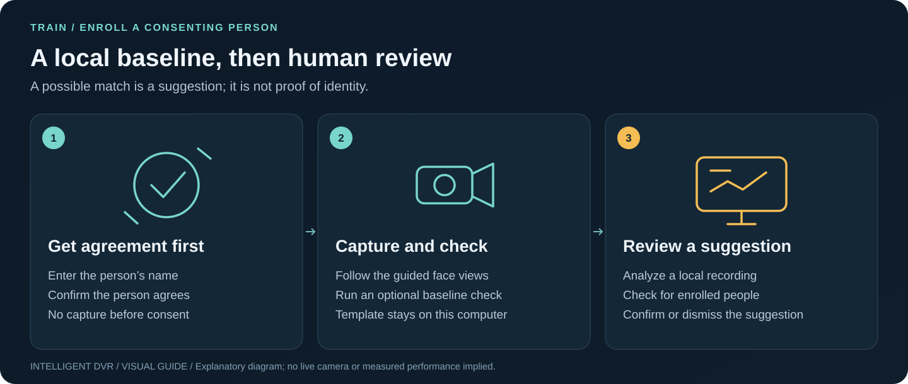

# Person enrollment

[Guide index](README.md) · [Visual handbook](how-to.md) · [Screenshot atlas](visual-atlas.md) · [Troubleshooting](troubleshooting.md)



**Quick path:** Train → Enroll a person → record explicit consent → capture a baseline → optionally check it → review possible matches by hand.

**Train → Enroll a person** sets a baseline for one consenting person: a face
template kept on this computer so the DVR can later suggest “possible match:
name” for human review. A match is never an identification, an access decision or
proof of who someone is. Enrollment is off unless the local app starts with
`--allow-face-enrollment` and the pinned face models are in the catalog.

## Consent and law

Enroll only people who are present and agree. Train requires a name and an explicit
confirmation before any face processing, and stores the consent statement version
and time with the template. Laws in some places (for example Illinois BIPA, Texas
CUBI and the GDPR) require written consent, a published retention schedule and
deletion on request for face data. Meeting them is the operator’s responsibility;
this record is not legal advice. Do not enroll children or anyone who cannot agree.

## Set up

On a fresh Mac checkout, [Mac model preparation](setup-macos.md#prepare-models-once)
can copy and verify all three selected models and build the catalog together.
An existing working catalog needs no repeat preparation. The manual option below
also remains available.

Download the two OpenCV Zoo models (revision `48b10fa505aeb51fbd127fc60a5c660040e823b7`)
into `faces/` beside the analysis catalog and check their hashes:

```bash
mkdir -p local-analysis/faces && cd local-analysis/faces
Z=https://media.githubusercontent.com/media/opencv/opencv_zoo/48b10fa505aeb51fbd127fc60a5c660040e823b7/models
curl -fLO $Z/face_detection_yunet/face_detection_yunet_2023mar.onnx
curl -fLO $Z/face_recognition_sface/face_recognition_sface_2021dec.onnx
shasum -a 256 *.onnx
```

| File | Bytes | SHA-256 | License |
| --- | ---: | --- | --- |
| `face_detection_yunet_2023mar.onnx` (YuNet) | 232,589 | `8f2383e4dd3cfbb4553ea8718107fc0423210dc964f9f4280604804ed2552fa4` | MIT |
| `face_recognition_sface_2021dec.onnx` (SFace) | 38,696,353 | `0ba9fbfa01b5270c96627c4ef784da859931e02f04419c829e83484087c34e79` | Apache-2.0 |

Add them to the catalog, which refuses any other file:

```json
"faces": {"detector": "faces/face_detection_yunet_2023mar.onnx",
          "recognizer": "faces/face_recognition_sface_2021dec.onnx"}
```

`Start-Mac.command` enables enrollment when the catalog has a `faces` entry. On
Linux add `--allow-face-enrollment`; on Windows `-AllowFaceEnrollment`.

## A session

| Step | What happens |
| --- | --- |
| Consent | Name (up to 60 characters) and the person’s agreement. Nothing is recorded before this. |
| Face capture | 20 seconds with an oval guide: look at the camera, turn slightly left, slightly right, lean back. Only this person should be in view. |
| Enrollment | The clip is imported and a bounded local worker keeps up to 40 distinct face views. At least 5 clear views are required; otherwise nothing is saved and the most common problem is named (too dark, too small, blurry, more than one face…). |
| Baseline check | Optional, 12 seconds of everyday views. Reports *recognized in N of M face views* and adds the matched views to the template, so each check also refines it. Run it again any time from the people list. |

## Interrupted imports or uncertain results

If you confirm leaving while the clip is being imported, the session cancels its
import path and does not submit a later enrollment or baseline-template change.
The local recording copy may already exist; leaving does not delete imported
recordings or saved templates.

After submission, a timeout, lost connection, server error or unverifiable reply
does not prove that the template write failed. The app warns that it may still
finish, keeps the clip in **Your recording is still here**, and offers **Save
person recording**. Keep that copy before leaving. **Retry this recording** is
withheld for an uncertain outcome; return to Train and check the saved people
before submitting again, so you do not create a duplicate enrollment or repeat a
baseline refinement. When the service confirms a refusal before writing a
template, the retained recording can be retried without recapturing it.

Retained clips are in-memory session recovery, not a permanent browser backup.
Closing or leaving the session releases them. A late response from an exited
session does not reopen it or start another template operation.

## How matching works

YuNet finds faces on a copy reduced to 640 px (it detects faces of about
10–300 px). A view is kept only when exactly one face is present and it is at least
60 px, confidently detected, inside the frame, neither too dark nor too bright,
and sharp. Sharpness is measured on the 112 px aligned face: still close-up views
scored 130–316 in testing and distant or moving ones 12–48, so enrollment requires
60 and a baseline check 20. SFace turns each view into a 128-value embedding; a
view matches a person when its best cosine similarity to their template reaches
SFace’s published 0.363 and beats the next person by 0.05. Otherwise there is no
suggestion.

## Possible matches in Recognition

After a local analysis opens in Recognition, **Check for enrolled people** runs the
same bounded worker on that job's own recording. It looks only inside person boxes
scoring at least 0.30 (up to 10 per frame and 1,200 sampled frames), takes the
largest clear face in each box and compares it with every template. A box gets
**Possible: name** only when the match clears the threshold and the margin above.

- **Confirm** adds that face view to the person's template, which can change later
  suggestions; an accuracy improvement is not guaranteed. Near-duplicates are
  skipped and the 40 newest views are kept.
- **Not this person** hides the suggestion in this page; nothing is saved.
- A jump list leads to every frame with a suggestion.

The browser receives frame and box numbers, names and similarity only. Face
embeddings for pending suggestions stay in the local service's memory for that one
job and are dropped when another analysis starts, the person is deleted or the
service stops. Suggestions are available for results from this computer's own
jobs, not for imported result files or LAN-recorder segments.

## Storage and deletion

| Item | Where |
| --- | --- |
| Templates | `people/<id>.json` beside the catalog: name, consent record, model hashes, up to 40 embeddings, last baseline. File 0600, folder 0700. |
| Clips | The recordings folder, like any import. Delete them there when no longer needed. |
| Browser | Names, view counts, baselines and suggestions only; never embeddings. |

**Delete** in the people list overwrites the template file, then removes it.
Filesystems and backups may still hold old copies; manage those with your
retention policy. Up to 50 people.

Deletion runs once at a time. Its row and other template controls stay disabled
while the request and list refresh finish. A matching deletion reply followed by
a fresh verified list without that person confirms completion. A lost reply or
storage error instead reports an unconfirmed outcome; that template stays blocked
in this Train session. **Refresh saved people** preserves the last verified list if refreshing
fails. A missing entry alone does not prove its file was deleted, because damaged
or unreadable template files are omitted from the list. Inspect the local app and
storage before attempting another template operation.

## Limits

Results describe your sessions and camera only: no accuracy, demographic-fairness
or anti-spoofing qualification. Photos or screens showing a face can match, and a
missing suggestion does not mean the person was absent. Suggestions are never
sent to Events or exported automatically.
