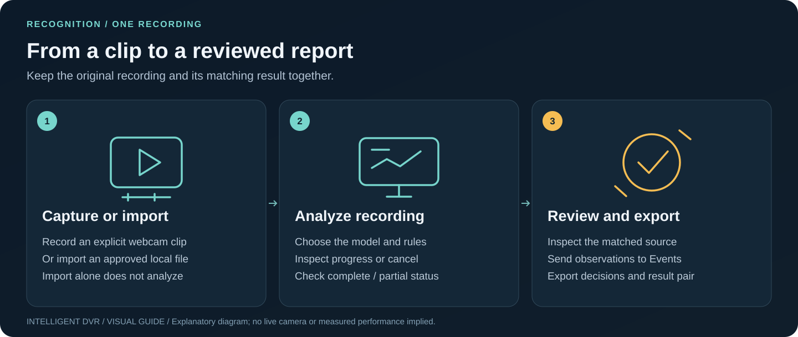

# 100-camera minimum and pilot service scope

[Guide index](README.md) · [Visual handbook](how-to.md) · [Screenshot atlas](visual-atlas.md) · [Troubleshooting](troubleshooting.md)

**Quick path:** Use the recording-to-review milestone first. Advance live ingest, representative quality and capacity only with separate acceptance evidence.

Owner decision, 2026-10-27: support **at least 100 simultaneously active cameras**.
Monitor starts with no feeds or observations; generated scenes are retained only
as historical/test material. The capacity target is mandatory; the current bounded
previews, two-camera live AI, one-channel recorder, OEM companion and offline
scheduling tests do not qualify live 100-camera operation. See [performance preparation](performance-100-cameras.md)
and the [machine-readable target](../edge/capacity-target.json).

## Service area

Computer vision, object detection and scene review are a **proposed custom-tool
and workflow service area**. This repository is the prototype. It does not
establish production availability, a fixed price, camera support, savings or
a service commitment on BARTA's public website.

## First useful workflow

An operator reviews a class/zone/duration observation, checks the recording,
and records a decision. “Out of place” must become a written rule tied to a
location, object class, time requirement and known failure modes. Nothing in
this prototype determines identity, intent or whether someone is authorized.

## Scope to agree before connecting cameras

| Item                | Required evidence                                                                     |
| ------------------- | ------------------------------------------------------------------------------------- |
| Task                | One recurring inspection/review task and the operator's response                      |
| Cameras             | Make, model, firmware, protocol, codec, resolution, FPS and permission                |
| Edge hardware       | CPU/GPU, RAM, thermals, storage and network budget                                    |
| Targets             | Exact model classes, normal scenes, zones and permitted times                         |
| Training/evaluation | Approved collection, consistent labels, provenance and held-out recordings            |
| Timing              | Agreed per-camera analytics cadence and maximum event delay; measured p50/p95/p99 under 100-camera load |
| Quality             | Per-class precision/recall, missed events and false alerts per camera-hour            |
| Review              | Named operator role, evidence handling, retention and escalation rules                |
| Commercial          | Hardware, storage, support and third-party costs; no assumed savings                  |

## Engineering sequence

1. Validate the UI workflow on generated samples and approved local footage.
2. Qualify a licensed model/export on labeled held-out recordings; record hashes.
   Start with the [model research and compatibility-only evidence](model-qualification-20261026.md).
   A synthetic-input pass does not complete this step.
   The [offline evaluation infrastructure](offline-evaluation.md) supports
   annotated-frame precision/recall, per-frame timing distributions and explicitly
   reviewed false alerts per camera-hour. Its committed synthetic fixtures qualify
   metric arithmetic and evidence links only; representative recordings, quality
   budgets and owner-hardware measurements remain outstanding.
3. Qualify the existing allowlisted local RTSP preview and single-channel recorder
   on one approved physical source, using the [field runbook](field-acceptance.md).
   Guided source setup saves credentials locally without connecting. No
   credentials or RTSP URLs should reach the hosted frontend or repository.
4. Measure the existing preview, live-AI, sampled recorder and OEM-copy lanes,
   including drops, reconnects, storage limits and end-to-end latency. Extend
   recording and ordered per-camera analytics beyond their current bounds only
   with a defined workload and new acceptance evidence.
5. Qualify staged concurrent loads of 1, 5, 25, 50 and at least 100 cameras,
   including disconnects, low light, occlusion, camera movement, empty scenes,
   noisy sources, worker failures and resource contention. Measure connection,
   recording, analytics and browser-view workloads separately and together.
6. Agree the remaining scope and support before any operational reliance.

## Architecture boundary

The browser provides review, explicit preview/capture, guided training and facility
planning. The token-bound loopback service supplies local recording import,
analysis, configured camera previews, optional two-camera live AI, one-channel
sampled recording and the OEM-copy companion. The direct `edge.analyze` CLI still
accepts one local recording, not a stream URL. These separate paths and their
storage locations are described in [architecture](architecture.md).

Sites can serve the browser workspace; its Worker does not provide the local
camera/analysis APIs. Hosted UI delivery is not installed native delivery or a
latency claim. No OpenAI API integration is included. The optional training
assistant uses installed local Ollama models; it is separate from the detector.
Any later cloud scene description needs a separate transmission, cost and
data-handling decision.

## Known limitations

- Rule observations describe class presence. Short-lived track numbers estimate
  box continuity within one camera; they are not identities or learned anomalies.
- Imported receipts are unsigned; UI review storage is local and editable.
- Camera adapters and explicit local inference exist, but no detector weights are
  bundled and representative model-quality, installed-device and capacity
  acceptance remain open.
- Video preview is separate from explicitly started analysis. Historical simulated
  playback is not AI evidence.
- Browser zones and edge-rule files use separate explicit schemas.
