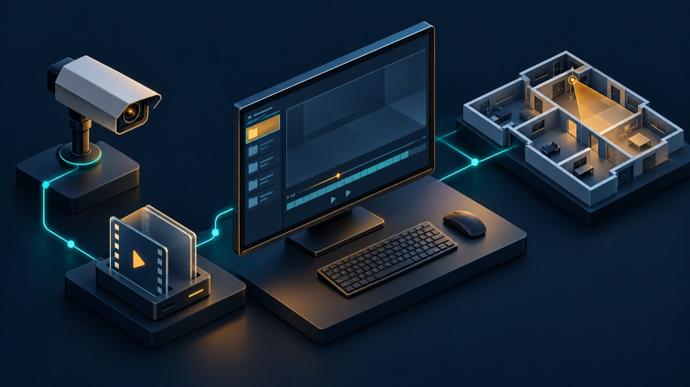

# Product status and evidence

**Current merged baseline:** [PR #122](https://github.com/bartytime4life/Intelligent-DVR-Tool/pull/122)
merged as [`c9b2b698`](https://github.com/bartytime4life/Intelligent-DVR-Tool/commit/c9b2b69862d854a19065e726ba84a64d5a555699), the
[integrated planning mathematics and coordinate integrity](verification/coordinate-integrity-math-2026-11-12/README.md)
work. It combines visible ground, pixel density
([#119](https://github.com/bartytime4life/Intelligent-DVR-Tool/pull/119)), zone area
([#121](https://github.com/bartytime4life/Intelligent-DVR-Tool/pull/121)) and image
diagnostics ([#120](https://github.com/bartytime4life/Intelligent-DVR-Tool/pull/120))
on top of projective calibration [#117](https://github.com/bartytime4life/Intelligent-DVR-Tool/pull/117).
PRs #119–#121 were closed because #122 includes their changes. Original proposal
receipts retain their exact source revisions.

#122 also repairs fractional presence-rule dwell/gap comparisons in
the local engine and browser training counter. It changes the rule-engine source
hash, so older traces need re-analysis for current evaluation. The
[timing record](verification/rule-time-boundaries-2026-11-12/README.md) retains
strict baseline failures, independent rational checks and a generated CPU
analyzer/review/evaluation test. [Planning readouts](verification/planning-readouts-2026-11-12/README.md)
also preserve small positive resource/distance values and avoid displaying
incomplete coverage as 100%; underlying numeric planning values are unchanged.

Two further reproduced fixes preserve rotated rooms when **Save site → Keep
buildings at their map positions** changes the local grid, and refuse calibrated
ruler/check points outside the closed convex reference boundary. Calibration
exports now identify `normalized-householder-dlt-v3`; the JSON schema is unchanged.
The Sobel method remains `srgb-luma-sobel-max-v2` with unsupported regions reported
as unavailable rather than measured zero.

Map shading, DORI contours, zone areas, route distance, rehearsal and installer
SVG share one current-plan visible-ground snapshot. Pending/failed views withhold
conclusions and offer retry; installer export requires a saved plan and complete
views. Save/Discard/Undo and portable JSON remain available under their existing
guards. No new controls or automatic camera, recording or inference starts are added.

Local checks, hosted CI, installed-machine state, Wiki publication, deployment
and physical qualification are distinct. #122 merged before hosted CI on its
final head completed; the [integration record](verification/coordinate-integrity-math-2026-11-12/README.md)
binds its local checks, independent replays, documentation inventory and earlier
CI readback.

**Earlier documentation record:** [PR #116](https://github.com/bartytime4life/Intelligent-DVR-Tool/pull/116)
merged as [`63b06ba2`](https://github.com/bartytime4life/Intelligent-DVR-Tool/commit/63b06ba2aab3adcffc38f52310b55969fb538afe).
All four hosted workflows passed on the final heads of PRs #114, #115 and #116.
The [latest documentation and CI record](verification/documentation-status-2026-11-12/README.md)
binds those results to their exact revisions. Earlier snapshots below retain
the workflows' states at their original read times. This documentation follow-up
does not rerun application suites or establish installed-machine acceptance.

**Merged after that record:** [PR #117](https://github.com/bartytime4life/Intelligent-DVR-Tool/pull/117)
merged as [`7868707a`](https://github.com/bartytime4life/Intelligent-DVR-Tool/commit/7868707aecbd61d997866f9fb25f695d3d7aeab2).
It corrects valid projective transforms rejected by the v1 calibration solver
and degenerate planes v1 could accept, using the `normalized-householder-dlt-v2`
matrix representation and its [generated checks](verification/calibration-projective-math-2026-11-12/README.md);
#122 later moved the method to `normalized-householder-dlt-v3`.
The dated documentation record above describes it as a draft at its read time.
Read the [calibration limits](facility-calibration.md#known-numerical-limits)
before relying on a plane ruler; this note does not record hosted CI for that
merge or physical calibration accuracy.

**Merged source baseline verified November 12, 2026 (America/Chicago):**
[PR #114](https://github.com/bartytime4life/Intelligent-DVR-Tool/pull/114) merged
as [`66e6dd1c`](https://github.com/bartytime4life/Intelligent-DVR-Tool/commit/66e6dd1cde9913e6c4f03fb94733e83dc3070c93).
Offline detection and tracking evaluation now parse and hash the same bounded
JSON capture. Tracking also rejects manifest/trace changes between validation
stages. The [input-binding record](verification/evaluation-binding-2026-11-11/README.md)
retains generated replacement-race proofs and the corrected cross-platform
regressions. The [CI snapshot](verification/documentation-alignment-2026-11-12/baseline-ci.json)
records successful cross-platform, PC-kit and Mac workflows; browser CI was
still running at its read time. Captured JSON does not establish an atomic
multi-file snapshot, a signature or loaded-code provenance.

[PR #115](https://github.com/bartytime4life/Intelligent-DVR-Tool/pull/115) merged
as [`2cac2173`](https://github.com/bartytime4life/Intelligent-DVR-Tool/commit/2cac2173f1f6b751f23ab1847ce25a3aea40a6b2).
Facility route coverage and overlap now measure path length inside the drawn
camera fans, counting distinct cameras. The display adds total uncovered
distance and the longest continuous gap across route vertices. Outdoor zone
grids and simulated handoff rehearsal remain separate planning calculations.
The [route record](verification/route-coverage-math-2026-11-12/README.md) binds
574 Node passes, four Sites checks, generated browser cases and independent
geometry comparisons to their tested source. These are local software checks,
not a claim that all hosted workflows or physical-device acceptance passed.

[PR #113](https://github.com/bartytime4life/Intelligent-DVR-Tool/pull/113)
completed the earlier [197-path documentation audit](verification/documentation-complete-2026-11-12/README.md).
The [current alignment follow-up](verification/documentation-alignment-2026-11-12/README.md)
corrects the rehearsal's adaptive position count and duration, retains dated
receipts, and records this newer merged route baseline.

**Historical merged source baseline verified November 11, 2026 (America/Chicago):**
[PR #112](https://github.com/bartytime4life/Intelligent-DVR-Tool/pull/112) merged
as [`cd6d1566`](https://github.com/bartytime4life/Intelligent-DVR-Tool/commit/cd6d15666beb55a9641068398d82a3d02eaa7769).
Its source tree matches tested head `ba735298`. Training searches empirical
score boundaries and preserves the exact selected value. Live sampling includes
unexpired tentative/lost tracks, and v3 association solves sparse feasible
components independently. [Mathematics and limits](science-and-algorithms.md).

The [source-bound local record](verification/science-math-2026-11-11/README.md)
reports 560 Python tests, 559 Node passes with two optional socket cases separately
verified, four Sites checks and 14 targeted Chrome scenarios. At the documentation
snapshot, [cross-platform checks](https://github.com/bartytime4life/Intelligent-DVR-Tool/actions/runs/43162852305),
[PC kit](https://github.com/bartytime4life/Intelligent-DVR-Tool/actions/runs/43162852342)
and [Mac installation](https://github.com/bartytime4life/Intelligent-DVR-Tool/actions/runs/43162852302)
passed; [browser CI](https://github.com/bartytime4life/Intelligent-DVR-Tool/actions/runs/43162852319)
was still running. See the [documentation snapshot](verification/documentation-complete-2026-11-12/README.md)
for the checked revision and separate documentation validation. Merged source,
hosted CI, installed-machine state and physical-device qualification are separate.

The optional [local training assistant](training.md#ask-the-local-training-assistant)
explains checked counts and suggests permitted review steps; it is separate from
the detector and cannot apply settings. Imported Lab receipts are recounted in
the browser before their summaries can be used. [Data flow](architecture.md#where-data-goes)
and [assistant boundary](../SECURITY.md#optional-local-training-assistant).

**Historical merged baseline verified November 11, 2026 (America/Chicago):**
[PR #110](https://github.com/bartytime4life/Intelligent-DVR-Tool/pull/110) merged
as [`cb91fa40`](https://github.com/bartytime4life/Intelligent-DVR-Tool/commit/cb91fa40d9d388faacca0785075c8b1986b33773).
Its tree matches tested head `13355e18`. All four final-head workflows passed:
[Mac source install](https://github.com/bartytime4life/Intelligent-DVR-Tool/actions/runs/43121401882),
[PC install kit](https://github.com/bartytime4life/Intelligent-DVR-Tool/actions/runs/43121401760),
[cross-platform checks](https://github.com/bartytime4life/Intelligent-DVR-Tool/actions/runs/43121401946)
and [browser regression](https://github.com/bartytime4life/Intelligent-DVR-Tool/actions/runs/43121401878).
Local verification separately passed 551 Node, 545 Python and four Sites checks;
300 distinct browser scenarios are covered across full and targeted passing runs.
The initial four browser expectation failures and their resolutions remain in the
[guided-experience receipt](verification/guided-experience-2026-11-11/README.md).
The [documentation reconciliation](verification/documentation-refresh-2026-11-11/README.md)
records the source/CI binding and this guide refresh. These are software checks,
not installation on the owner's computer, physical-device endurance, measured
recognition accuracy or 100-camera qualification.

**Historical merged baseline verified November 9, 2026:**
[PR #93](https://github.com/bartytime4life/Intelligent-DVR-Tool/pull/93), merged
as `9ae03ce`, passed all four PR workflows at the identical source tree `fd7b600`.
Each platform passed 451 frontend and four Sites checks. Python results were
510 passed on Linux, 424 passed/86 skipped on Windows, and 395 passed/115 skipped
on Apple silicon. The full 151-case general/Facility browser run and separate
generated analysis, feed, recorder and backup suites passed. See the
[revision-bound CI record](verification/merged-baseline-2026-11-09/README.md).
CI installation and generated runtime checks remain separate from owner-device,
recognition-quality and capacity acceptance.

**Current source workflow updates:** **Find a task** opens common jobs directly
from any workspace. Note drafts remain accessible across navigation and can be
saved without changing a verdict. Machine plans join reviews/rules in locked
multi-tab save recovery. Interrupted person imports cannot start later template
writes; uncertain submitted outcomes retain a downloadable clip and withhold
duplicate retries. See the [workspace verification](verification/workspace-experience-2026-11-09/README.md)
and [task guide](how-to.md#find-the-next-task).

Train warns before leaving unfinished work
and retains the warning after a requested browser save fails. Reviews and browser
rules keep both versions when another tab saves over unsaved local work; operators
can download both, choose a version and manage up to ten preserved conflict copies
per workspace. OEM and LAN review transfers have cancellation/deadline controls
that leave Stop available while connected, and status announcements focus on state
changes. See [review recovery](review-and-events.md#resolve-a-browser-save-conflict),
[training](training.md#leave-or-restart-a-session), [OEM backup](oem-backup.md) and
[LAN recording](lan-recording.md). These describe source behavior; the dated
verification records below keep their original revisions and qualification limits.

Monitor preserves unsent analyzed stills after a source disconnects, with four
temporary review slots and explicit Send/Dismiss controls. Navigation and tab
closure warn about pending review; camera Stop and hidden-page shutdown remain
immediate. See [live review and its limits](live-detection.md#use-live-ai) and the
[scoped verification](verification/live-review-retention-2026-11-11/README.md).

Live AI also validates startup/frame replies before rendering or adding temporary
review. Invalid metadata or mismatched run provenance stops that AI run while
preserving camera preview and earlier observations. See the
[reply-validation record](verification/live-reply-validation-2026-11-11/README.md).

Browser still operations also have a shared open/transaction deadline. A stalled
live still save releases Send and Dismiss, keeps the observation unsent, and cannot
queue it from a late callback. Outstanding database opens remain bounded and
late handles close before retry. See the
[storage recovery record](verification/bounded-image-storage-2026-11-11/README.md).

Recognition's Send-to-Events handoff can now be cancelled while keeping its loaded
review. Replaced results/recordings, workspace departure and hidden pages cancel
the old transfer; late still work cannot queue old observations or clear a newer
transfer. See [handoff verification](verification/recognition-transfer-2026-11-11/README.md).

Monitor now offers direct goal shortcuts and a guided camera-source setup
handoff. System starts with storage and browser controls, with advanced planning
available on demand and unapplied edits still visible. Shared review-opening
requests prevent older downloads from replacing newer file choices; expired
live-AI sessions can be rechecked explicitly. Narrow coverage zones receive
fitted samples, and unsampled areas remain unestimated. Training preserves manual
thresholds and expanded controls when evidence changes, while automatic trials
follow their current suggestion. See the
[guided-experience verification](verification/guided-experience-2026-11-11/README.md)
for source hashes, controlled regressions, screenshots and remaining limits.

**GPU preference:** live AI and recorded-video analysis now default to GPU first with visible CPU fallback and an explicit CPU override. Actual controlled RTX 5080 checks are recorded in the [GPU-default verification](verification/gpu-default-2026-11-03/README.md); physical-device accuracy and capacity remain separate.

**November 3 source follow-up:** [OEM companion backup](oem-backup.md) adds
owner-selected watched folders, verified byte-for-byte local copies, durable
review storage, optional queued analysis and guided private RTSP source/recorder
setup. Controlled Linux source checks do not establish particular OEM/device,
Windows/Mac, continuous-recording or 100-camera acceptance. It does not implement
ONVIF discovery, vendor SDKs or universal proprietary-format analysis.

[Offline tracking evaluation](tracking-evaluation.md) now measures saved traces
against independently labeled sampled frames, reporting identity switches,
misses, false tracks, MOTA, IDF1 and reference HOTA. Deterministic synthetic cases
validate evaluator arithmetic, alignment and tracker integration; representative
physical-camera tracking accuracy and multi-camera capacity remain unqualified.

[Guide index](README.md) · [Visual handbook](how-to.md) · [Screenshot atlas](visual-atlas.md) · [Verification](verification/README.md)

**Historical software baseline verified November 1, 2026 (America/Chicago):** [`main` at `2566d845`](https://github.com/bartytime4life/Intelligent-DVR-Tool/commit/2566d845fbbc7b9f54f98441009a604f2fa513ce), through [PR #71](https://github.com/bartytime4life/Intelligent-DVR-Tool/pull/71). Its final tested head `89bf2fca` passed 16 checks, including [Mac installation](https://github.com/bartytime4life/Intelligent-DVR-Tool/actions/runs/41346718983), [Linux/Windows validation](https://github.com/bartytime4life/Intelligent-DVR-Tool/actions/runs/41346718991), [browser regression](https://github.com/bartytime4life/Intelligent-DVR-Tool/actions/runs/41346718947) and [PC install kit](https://github.com/bartytime4life/Intelligent-DVR-Tool/actions/runs/41346719085). These are software checks, not physical-camera, biometric-accuracy or 100-camera qualification. [Mac source/setup evidence](verification/mac-setup-2026-11-01/README.md).

| Recent merged work | Operator-visible change | Boundary |
| --- | --- | --- |
| [#63](https://github.com/bartytime4life/Intelligent-DVR-Tool/pull/63) | Presence observations continue across brief missed samples within `max_gap` | Re-analyze old traces before comparing rule behavior |
| [#64](https://github.com/bartytime4life/Intelligent-DVR-Tool/pull/64), [#65](https://github.com/bartytime4life/Intelligent-DVR-Tool/pull/65), [#71](https://github.com/bartytime4life/Intelligent-DVR-Tool/pull/71) | [Mac Install / Check / Start](setup-macos.md), pinned CPU environment, verified models, preserved settings and same-port launch checks | Apple silicon source delivery; Mac worker has no address-space memory cap; physical-device acceptance remains separate |
| [#66](https://github.com/bartytime4life/Intelligent-DVR-Tool/pull/66) | [Train](training.md) guides a webcam session and optionally saves a tuned rule threshold | Session-specific tuning, not model retraining or independent accuracy measurement |
| [#67](https://github.com/bartytime4life/Intelligent-DVR-Tool/pull/67), [#68](https://github.com/bartytime4life/Intelligent-DVR-Tool/pull/68) | [Consent-based enrollment and possible matches](person-enrollment.md) in local-job Recognition | Local templates; human review; no verified identity/access decision or automatic Events/export handoff |
| [#75](https://github.com/bartytime4life/Intelligent-DVR-Tool/pull/75), [#76](https://github.com/bartytime4life/Intelligent-DVR-Tool/pull/76) | [Start AI on a Monitor tile](live-detection.md): local detection, numbered short-lived tracks, motion gate and explicit Send to Events; tracks in Recognition; optional local CUDA preference with CPU fallback | Explicit and local; tracking quality, physical cameras and capacity unqualified |
| [#70](https://github.com/bartytime4life/Intelligent-DVR-Tool/pull/70) | [Visual building placement, room sketching, wall edits, doorways, windows and stairs](facility-builder.md) | Editable planning geometry and visibility estimates; no survey or building-code certification |

**November 1 visual baseline:** the [atlas](visual-atlas.md) retains the merged `2566d845` interface in a clean local browser session. Recognition, Events and Zones examples use generated flat-color video and a constant-output test model. The hero is conceptual ImageGen artwork; ten SVGs explain operator steps. [Capture and generation provenance](media/guide/README.md). The five PR #61 screenshots and October 27 generated tour remain preserved as dated collections. Wiki publication has its own history; repository mirrors alone do not publish it.

**Field-testing guidance (October 31, 2026):** use the [field-acceptance runbook](field-acceptance.md) with the [PC kit](pc-testing.md) to verify real webcam, RTSP, recording, review and interruption behavior. CI, simulated feeds and generated recordings below are not field acceptance.

**Merged facility work (November 1, 2026; PR #70):** visual building placement,
indoor room sketching and shared-wall edits now include click-to-place, draggable
doorways and exterior windows. Doorways cut planned room walls and affect
estimated visibility. Windows can be resized on the map and adjusted in elevation;
glazing remains opaque to the estimator. Both survive floor copying/save/export/Undo.
Stairs can start on the map and be moved or rotated around the clicked landing.
Their destination can be above or below; floor cutouts remain separate.
See the [facility builder guide](facility-builder.md).

October 30 [full review](review-2026-10-30.md): 61 verified defects across the
browser workspaces, facility editor and local service were fixed in PR #45, and
the Windows launchers' line endings in PR #46. Highlights: unreadable saved data
is backed up instead of overwritten, other tabs' saves are adopted, unsaved
facility edits prompt before leaving, facade-mounted cameras keep coverage,
Windows file-sharing and non-ASCII path failures are handled, the local service
handles requests concurrently, and on Linux it refuses other accounts on the same
computer. The interface font is now bundled. [Test evidence](verification/review-fixes-2026-10-30/README.md).
Four follow-up pull requests merged on October 31 (#47–#50): local observation
stills and keyboard review with filters, CSV and bulk dismiss; zones drawn on a
camera still with an analyzer-ready rule export; pixel-density and coverage
planning estimates with an installer sheet; and specific failure causes, a
local diagnostic log, model reuse and hash-pinned installs. They are tested with
synthetic fixtures and CI only; see the [roadmap](roadmap.md#review-follow-up--october-30-2026)
for what each still needs before you rely on it.

[Recording coverage validation](recording-coverage.md) now checks alleged EOF
before publishing completion, rejects early/corrupt decoding, and distinguishes
unknown coverage from intentional limits. Legacy results remain unverified.
The PC runtime adds pinned PyAV for this bounded local validation pass.

Optional saved-recording [sharpening comparison](enhancement-comparison.md) reuses
the existing detector on paired original and mildly sharpened samples, with
separate review overlays, reports and labeled evaluation. Original-only rule
observations and unchanged source recordings are preserved. This non-learned
experimental control does not install Real-ESRGAN/SwinIR or qualify accuracy.

October 30 LAN-recorder follow-up: [one configured RTSP channel](lan-recording.md)
now supports explicit sampled segment capture, bounded retention, reconnects,
restart recovery and the existing local analysis/review path. It is a one-camera
pilot with visible gaps/drops, not gapless recording or multi-camera qualification.
See its [separate evidence](verification/lan-recorder-2026-10-30/README.md).

October 30 recording-workflow baseline: explicit browser-webcam clips, opt-in
same-computer recording import, pinned local model preparation, and printable
HTML/JSON/CSV reporting now join preview to human review. See the
[workflow and storage limits](recording-workflow.md). Native local checks include
the actual pinned pretrained model on generated video; physical-camera accuracy,
continuous recording/live AI and 100-camera acceptance remain unqualified.

[PC test installation](pc-testing.md) provides a prebuilt kit, pinned isolated CPU dependencies,
readiness diagnostics and separate Install/Check/Start actions. CI installation
checks do not establish compatibility with a particular physical PC or camera.

The current Monitor starts empty and supports explicit browser webcam and bounded
local RTSP previews. Generated camera images/default events are removed. See
[connections, limits and device qualification](local-camera-feeds.md).
Owner-approved direct HTTPS JPEG/MJPEG public webcams now use the same bounded
preview lifecycle, with attribution, retrieval age and snapshot labels. See the
[public-webcam boundary](public-webcams.md). External-provider availability and
capture freshness remain unqualified; no public source is enabled by default.

The October 29 recording milestone introduced the bounded same-origin CPU job
service and source-matched Recognition controls. Today's service adds GPU
preference/fallback, explicit live AI and short-lived tracks, as described in the
capability register. [Setup, resource limits and recovery](local-analysis-service.md)
remain distinct from representative accuracy and 100-camera acceptance.

**Historical audited application baseline (October 27–28, 2026; not the current HEAD):**
[`82c862c68735720b8840461fc624e8dbe148a53a`](https://github.com/bartytime4life/Intelligent-DVR-Tool/commit/82c862c68735720b8840461fc624e8dbe148a53a)
(the merged PR #11 revision). Later native-runtime and optional-CUDA work has
its own dated evidence in the verification index below.

[Home](../README.md) · [Verification index](verification/README.md) · [Roadmap](roadmap.md)

Intelligent DVR is a local camera-analysis and human-review prototype with an
editable facility planner and System resource-planning workspace. At least **100
simultaneously active cameras** is the owner's requirement. Sustained multi-camera ingest/recording, representative field/event accuracy,
cross-platform GPU deployment and actual 100-camera capacity remain unqualified.
The one-camera LAN recorder has separate controlled-source test evidence, not
physical-device acceptance. The optional CUDA route has bounded
owner-PC execution evidence in its dated record.

The [facility follow-up](verification/facility-2026-10-28/README.md) records the
newer source/check scope separately from the historical baseline counts below.

The facility workspace starts blank on new installs and supports independent named
facilities, browser saves and portable JSON backups. Examples are opt-in; legacy
saves migrate without deleting the original. See [saved facilities](saved-facilities.md).

## Capability register

| Capability | Implemented baseline and source | Evidence and next gate |
| --- | --- | --- |
| Monitor/review | Real-source chooser, explicit webcam/local RTSP/approved public preview, queue, notes, history, zones and exports; [workspace source](../src/App.jsx) | Starts with no camera images and no automatic activation; live AI runs only after **Start AI** on a tile. [November 11 screenshot](media/guided-experience-2026-11-11/04-monitor-after.jpg) and [feed guide](local-camera-feeds.md). Physical-device compatibility and sustained operation remain unqualified. |
| Local video and receipts | Explicit video preview and receipt import; [offline CLI](../edge/README.md) | Preview does not analyze. Imported events do not borrow sample images. |
| Recording recognition | Explicit GPU-preferred local jobs with visible CPU fallback, recording/model/rule selection, progress/cancel and automatic source-matched review; optional CLI bundle import, paused sample overlays, class counts and Event handoff; [guide](local-analysis-service.md) | HTTP/native/browser job qualification in the [service record](verification/local-analysis-2026-10-29/README.md); earlier CPU/contract checks in the [recognition record](verification/recognition-2026-10-29/README.md). Scene counts are sampled detections, not learned scene interpretation or identity; new results add short-lived tracks. Live deployment/accuracy remain unqualified. |
| Live AI and tracking | **Start AI** on a Monitor tile: local YOLOX-S detection (CUDA preferred when supported, visible CPU fallback and an explicit CPU override) with a motion gate, ByteTrack-style short-lived tracks, the existing rule engine and explicit **Send to Events**; at most two cameras, one frame in flight, 15-minute sessions. Recording analysis adds the same tracks to traces and Recognition; [guide](live-detection.md) · [tracker](../edge/tracking.py) · [live worker](../edge/live_worker.py) | Unit, protocol and fixture-model checks, a Chromium synthetic-camera browser test, and a development run of the actual pinned model on one local owner clip (about 80–90 ms per frame on an Apple M4 CPU). The [November 2 live GPU record](verification/live-gpu-2026-11-02/README.md) adds deterministic selection/recovery tests and actual CPU execution/fallback evidence; GPU timing/parity could not be measured in that session. The [November 3 GPU-default record](verification/gpu-default-2026-11-03/README.md) separately records controlled RTX 5080 execution. Current-source synthetic tracker checks do not qualify physical-camera tracking quality, other OS/GPU combinations or multi-camera capacity. Track numbers are not identities. |
| Guided training | Named camera views can accumulate up to 50 confirmed sessions in this browser. Compatible calibration sessions inform threshold suggestions equally; saved recordings guard against regressions. A separate 20-second fresh check, sample counts, JSON receipt and explicit Recognition rule selection remain required. [Guide](training.md) | [Cumulative-session verification](verification/cumulative-training-2026-11-02/README.md) covers generated-camera persistence, pooling and apply gating. Threshold tuning does not retrain detector weights or guarantee accuracy gains. Older summary-only history is preserved separately; representative detection accuracy needs independently labeled recordings. |
| Enrolled-person suggestions | Consent-gated local templates, baseline checks, explicit matching within a local job's person boxes, Confirm and Not this person; [guide](person-enrollment.md) | Templates stay in the local service; no face embeddings in the browser, automatic identity decisions or automatic Events/export handoff; accuracy and anti-spoofing remain unqualified |
| Facility planning | Map-first task selector, buildings/floors/rooms/labels, camera aim, zone coverage estimates, route covered/overlap distance and longest blind gap, simulated rehearsal, local image diagnostics, experimental ground-plane calibration, export and Undo; [guide](facility-builder.md) | Dated [November 1 interface screenshot](media/guide/facility.jpg), [route geometry checks](verification/route-coverage-math-2026-11-12/README.md), [pixel limits](facility-image-diagnostics.md) and [calibration constraints](facility-calibration.md). Coverage and distances require real marker/optical qualification; simulated handoffs remain unverified. |
| Find and draft a site | Submitted Photon search, GPS/numeric origin, map-pin suggestion, rectangular/custom polygon area, selectable services, offline JSON file/paste; opt-in Streets (OSM) and Aerial (USGS/NAIP, contiguous U.S.) map layers for tracing, with map preview of a suggested site; one-click **Find mapped buildings** with click-to-include/exclude drafts on the map; [service source](../src/facility-services.mjs) · [map layers](facility-builder.md#real-map-layer) | [Six Chromium scenarios](verification/facility-2026-10-27/README.md) use recorded geometry/mocked services; map-layer and one-click draft scenarios use stand-in pictures and the recorded Eppan extract. Public Overpass endpoints timed out in live testing on 2026-11-01. External availability, real GPS, imagery positional accuracy and novice completion remain unqualified. |
| OSM geometry | Facility v2, complete simple ways and supported outer/inner relations, raised bases and independent parts; [adapter](../src/facility-starter.mjs) | Review and provenance survive apply/export. Courtyards/bases survive edits, rendering and coverage. Overlapping parts/envelopes and invalid/incomplete geometry remain excluded. [Limits](facility-setup-reliability.md). |
| System controls | Basic storage/browser settings first, advanced planning on demand, preserved drafts, planning arithmetic, applied browser limits, setup/policy exports and host-snapshot import; [control contract](resource-controls.md) | Browser controls and analyzer thread/frame caps have explicit scopes. RAM/VRAM/power/storage estimates are not OS quotas or activated hardware. |
| Offline detection | One local recording per run, default OpenCV CPU and explicit pinned YOLOX-S CUDA option, bounded rule receipts/traces with backend metadata; [analyzer](../edge/analyze.py) | [CUDA qualification](verification/cuda-2026-10-28/README.md) covers the owner PC and bounded inputs. Field/event accuracy, sustained capacity and other GPU/OS combinations remain unqualified. No detector weights are bundled. |
| Evaluation | Annotation matching, precision/recall, timing distributions and reviewed false alerts; [guide](offline-evaluation.md) | Synthetic fixtures verify calculation/evidence plumbing. Approved representative labels and held-out quality measurement remain required. |
| Scale preparation | Bounded fair scheduler, explicit 1–4 thread processors, optional Linux process supervision/local outcome journal and virtual-time 100/125-source tests; [guide](performance-100-cameras.md) | [Thread trials](verification/workers-2026-10-28/README.md), [process recovery](verification/recovery-2026-10-28/README.md) and [parent-crash journal](verification/journal-2026-10-28/README.md) use bounded offline inputs. The [batching record](verification/batching-2026-10-28/README.md) separates atomic commits/index changes from consumer acknowledgment timing. Durable dispatched outcomes are optional; the scale subsystem is not integrated with multi-camera live ingest/recording, per-camera rule state or distributed services; physical/sustained 100-camera operation remains unqualified. |
| Linux/Windows delivery | Pinned isolated install, prebuilt PC kit, integrity/readiness checks and foreground loopback service; [PC guide](pc-testing.md) | Fresh extracted-kit installation, repeated install/settings preservation and HTTP startup are checked on Linux/Windows CI. Physical-device/target-PC and unattended service acceptance remain separate. |
| macOS source delivery | Repeatable Apple silicon Install/Check/Start, exact wheel hashes, pinned model preparation and update preservation; [setup](setup-macos.md) | Mac CI checks installation/readiness, repeat installation and preservation. Local setup receipts remain separate from camera/accuracy qualification. No Mac worker address-space memory cap. |

## Read the status labels

- **Implemented** means source exists at the stated baseline.
- **Verified** requires a linked revision, environment and bounded check.
- **Historical** evidence keeps its original revision/date and limitations.
- **Estimated/simulated** results do not establish field accuracy or capacity.
- **Required/proposed** work has not passed its delivery and acceptance gates.
- **Reported local work** needs a matching source revision and receipt before it
  can be described as shipped.

The **historical October 27 audited baseline**, not the latest `main`, has 46 frontend + 4 packaging passes per platform,
66 Python passes on Linux, and 63 Python passes/3 skips on Windows. Six browser
scenarios ran separately. See the [exact record](verification/facility-2026-10-27/README.md).

Later [October 28 native execution](verification/native-2026-10-28/README.md)
ran all 77 Python cases without skips, the actual pinned pretrained model, and
a 20-frame synthetic recording on an isolated cloud CPU. Its repaired package
pins, measured timings and failures are recorded separately. It does not measure
representative accuracy, owner-hardware performance or 100-camera operation.

## Reconciliation and operational gates

The later [offline evidence checklist](offline-qualification.md) provides a local
source/log collector, listed-file integrity verification and a workload-plan
preflight. These preparation tools do not run inference or qualify any operating
capacity; their tests belong to their own revision, not the baseline counts above.

The [owner-PC continuation](verification/host-2026-10-28/README.md) now records local AI execution, isolated GPU output agreement, short public-feed loads and fixed person-image metrics with source hashes and sanitized receipts. That dated record distinguishes its then-unpublished local changes and private GPU harness from the public source at the time; later public GPU and service delivery has separate records above. Production integration, representative video/event accuracy, sustained recording and 100-camera acceptance remain unqualified.

[Issue #6](https://github.com/bartytime4life/Intelligent-DVR-Tool/issues/6) retains
overlapping-part decomposition, installed/live-service delivery, real-site checks
and the novice study. The proposed 80% unaided completion and median under three
minutes with 5–8 novices have not been measured.

The [capacity target](../edge/capacity-target.json) still needs accepted codec,
resolution/source FPS, analysis cadence, delay, retention and hardware/worker
values. Qualification must distinguish recording, analytics and browser workloads.

The [current visual atlas](visual-atlas.md) distinguishes actual controlled-browser UI from illustrative diagrams and the archived fictional-camera tour. November 11 Monitor/System captures bind to PR #110 head `13355e18`; the November 1 collection remains bound to `2566d845`, and older CI captures retain their original GitHub Actions job. None qualifies a physical camera.

The hosted app and published wiki require their own revision/publication checks.
A repository merge or green CI run does not establish deployed-version parity.
No GitHub release was present at the October 28 audit.

No subscription, paid inference or paid trial is required by this implementation.
Local hardware/storage still consume resources. The repository currently assigns
no software license; third-party licenses remain separate. See
[project terms](../README.md#checks-and-project-terms) and [security boundaries](../SECURITY.md).
