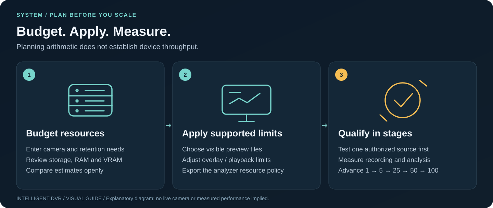

# Resource controls: what actually takes effect

[Guide index](README.md) · [Visual handbook](how-to.md) · [Screenshot atlas](visual-atlas.md) · [Troubleshooting](troubleshooting.md)



**Quick path:** Enter workload assumptions → Apply workspace limits for browser behavior → Export analyzer policy for supported offline limits → measure actual use.


*Merged source `2566d845`, clean local browser; [capture provenance](media/guide/README.md).*

[Hardware](hardware-guide.md) · [Linux](setup-linux.md) · [Windows](setup-windows.md) · [GPU planning](gpu-planning.md)

Open **System** in the main navigation, or use `/#system`. The page combines workload planning and explicit local limits. It has no privileged host-control API.

## Controls and their scope

| Setting / action | Enforced now | Limits |
| --- | --- | --- |
| Camera wall tiles: 1, 2 or 4 | Applied browser setting unmounts excess wall tiles and keeps the selected source visible | Does not connect, decode or analyze real cameras; an expanded view is separate |
| Camera overlay pixel scale: 1× or 2× | Applied setting changes camera overlay canvas dimensions | 1× uses a quarter of the overlay pixels of 2×; scene imagery is unaffected; no frame-rate claim |
| Pause sample playback in hidden tabs | Applied setting stops sample-timeline timers while `document.hidden` is true | Covers sample camera-tile playback, not a whole-host power policy or the facility rehearsal |
| OpenCV threads per analyzer | `edge.analyze --resource-policy FILE` calls `cv2.setNumThreads` with a value no greater than the policy cap | OpenCV's CPU pool only; other native libraries/decoders and the OS may have additional threads |
| Decoded frames per run | Analyzer stops reading at the policy ceiling and records partial state when the bound is reached | A decoded-frame count, not seconds or a memory ceiling; stride still controls analyzed samples |
| Worker slots, retained queue bytes, dispatch age | `scheduler_from_policy` constructs the bounded scheduler with these limits | No worker processes are created; it is not yet wired into live ingest or the recording analyzer |
| Worker slots × OpenCV threads budget | Validation rejects configurations whose product exceeds the entered budget | Planning/admission constraint, not an OS CPU-rate quota |
| RAM reserve, per-worker memory and VRAM allowances | Checked for consistent arithmetic and warnings | No physical RAM/VRAM is reserved; tensors, decoding and other allocations need measurement |
| GPU candidate, context/batch and power plan | Updates VRAM arithmetic and GPU watts for the selected location | Does not activate CUDA/NVDEC/NVENC, change clocks or set a power cap |
| Drive count, layout, bitrate and retention | Recomputes capacity, free reserve, read/write workload and warnings | Does not provision RAID, record footage, delete old files or measure storage speed |
| Read-only host snapshot | Explicit Python command reports selected local OS counters; browser import is local | No live dashboard, health guarantee or background polling |

## Save, import and export

**Apply workspace limits** validates and stores the setup as `dvr.setup.v1` in this browser's localStorage. A save failure is visible; export to preserve work. **Reset draft** does not change applied settings until Apply. The sample-workspace reset is separate from the hardware plan.

- **Export setup plan:** all numerical planning inputs, selected platform and browser preferences, schema `intelligent-dvr.setup.v1`. It contains no cameras, credentials or host snapshot.
- **Import setup:** bounded to 64 KiB and checked for exact fields/ranges, array consistency, thread budget and reserves. Import creates a reviewable draft; it does not immediately apply settings.
- **Export analyzer policy:** schema `intelligent-dvr.resource-policy.v1`, containing the browser limits and bounded analysis settings. GPU/RAM/power estimates are deliberately absent because they are not runtime quotas. Export uses the current valid draft; applying the browser settings is a separate action.
- **Import host snapshot:** schema `intelligent-dvr.host-snapshot.v1`, at most 64 KiB, eight selected volumes and sixteen GPU records. Extra fields, paths and serials are not retained. Snapshot state is session-only. Reported data is untrusted input, not authenticated hardware attestation.

An imported snapshot never silently overwrites a plan. The explicit copy buttons put reported CPU/RAM or first-GPU VRAM into the draft; review and Apply. Duplicate volume selections may refer to the same filesystem and must not be summed blindly.

## Local policy contract

The app's default export is shared with Python tests in [the contract fixture](../tests/fixtures/resource-policy.json):

```json
{
  "schema": "intelligent-dvr.resource-policy.v1",
  "platform": "linux",
  "browser": { "visible_tiles": 4, "pause_when_hidden": true, "overlay_scale": 2 },
  "analysis": {
    "opencv_threads": 1,
    "worker_slots": 8,
    "thread_budget": 16,
    "max_sample_bytes": 1228800,
    "max_buffer_bytes": 268435456,
    "max_age_seconds": 2,
    "max_frames": 6000
  }
}
```

The OS label is planning metadata; the numerical analyzer limits have the same semantics on Linux and Windows. `max_sample_bytes` describes one 640×640×3 byte RGB sample, not a float32 tensor. Retained bytes include pending and in-flight scheduler payloads; memory outside that component is separate.

```python
from edge.resources import load_policy, scheduler_from_policy
policy, policy_sha256 = load_policy('/private/dvr/dvr-resource-policy.json')
scheduler = scheduler_from_policy(['dock-01', 'gate-02'], policy)
# Caller explicitly submits samples, executes Work and completes tokens.
# No workers, camera connections or inference are started by construction.
```

For `edge.analyze`, omitted `--threads` / `--max-frames` take policy values. Explicit values can lower the caps; exceeding either fails before inference. Without a policy, legacy defaults remain one OpenCV thread and 6,000 decoded frames. Successful receipts/traces record the policy hash and actual applied analyzer limits. Other policy fields are not misreported as enforced analyzer features.

## OS hard limits and future work

The optional [Linux process adapter](performance-100-cameras.md#optional-linux-process-supervision)
is constructed explicitly by local application code. A policy-created scheduler
does not start it or choose its factory, deadlines or restart budget. The adapter
requires 1–4 scheduler slots and rejects larger counts; it does not silently
clamp an exported plan. Its polled deadlines, bounded IPC and owned-child
termination are distinct from the browser's planning fields and OS quotas.

Use the Linux/Windows guides for the distinction between cgroup/systemd properties and Windows Job Object limits. No OS containment, filesystem quota, GPU-power setting, retention-deletion service or priority tuner is controlled by the browser. An admitted host-control service still needs authenticated narrow APIs, supported OS enforcement, per-process health and durable failure receipts before such controls can be presented as live.

The 100-camera requirement remains a workload qualification target. Valid policy imports, successful calculations and green unit tests do not establish sustained camera throughput or recognition quality.
