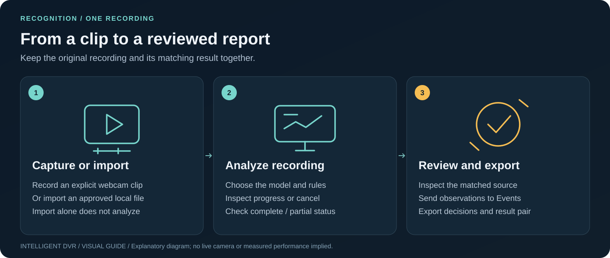
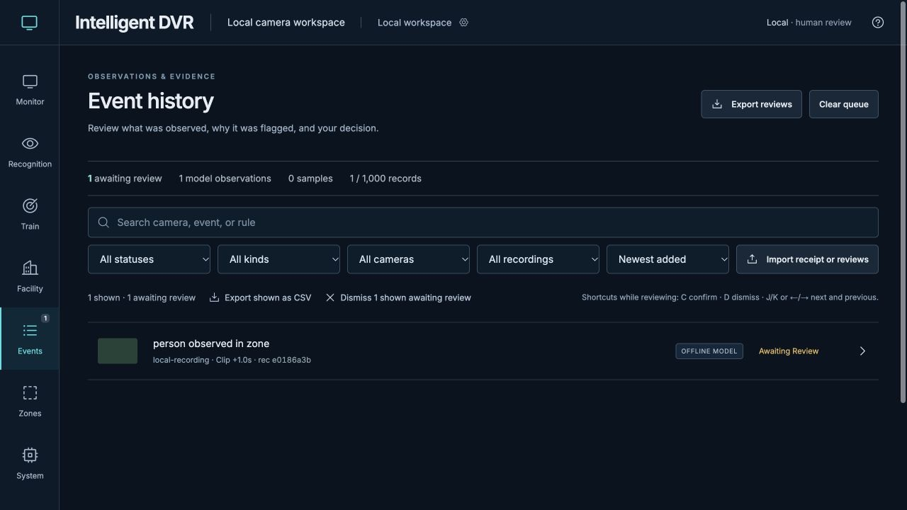
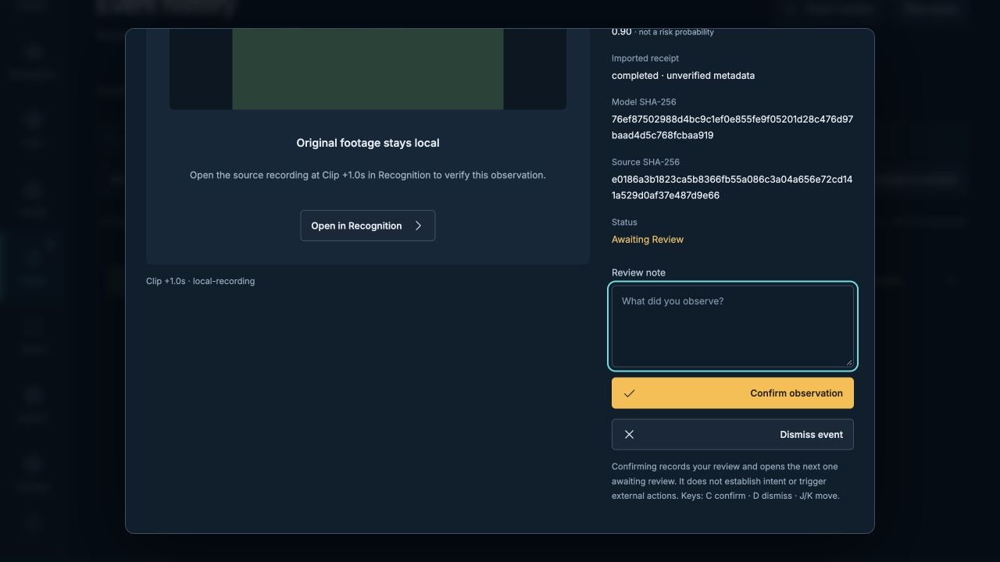

# Review observations and export decisions

[Visual handbook](how-to.md#4-review-and-export) · [Recording workflow](recording-workflow.md) · [Recognition contracts](recording-recognition.md)

*The example observation is produced by a constant-output test model; it is not a real incident.*

## Before you make a decision

Open results with their exact original recording. Recognition verifies the source
bytes before attaching overlays. Read complete/partial coverage and the sampled
frame position. A box or score is an observation to investigate, not a verdict.

For a recording observation already in Events, **Open in Recognition** reveals
**Open saved results** and focuses the next source-review step. Its camera, clip
time and recording/model fingerprints identify the requested evidence. Load its
matching results and original recording explicitly; unrelated loaded results
stay available. When both already match, the observation opens on its original
sample. **Close source request** removes the guidance without clearing the review.
Ordinary navigation then preserves your current sample and task.

## Work through the queue

1. Inspect the relevant sampled scene in **Recognition**. Compare the box with
   the original image and the configured class, region, threshold and dwell rule.
2. Use **Send observations to Events** deliberately. A LAN segment also requires
   its own explicit send action; it is not queued automatically. A
   [live AI](live-detection.md) observation is sent one at a time from its Monitor
   tile, with the analyzed still; there is no recording behind it, so Events labels
   it **Live AI** and shows no Open in Recognition button. Unsent live observations
   remain reviewable after disconnecting their source. They are temporary:
   Monitor warns before navigation discards them. Send or dismiss them explicitly;
   [live review limits](live-detection.md#use-live-ai) keep preview and Stop available.
3. In **Events**, use filters to focus the queue, open an observation, make the
   appropriate confirm/dismiss decision and add a note explaining the evidence.
4. Reopen an observation to correct its decision. Bulk dismissal and queue clearing
   have their own **Undo** controls. Review state stays through workspace changes;
   storage errors are visible and need attention.
5. Return to Recognition for a report with the current decisions matched to this
   source. Save the recognition results and analyzed recording as a pair.

Result openings share one current request across recording jobs, LAN segments,
OEM backups and imported files. Older downloads cannot replace a newer choice,
including a rejected file. Leaving Recognition or hiding the page cancels pending
openings while retaining the loaded review; reopen deliberately when ready.
Background analysis, recording and backup keep their own Stop/Cancel controls.

Keyboard review, local observation stills, CSV and bulk dismiss are convenience
controls. Verify the selection and original evidence before a bulk decision.
Possible enrolled-person suggestions have a separate Confirm/Not this person
flow; they do not reach Events or exports automatically.

State announcements describe changes such as analysis starting, finishing or
losing contact with the service. Frequently refreshed sample, storage and queue
counts remain readable in place without being announced on every poll.

## Keep notes without making a verdict

Edit **Review note**, then choose **Save note** to add it to the current reviews
without changing the observation's pending, confirmed or dismissed status.
Confirm/dismiss also records the note with that decision. Browser saving can still
be pending or fail; use the save warning and conflict controls below when needed.
**Discard note draft** drops the unsaved edit and restores the observation's
current note; it does not reverse a review decision.

Unfinished note drafts stay in this tab when you use Next/Previous, close the
review dialog, inspect the source in Recognition or change workspaces. The
**Review note drafts** banner opens the recovery list. Use **Resume note draft**
to continue, **Download note drafts** to keep a separate JSON copy, or explicitly
**Discard note draft**. Reloading or closing releases these in-memory drafts and
triggers the browser's unfinished-work warning. The draft download is a recovery
record, not an ordinary review export or an automatically importable backup.

Drafts remain bound to their original evidence. If an observation was removed or
its evidence changed, its retained draft is read-only; download it before
discarding it. It is not attached to a replacement observation with the same ID.
If the saved note or decision changed while you were reviewing the same evidence,
choose **Review saved version** before saving or deciding. Your draft stays
available, and the dialog shows a changed saved note before you replace it.
Ordinary review exports and reports include notes added to reviews; unsaved note
drafts need their separate download.

## Choose the right export

| Export | Keep it for |
| --- | --- |
| Printable HTML report | An offline readout; print to PDF when needed |
| Report JSON | Structured report with the current supported review decisions |
| Observation CSV | A compact tabular readout of observations |
| Recognition results + analyzed recording | Reopening the exact source/result pair |
| Browser review/rule backups | Preserving browser state before an origin change or reset |

Browser storage can be edited or cleared; it is not a shared, authenticated audit
trail. Counts across sampled frames can include repeated sightings of the same
person. Preserve the original recording and context when sharing a report.
Review exports carry metadata, decisions and saved notes, not the analyzed stills
in IndexedDB. Those images belong to this browser profile and origin/port;
copying the checkout or an OEM backup does not copy them.

## Resolve a browser save conflict

Reviews and browser rules are saved separately. If another tab changes a workspace
while this tab has unsaved edits, the app keeps this tab's version in memory and
pauses saving. This includes edits left unsaved by a quota or permission failure.
Further edits do not silently replace the other tab's saved version. A tab with
no unsaved edits can adopt a valid save from another tab.

1. In **Reviews save conflict** or **Rules save conflict**, choose **Download this
   version** and **Download other version**. Inspect both files before deciding.
   An unreadable other version is offered as raw text so it can be preserved.
2. Choose **Keep this tab’s version** to save the in-memory version, or **Use other
   tab’s version** to adopt the saved one. The displaced version must be backed up
   in this browser first. An unreadable version cannot be adopted. If another tab
   removed the saved entry, the choice explicitly offers an empty review queue or
   default browser rules.
3. If either version changed while the choice was waiting, review the refreshed
   versions and choose again. A storage error leaves both versions available for
   download and keeps saving paused. Reloading or closing can discard the version
   held only in memory; heed the unfinished-work warning.

Each workspace has room for **ten saved conflict copies**. Existing copies are
never replaced automatically. In **Saved conflict copies**, use **Download copy**,
inspect the downloaded file, then explicitly choose **Remove this copy** only when
you no longer need its browser copy. Removal is enabled after that exact copy's
download starts, and removes only the rechecked copy. It does not clear the current
queue, current rules, source recordings or OEM backups. If all ten slots are
occupied, make room this way before retrying the unresolved choice. Downloads
remain separate from browser storage and do not remove a copy by themselves.
Saved-copy downloads preserve the stored backup archive, including its raw
snapshot; damaged copies retain their original bytes. These archives are for
inspection and recovery, and are not accepted directly by **Import reviews**.
Use **Download this version** or **Download other version** for the ordinary
portable review export.

Browser saves and conflict choices use a shared browser save lock. If this feature
is unavailable, the app reports that changes are in memory and keeps export
available. Preserve downloads before changing browser or origin. Unreadable
startup data keeps its separate recovery download; do not clear storage to force
a save.
