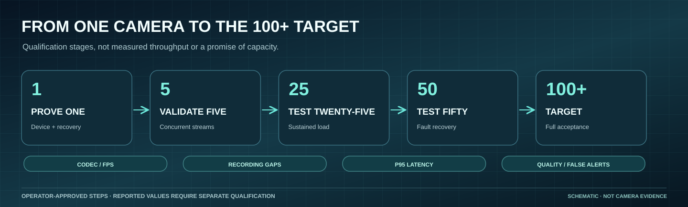

# Build the next claim with evidence

[Current visual atlas](visual-atlas.md) · [Product status](product-status.md) · [Provenance](media/current/README.md)

*The 100+ target remains unqualified; virtual decoders are not physical cameras.*

[Home](../README.md) · [Product status](product-status.md) · [Verification](verification/README.md) · [100-camera plan](performance-100-cameras.md)

The minimum capacity goal is **100 simultaneously active cameras**. The current Monitor starts empty with an explicit real-source chooser; generated camera scenes remain only in the [historical gallery](visual-tour.md#historical-prototype-captures). The [goal-based navigation and recovery fixes](https://github.com/bartytime4life/Intelligent-DVR-Tool/pull/110) are merged and software-tested, but real-camera endurance, accuracy and 100-camera capacity remain unqualified.

| Lane | Exists now | Next evidence required |
| --- | --- | --- |
| Review | Wall, queue, notes, history, rules and exports | Accessibility/mobile/long-session acceptance; durable authenticated records |
| Facility | Visual buildings, room sketching/wall edits, doorways/windows/stairs, cameras, estimates and rehearsal | Site measurements, optical calibration and qualified visibility |
| Easy setup | Submitted address search, GPS/numeric/map-pin origin, rectangular or custom polygon area, selectable services, offline-file review, OSM relations with courtyards, raised bases and independent parts, seven shapes | Live-provider/installed local-service and real-site qualification; overlapping-part decomposition; novice-user study |
| Detection | Offline ONNX adapter; prior YOLOX-S compatibility probes; [guided threshold tuning](training.md); [explicit live AI on Monitor tiles](live-detection.md) | Independent labels, precision/recall, false alerts and held-out scenes separate from tuning sessions |
| Tracking | [ByteTrack-style short-lived tracks](live-detection.md) in live AI and recording traces, with per-track zone time | Identity-labeled held-out clips with MOTA/IDF1/HOTA and ID switches at the deployed sampling stride |
| Enrolled-person suggestions | [Consent-gated local templates and explicit possible matches](person-enrollment.md) | Representative consented evaluation, false matches/misses, spoofing and deletion checks; no identity/access-decision claim |
| Delivery | Linux/Windows PC kit and Mac Install/Check/Start with preservation checks | Physical host, codec, camera and recovery acceptance on each intended platform |
| Performance | Bounded scheduler, budgets, synthetic overload model | Sustained decode/inference/end-to-end rates on intended hardware |
| 100-camera operation | Owner requirement and staged acceptance design | Ingest/recording/worker implementation and simultaneous-source qualification |

## Delivered through November 12, 2026

[PR #122](https://github.com/bartytime4life/Intelligent-DVR-Tool/pull/122), merged
as `c9b2b698`, delivers the [integrated planning work](verification/coordinate-integrity-math-2026-11-12/README.md):
visible ground, pixel density (#119), zone area (#121) and image diagnostics
(#120), on top of the calibration fix (#117). Additional coordinate fixes preserve ordinary
rotated boundary rooms during keep-position site corrections and prevent
calibrated ruler/check extrapolation beside short reference edges. Independent
numeric and browser checks establish behavior on their generated inputs.

The [timing follow-up](verification/rule-time-boundaries-2026-11-12/README.md)
keeps fractional samples at dwell/gap boundaries consistent across the engine and
training counter, with old-trace refusal and generated CPU integration checks.
[Planning readouts](verification/planning-readouts-2026-11-12/README.md) preserve
small positive values and distinguish incomplete coverage from an exact endpoint.
The existing controls, numeric models and explicit start actions remain.

Hosted CI on #122's final head, platform installation and physical acceptance
are separate next steps. Physical validation needs surveyed ground/pose measurements, independent
markers and targets, lens effects, low walls, raised structures and steep views.
Documentation and generated Wiki source are aligned in the repository; Wiki publication
and deployment need their own revision checks. No calendar or capacity guarantee
follows from this work.

[PR #117](https://github.com/bartytime4life/Intelligent-DVR-Tool/pull/117), merged
as `7868707a`, accepts valid perspective calibration regardless of matrix scale
while refusing collapsed ground planes. Its generated numerical and browser
checks are software evidence, not a physical-camera result; the
[calibration guide](facility-calibration.md#known-numerical-limits) records the
earlier solver's failures and remaining limits.

[PR #116](https://github.com/bartytime4life/Intelligent-DVR-Tool/pull/116), merged
as `63b06ba2`, aligns operator/developer guides and generated Wiki source with
the route and evaluation changes below. The [latest documentation record](verification/documentation-status-2026-11-12/README.md)
confirms all four hosted workflows passed for each final head of PRs #114–#116.
Separate Wiki publication and physical acceptance remain distinct steps.

[PR #114](https://github.com/bartytime4life/Intelligent-DVR-Tool/pull/114), merged
as `66e6dd1c`, binds detection/tracking evaluation to the JSON bytes actually
captured and checked. It rejects tracking input changes between stages while
retaining bounded reads and strict validation. [Replacement-race proofs and
portable regressions](verification/evaluation-binding-2026-11-11/README.md)
establish input consistency, not detector accuracy or an atomic filesystem snapshot.

[PR #115](https://github.com/bartytime4life/Intelligent-DVR-Tool/pull/115), merged
as `2cac2173`, measures route coverage and overlap by covered path length and
reports total uncovered distance plus the longest continuous gap. The
[generated geometry record](verification/route-coverage-math-2026-11-12/README.md)
keeps analytic, independent-oracle and local browser evidence. Zone grids and
the simulated handoff rehearsal remain separate; no optical calibration,
real tracking or camera-capacity claim follows from these calculations.

## Earlier delivered work

[PR #112](https://github.com/bartytime4life/Intelligent-DVR-Tool/pull/112), merged
as `cd6d1566`, replaces coarse automatic training cutoffs with empirical score
boundaries, requests live detections while tentative/recoverable tracks need
them, and solves sparse feasible match components independently. The
[science guide](science-and-algorithms.md) explains the mathematics, version v3,
generated before/after cases and limits. Representative held-out recording
comparisons remain the next quality gate; fewer assignment cells do not measure
detector throughput or camera capacity.

[PR #110](https://github.com/bartytime4life/Intelligent-DVR-Tool/pull/110), merged
as `cb91fa40`, adds Monitor goal shortcuts, guided camera-source handoff, basic
System settings before advanced planning, explicit expired-session recovery,
shared review-intent protection, retained training choices and fitted coverage
samples. [PR #107](https://github.com/bartytime4life/Intelligent-DVR-Tool/pull/107)
and [#108](https://github.com/bartytime4life/Intelligent-DVR-Tool/pull/108) repair
tracker time/covariance math and frame-resize continuity. OEM byte receipts,
copy-only startup, local review recovery and GPU-preferred execution have their
own [verification records](verification/README.md). The current
[capability register](product-status.md) separates these delivered behaviors from
representative quality, physical-device and 100-camera acceptance.

## Delivered November 1, 2026

The merged baseline through [PR #71](https://github.com/bartytime4life/Intelligent-DVR-Tool/pull/71) includes guided detection tuning, consent-based enrollment and possible matches, approachable building/interior editing, and repeatable Mac installation and update preservation. See the [capability register](product-status.md), [visual handbook](how-to.md) and [Mac guide](setup-macos.md). The next gate is representative operator/device acceptance; these deliveries do not establish accuracy or 100-camera throughput.

## Priorities and acceptance

The [facility reliability guide](facility-setup-reliability.md) records the implemented search/review path and its limits. Separately reported local AI work needs a matching source revision and test receipt before it joins this published baseline.

1. **Define the workload.** Agree resolution, codec, recording/retention, analysis cadence, maximum delay, allowed loss and quality targets. “100 cameras” alone is not a sufficient benchmark.
2. **Build representative evaluation.** Use approved recordings with independent labels and reviewed alert coverage. Separate tuning/final scenes. The synthetic corpus checks arithmetic only.
3. **Measure the intended host.** Instrument decode, preprocessing, inference, postprocessing, rules and delivery. Report p50/p95/p99, resource use and sustained duration.
4. **Qualify acceleration and workers.** Preserve profile semantics, compare outputs and labeled quality, test fairness, stale work, failures and per-camera ordering. The scheduler currently creates no workers.
5. **Qualify and extend local ingest and recording.** The [single-channel pilot](lan-recording.md) already implements explicit admission, reconnects and bounded retention. Measure its continuity/recovery, then implement multi-source ingest while preserving the distinction between recording gaps and analytics drops.
6. **Scale 1 → 5 → 25 → 50 → 100+ sources.** Test disconnects, overload, low light, motion, worker loss, disk pressure, UI load and recovery. Record each camera's delivered service and recording continuity.
7. **Complete operational acceptance.** Add durable records where required; finish authentication, retention, accessibility and long-session checks before operational reliance.

No finish dates or hardware guarantees are implied. Use [pilot scope](pilot-scope.md) for decisions and the [performance guide](performance-100-cameras.md) for budgets.

## Review follow-up — October 30, 2026

The [full review](review-2026-10-30.md) fixed 61 verified defects on `main`. Its
missed opportunities merged to `main` on October 31 as four pull requests, tested
with synthetic fixtures and CI only:

| PR | Deliverable | Acceptance before relying on it |
| --- | --- | --- |
| [#47](https://github.com/bartytime4life/Intelligent-DVR-Tool/pull/47) | Faster review: local stills, keyboard review, filters, CSV, bulk dismiss, explicit LAN send | Reviewer walkthrough on a real recording queue; physical webcam hot-plug |
| [#48](https://github.com/bartytime4life/Intelligent-DVR-Tool/pull/48) | Zones drawn on camera stills; analyzer-ready rule export | A still from each physical camera at the analyzed resolution; exported rules exercised in a recorded analysis |
| [#49](https://github.com/bartytime4life/Intelligent-DVR-Tool/pull/49) | Pixel-density distances, coverage/overlap metrics, camera drag/rotate, installer sheet | Site survey and lens/sensor data; estimates stay planning aids |
| [#50](https://github.com/bartytime4life/Intelligent-DVR-Tool/pull/50) | Failure causes, diagnostic log, model reuse, timing-drift and eviction status, streaming hashing, hash-pinned installs | Sustained one-camera soak with the new status fields (pinned-hash installs pass Linux and Windows CI) |

Next engineering steps: wait on worker exit instead of polling,
design a recycled long-lived analysis worker, and decide whether rule timing
should move from constant frame rate to measured receive times.

## Recognition deployment path — October 29, 2026

The owner prioritized real deployment of AI-assisted scene, person and object
recognition. The immediate milestone is the [recording recognition pilot](recording-recognition.md):
actual model output, original-source matching, sampled boxes/counts and human
review in one workflow. The optional CUDA, worker supervision and outcome journal
already have implementations and dated checks; those components are not yet a
complete ingest/recording product.

| Order | Deliverable | Acceptance before advancing |
| --- | --- | --- |
| 1 · Recording pilot | Implemented analyzer-to-Recognition handoff; metadata stays separate from footage | Exact-source match, actual person/object model execution, rejection/partial-state/browser checks and operator walkthrough |
| 2 · Detection quality | Independently labeled, approved day/night/occlusion clips; held-out evaluation and scene-specific rules | Agreed per-class recall/precision and reviewed false alerts; record misses, not just visible successes |
| 3 · One live source | Explicitly configured local ingest, recording, reconnect, retention and stop controls; connect inference/review | Continuous recording and visible gap/stale/drop accounting under disconnect, restart and disk pressure |
| 4 · Person/object tracking | Implemented November 1: short-lived within-camera track IDs, per-track zone time and live AI on Monitor tiles ([guide](live-detection.md)); entry/exit events and track-triggered rules remain | Labeled continuity/ID-switch metrics; no implied real-world identity; separate cross-camera evidence |
| 5 · Staged deployment | 1 → 5 → 25 → 50 → 100 simultaneous sources | Accepted source resolution/codec/FPS/cadence, quality, latency, retention, sustained soak and recovery at each stage |

Scene inventories and rule observations come first. Learned scene/behavior
models require separate model/license selection and labeled acceptance. Host
GPU visibility must be verified before CUDA measurements; synthetic storage
improvements do not substitute for native inference or camera acceptance.

## Read the historical load model correctly

The fresh 100-source simulation offers 2,000 synthetic samples over ten virtual seconds. With eight assumed 650 ms workers it completes 144, replaces 1,780 and expires 76. With assumed 10 ms service it completes all 2,000. These are modeled outcomes, not measurements of either model or hardware.

Both retain `concurrent_camera_capacity: unqualified`. Serving every source eventually does not satisfy an analysis cadence. [Raw reports and commands](verification/2026-10-27/README.md#100-source-load-model).

## Facility acceptance follow-up — October 28, 2026

Map pin/custom polygon AOI, v2 courtyards/raised bases, independent non-overlapping
parts and native fixed-loopback delivery are implemented in the
[facility follow-up](facility-setup-reliability.md). Overlapping-part decomposition,
installed services/live retrieval, field/device accuracy and the original three-flow
novice comparison remain open. The [study kit](facility-novice-study.md) records
imagery assistance as unavailable rather than replacing it with another flow.
