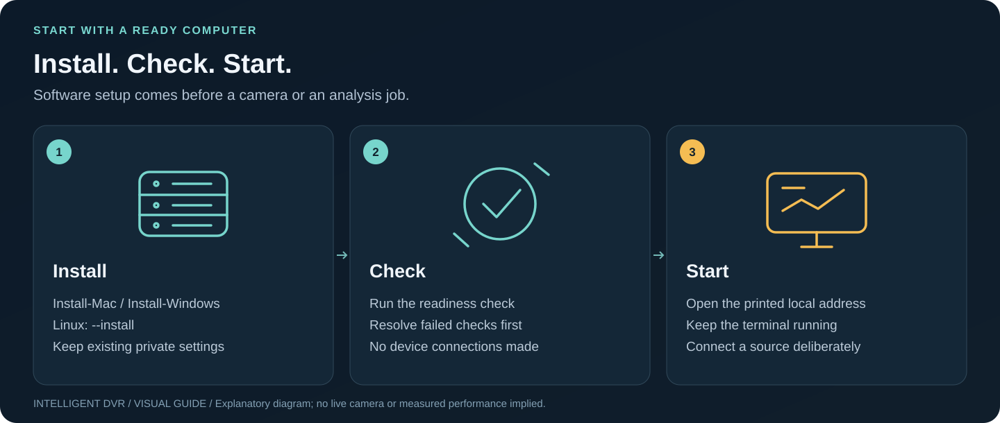

# Run on Linux

[Guide index](README.md) · [Visual handbook](how-to.md) · [Screenshot atlas](visual-atlas.md) · [Troubleshooting](troubleshooting.md)



**Quick path:** Install prerequisites and the isolated PC runtime → prepare local models → run Check → Start the foreground loopback service.

[Hardware and storage](hardware-guide.md) · [GPU plan](gpu-planning.md) · [Resource limits](resource-controls.md) · [Windows](setup-windows.md)

Reference target: **Ubuntu 24.04 LTS x86-64**, Node.js **22**, Python **3.12**, a WebGL-capable desktop browser. Canonical lists standard security maintenance for Ubuntu 24.04 through May 2029 [L1]. A desktop is convenient for review; a future recorder service can be headless, but no such service is installed by these instructions.

## Prepare the machine

1. Verify CPU cooling, motherboard firmware/RAM QVL, disk/HBA/backplane compatibility, PCIe lane allocation and UPS behavior. Start with the [hardware candidates and arithmetic](hardware-guide.md), not a claimed camera count.
2. Install the OS to its own SSD. Have the storage operator provision the selected recording array/filesystem and mount it at a deliberate stable path. Keep recordings and model files outside the repository. The launcher never partitions, formats or mounts disks.
3. Install Python 3.12 with venv support through supported OS tooling. A source checkout additionally needs Node.js 22 from the [official distribution](https://nodejs.org/en/download) and Git; the prebuilt kit does not. The installer checks interpreter versions.
4. Use an unprivileged account. Review encryption, recoverable backup keys, permissions and restore procedures for the data store. Do not expose the development preview directly to the internet.

## Install and run for PC testing

Use the [PC test kit and first-device checklist](pc-testing.md) for the simplest
installation. The prebuilt kit needs Python 3.12; Node/Git are only needed when
building a source checkout.

From the extracted kit or repository root:

~~~bash
bash scripts/run-linux.sh --install
bash scripts/run-linux.sh --check
bash scripts/run-linux.sh
~~~

Install uses the exact pins in edge/requirements-qualification.txt inside .venv,
creates an empty local-feeds.json only if absent, and exits without starting a
server. In a source checkout it first runs npm ci and builds the UI. The Check
step validates files, native video support, temporary storage, config and port
availability. Start runs the actual local camera service at
http://127.0.0.1:4173 and opens the browser; cameras remain disconnected.

Stop with Ctrl+C. DVR_PORT=4175 selects another port; DVR_PYTHON selects a
Python 3.12 executable. An incompatible environment is refused, not replaced.
Keep the origin/port stable for saved browser reviews. Add --no-browser to avoid
opening a browser. Reinstall after source updates to rebuild the interface.
DVR and optional recording-analysis settings are documented in the PC guide.
For opt-in recovery of the last recording analysis, add **--state-dir** to Check
and Start as shown in [Linux analysis recovery](pc-testing.md#optional-linux-analysis-recovery).
Use **--temporary** to bypass saved state without deleting it. Neither mode
automatically connects a camera or runs analysis.

## Compare with the host

Select an existing path on the actual recording volume, not merely the OS/project disk. Use a new output filename each time:

```bash
.venv/bin/python -m edge.host --path /srv/dvr/recordings --gpu \
  --output /tmp/dvr-host-001.json
```

The path must already exist. The fixed optional GPU query reads NVIDIA names/VRAM only; it does not install a driver or change power/clocks. Import the file locally using **System → Import local host snapshot**. Hostnames, usernames, IPs, serials and selected disk paths are omitted. A snapshot reports point-in-time OS totals/free space; it does not establish RAID health, CPU entitlement, decode throughput or 100-camera support.

Use **Use reported CPU count & RAM in draft** only after checking the snapshot's origin/date. Physical RAM is not necessarily available to this process under containers/cgroups. Disk selections may refer to the same filesystem; do not sum them without checking.

## Export and use explicit analyzer limits

Export **dvr-resource-policy.json** from System to a private local path. Validate without starting inference:

```bash
.venv/bin/python -m edge.resources --policy /private/dvr/dvr-resource-policy.json
```

After deliberately obtaining the compatible model and approved recording described in the [edge guide](../edge/README.md), an example invocation is:

```bash
.venv/bin/python -m edge.analyze \
  --video /private/dvr/dock.avi \
  --model /private/models/object_detection_yolox_2022nov.onnx \
  --labels edge/labels/coco80.json --profile opencv-zoo-yolox-s-2022nov \
  --rules edge/rules.example.json --camera dock-01 --stride 5 \
  --resource-policy /private/dvr/dvr-resource-policy.json \
  --output /private/dvr/receipt-001.json \
  --trace-output /private/dvr/trace-001.json
```

Paths are examples; input files and output directories must exist, and output files must be new. Review the example rule for the intended recording before using it. Policy caps apply to OpenCV threads and decoded-frame count; explicit flags may lower but cannot exceed them. Rule max-gap checks still apply. This is **offline CPU analysis**, not live capture or GPU inference.

## Optional OS containment, separate from the app

For a deliberately launched offline task, an operator can wrap its full command in a transient `systemd-run --user --scope` with reviewed `CPUQuota`, `MemoryHigh` and `MemoryMax` properties. For example, `CPUQuota=400%` means approximately four CPUs' worth of execution time, not 400% of the whole host. `MemoryMax` can terminate a task under pressure; choose it after measuring native/model allocations and preserve source recordings [L2]. Availability depends on controller delegation and the host's systemd/cgroup configuration.

These OS controls are not set by System, its policy or the launcher. Do not infer a process-wide CPU cap from `opencv_threads`, or a RAM cap from the retained-payload queue. No service unit is installed or enabled here.

## Before relying on the machine

Run the repository checks, then qualify the actual storage/decoder/model workload. Test long writes and concurrent reads, full-disk handling, disk/worker failures, UPS shutdown/recovery, reconnect behavior once ingest exists, time synchronization and retention deletion. Keep recording separate from analytics sample drops. Follow the [100-camera qualification ladder](performance-100-cameras.md).

GPU driver/backend installation and acceleration parity remain deliberate separate work; see [GPU planning](gpu-planning.md). Confirm system sleep/power/reboot policy with the owner before unattended operation; the launcher changes none of it.

## Primary OS references

- **L1:** [Canonical release cycle](https://ubuntu.com/about/release-cycle), [Ubuntu 24.04 release notes](https://documentation.ubuntu.com/release-notes/24.04/).
- **L2:** [systemd resource control](https://www.freedesktop.org/software/systemd/man/latest/systemd.resource-control.html).
- [OpenZFS Ubuntu installation reference](https://openzfs.github.io/openzfs-docs/Getting%20Started/Ubuntu/index.html); storage provisioning is outside the launcher.
