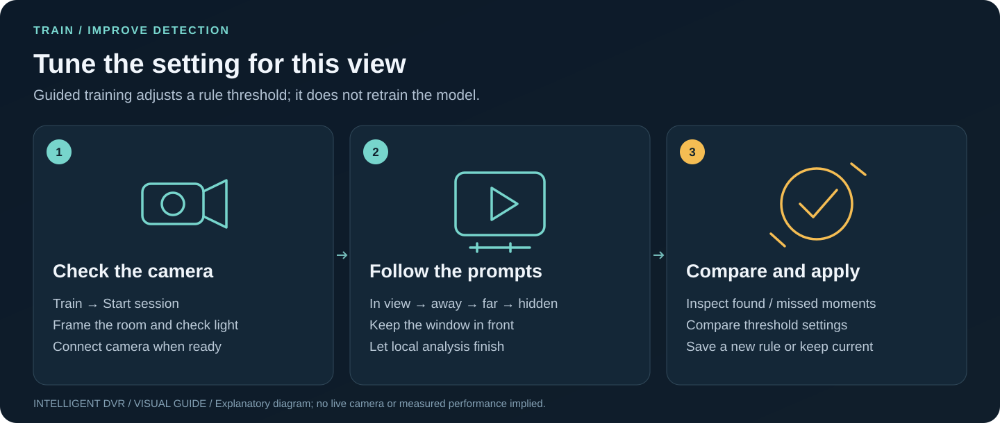

# Guided training

[Guide index](README.md) · [Visual handbook](how-to.md) · [Screenshot atlas](visual-atlas.md) · [Troubleshooting](troubleshooting.md)

**Quick path:** Train → Start session → check camera → follow prompts → compare thresholds → apply a new rule or keep the current setting.

**Train** turns detection tuning into one guided page. A session records about a
minute from this computer's webcam while on-screen prompts tell the person what to
do, analyzes the clip with the configured local CPU detector, compares what it saw
with what the prompts asked for, and suggests a detection threshold. Applying it
saves a new rule set that Recognition then selects by default. Video, results and
the saved setting stay on this computer.

Results describe this camera, room and session. They are not accuracy, camera or
operational qualification.

## Start

1. Start the local app with recording import and training enabled:
   - macOS: double-click `Start-Mac.command` (see the
     [Mac setup](setup-macos.md)).
   - Linux: `bash scripts/run-linux.sh --analysis --allow-recording-import --allow-training`
     with the recordings folder and catalog from the [analysis guide](local-analysis-service.md).
   - Windows: `.\scripts\Start-IntelligentDvr.ps1 -Analysis -AllowRecordingImport -AllowTraining`
     with the same folder and catalog.
2. Open **Train**. When it says *This computer is ready*, press **Start session**.

Without `--allow-training` a session still runs and shows results, but **Use … from
now on** stays disabled.

## A session

| Step | What happens |
| --- | --- |
| Camera check | Connect the webcam on this page (no microphone). A framing guide and a brightness check help before recording. |
| Guided recording | 54 seconds of prompts with a countdown: stay in view (10 s), leave the view (12 s), walk across the far side (14 s), stand partly hidden (10 s), come back (8 s). If the window is hidden or covered, recording and the script pause and resume three seconds after it returns. |
| Analysis | The clip is imported into the recordings folder and analyzed by the selected catalog model as an ordinary job. |
| Results | Each prompt shows how many sampled moments found a person; the empty-room prompt shows false alarms. A slider compares the current and chosen thresholds, including how many observations the rule would emit. Stills of misses and false alarms come from the analyzed copy in this page only. |
| Apply | Saves the chosen threshold as a new rule set and selects it by default in Recognition. **Keep current setting** records the session without changing anything. |

## How results are computed

- A sampled frame belongs to the prompt shown when it was recorded. Its position
  comes from its index among the decoded frames scaled to the recorded (unpaused)
  length, because browser recordings declare unreliable frame rates.
- The first two seconds after each prompt change are skipped while the person reacts.
- **Found** counts frames in the in-view prompts where a `person` detection meets the
  threshold. **False alarms** count frames in the empty-room prompt that do.
- The recommendation keeps the empty room at zero false alarms and adds 0.20 of
  headroom above the strongest empty-room score (minimum 0.40, range 0.30–0.90),
  because lighting changes scores: a wall portrait scored 0.26 in the evening and
  0.43 in daylight. If no threshold in range separates the person from something in
  the empty room, the current setting is kept and a zone is suggested instead.
- Observation counts use the analyzer's rule semantics: a run continues while
  matches are at most `max_gap` seconds apart.

## What is saved where

| Item | Location |
| --- | --- |
| Session clip | The configured recordings folder, as an ordinary import (same limits) |
| Trained rule set | `trained/trained-<hash>.rules.json` beside the analysis catalog, private permissions, never overwritten, at most 50 |
| Default selection and session history | This browser's storage (last 50 sessions) |

A trained rule set is a plain analyzer rules file, so the command-line analyzer can
use it with `--rules`. Move older files out of `trained/` and restart the app to
make room or retire them.

## Limits

One person, one camera and one room per session. The script does not prove what the
person actually did; skipped transition frames reduce but do not remove mistakes.
Training tunes a threshold on the pinned detector. It does not retrain the model,
identify people or qualify detection for other cameras, rooms or lighting.

To set a baseline for a specific, consenting person, see [person enrollment](person-enrollment.md).
