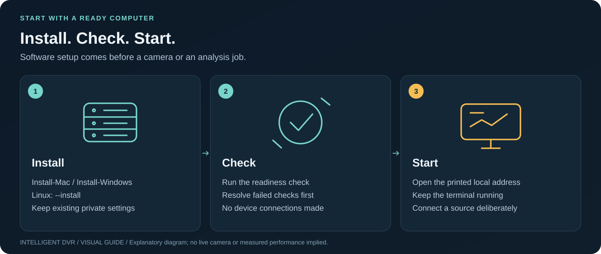
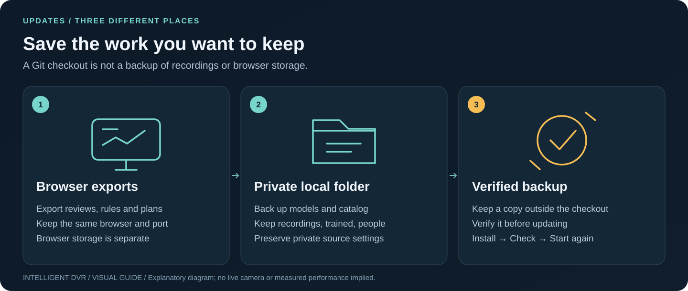

# Find the next fix

[Visual handbook](how-to.md) · [Mac setup](setup-macos.md) · [PC setup](pc-testing.md) · [Field runbook](field-acceptance.md)

Start with the readiness check for the same checkout you are launching.
**Check-Mac.command** checks the Mac source installation; PC **Check** uses the
Linux/Windows launcher. Check does not contact a configured camera.

| What you see | What to check next |
| --- | --- |
| Port 4180 is already in use | Open the existing Mac app, or stop its older terminal with Ctrl+C before launching this checkout. Keep the normal port/browser to retain browser saves. |
| Interface only / local analysis unavailable | Start the local service launcher and verify the Python environment, recordings folder and model catalog. Vite alone provides a browser preview. |
| Python dependencies missing or wrong version | Rerun the platform installer in this checkout; retain an incompatible environment and use a fresh folder if advised. |
| Model or catalog verification fails | Check the selected pinned files, SHA-256, relative paths, labels and compatible rules. Preserve the existing analysis folder while repairing it. |
| A camera preview is blank | Confirm the intended source, permission, device availability and receiving status. For DVR, verify the private host, port, credentials and RTSP path. |
| No DVR channels configured | In Monitor's DVR chooser, choose **Add camera or DVR source**. Explicitly connect to this computer if needed, then use the guided source form. Save it, return to Monitor and load/connect the channel deliberately. Cancelling a leave warning keeps your chooser and unsent observations. |
| Guided camera setup asks for the DVR Companion launcher | Start the Linux/Windows **DVR Companion** after normal installation; copy-only mode needs no model. An analysis-enabled PC launch also supplies the required library connection. Plain preview-only Start cannot complete this form. Preserve settings, restart appropriately and reconnect, or use the [manual source-file alternative](local-camera-feeds.md#manual-configuration-alternative). |
| Live AI session expired after restarting the app | In Monitor's Live AI settings, choose **Check again**, then explicitly **Start AI**. Rechecking preserves unsent observations and does not start inference. A network preview ended by the restart needs its own reconnect. |
| Public webcam fails | Confirm the provider-permitted direct HTTPS JPEG/MJPEG source and availability; HTML players/HLS are not bundled formats. |
| Recording cannot open or decode | Keep the original. Verify supported container/codec and a complete copy; analyze a separately converted copy when necessary. |
| Partial or unverified result | Read the coverage status and frame/time limits. Partial/unknown coverage is not complete coverage. |
| Browser playback fails after native analysis | The browser may not support that codec. Keep the original, convert a copy and analyze that new encoded file. |
| Overlay/result does not match a file | Select the exact analyzed source bytes. Re-encoding changes the hash and must not inherit old boxes. |
| Training does not offer to apply a setting | Check the fresh recording result. Apply needs at least three scored in-view samples and three empty-room samples, confirmed conditions, and a different threshold that improves one count without worsening the other. Check timing on both recordings, use a single whole-frame person rule and enable `--allow-training`. A regression on saved compatible evidence or a library read/save error can also block Apply; inspect those messages and preserve/export the measurement before retrying. [Combined evidence](training.md#build-on-multiple-sessions) |
| Suggested threshold has more digits than the slider | Automatic tuning can choose an observed-score boundary between slider steps. Keep its exact value for the fresh check and saving; moving the slider deliberately selects a manual value and requires checking that new choice. [Threshold mathematics](science-and-algorithms.md#choose-a-useful-detection-threshold) |
| Tracking evaluation rejects an older trace | Preserve the original report, then re-analyze the approved source with the current tracker and evaluate a new trace/output. Review import compatibility does not make an older method/hash valid for current tracking evaluation. [Provenance requirements](tracking-evaluation.md#metric-provenance-and-reproducibility) |
| No local assistant models appear | Open the loopback-hosted DVR, verify your separately installed Ollama service and installed chat models, then choose **Find installed models** again. Remote/cloud entries and unsupported model metadata are excluded. Do not change the DVR service’s access checks. [Assistant setup](training.md#ask-the-local-training-assistant) |
| Assistant advice fails its measurement check | Use the measured scorecard and its required fresh-check/confirmation step. Refresh the model selection or retry explicitly; an assistant response does not override counts or enable Apply. [Assistant limits](training.md#ask-the-local-training-assistant) |
| Person enrollment is absent | Verify the two pinned face models and the enrollment-enabled launch path. Obtain consent before any capture. |
| Facility is blank or WebGL fails | A fresh plan is intentionally empty. Check browser WebGL support, then add a building or explicitly open an example. |
| Estimated views are updating or unavailable | Keep editing or saving. Release an active drag, then wait for the current view calculation. On failure choose **Try views again**, or simplify the plan. Totals/proposals stay unavailable until all needed camera views recover; missing geometry is not zero coverage. [Planner limits](facility-builder.md#visibility-model-and-evidence-limits) |
| Installer sheet is disabled | Save or discard edits and wait for the saved plan's complete estimated views. Retry failed views. JSON plan and collection backups remain available after their existing Save/Discard guards are satisfied. |
| Camera drag was cancelled | Leaving camera editing or changing the selection, view, floor or plan invalidated the gesture. Undo that changes the plan also cancels it. Release, then start a fresh drag; the old release does not commit to the new context. Units-only changes preserve the gesture. |
| A map request fails | Check the selected provider or use numeric coordinates/offline OSM import. Provider choice, search and tile loading are explicit actions. |
| Browser save fails or another tab changed the plan | Preserve exports and resolve the visible conflict/error before editing further. Do not reset storage to force a save. |
| Reviews or rules show a save conflict | Download this tab's version and the other version, then explicitly choose which to use. Later edits remain in memory while saving is paused. [Conflict recovery](review-and-events.md#resolve-a-browser-save-conflict) |
| All ten saved conflict copies are occupied | Open **Saved conflict copies**, download and inspect an older copy, then choose **Remove this copy** before retrying. No older copy is removed automatically. |
| Browser cannot coordinate workspace saves | Preserve review/rule exports before closing. The app keeps changes in memory when shared browser save locking is unavailable. |
| Train warns before leaving | Cancel to keep unfinished recordings, checks or consent input. If a decision finished but a browser save failed, download the measurement and inspect the save messages before leaving. [Training saves and exit](training.md#leave-or-restart-a-session) |
| A backup or LAN review transfer stalls | Use **Cancel backup opening** or **Cancel review transfer**. These operations also have a two-minute deadline and preserve the current review. Stop the connected recorder or backup separately if needed. |
| A local job's completed result opening stalls | Use **Cancel result opening**, then **Open results again** when ready. The opening has its own two-minute deadline. Reconnect if contact was lost; do not start another analysis just to retrieve the existing result. |
| Opening was cancelled or a newer review stays open | Leaving Recognition or hiding the page cancels pending file reads/downloads. A newer file choice or source match also supersedes older result openings, even when the newer file is rejected. The loaded review remains available; explicitly reopen the intended result or choose its file again. Background jobs have separate Stop/Cancel controls. |

## Before reinstalling or moving folders

Export browser reviews, rules and facility plans separately. Export temporary
last-job results before stopping the service. Back up private recordings, models,
catalog, `trained/`, `people/` and source settings outside the checkout. Keep the
old installation until the new Check and the saved-data inspection pass.

The [service guide](local-analysis-service.md#limits-and-recovery) documents fixed
failure codes, deadlines and recovery. The [recording coverage guide](recording-coverage.md)
explains complete, partial and unverified outcomes. Physical compatibility and
recognition quality still require the separate [field runbook](field-acceptance.md).
