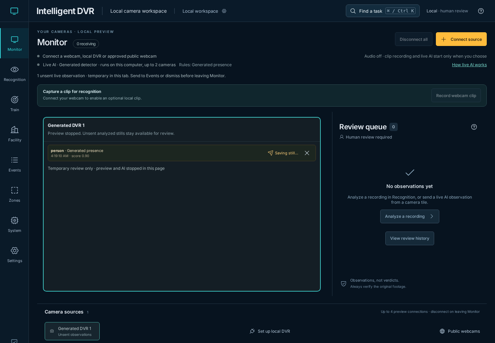
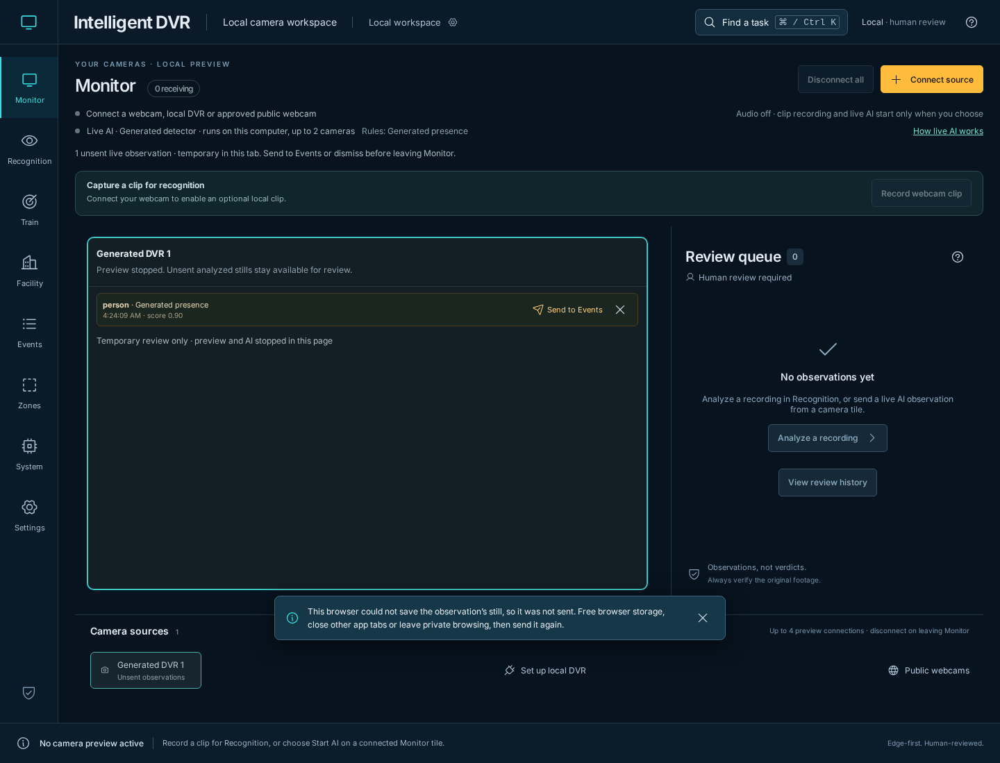

# Bounded browser image storage — November 11, 2026

[Verification index](../README.md) · [Live review guide](../../live-detection.md) · [Source fingerprints](source-hashes.json)

The baseline is merged PR #104 at
`1d4be3365b5efbf35ef5a22ba7bf56e1afb1b677`. All four PR workflows passed,
including the [full browser workflow](https://github.com/bartytime4life/Intelligent-DVR-Tool/actions/runs/42954338051)
and its native analysis/feed/recorder/backup stages. This record covers the next
scoped change identified by the adjacent SHA-256 manifest.

## Reproduced failure and recovery

A live observation's **Send to Events** awaits its browser still save. Previously,
an IndexedDB open or transaction that never delivered completion could leave
**Saving still…** and all live Send buttons blocked indefinitely. Disconnect
still stopped camera/AI activity, but could not release the save or Dismiss.
The new stalled-save browser regression failed against the baseline.

Image reads, writes, deletes and pruning now use a five-second budget per call
for opening the database and completing the transaction together. Timeout rejects
the operation and attempts transaction abort. Live review remains unsent, Send
and Dismiss recover, and a late completion cannot add an Event. Explicit retry
can save the retained analyzed still and queue exactly one observation.

| Lifecycle case | Result |
| --- | --- |
| Opening storage stalls or is blocked | Call fails within its budget, or promptly when blocked; further callers reuse the failed pending request rather than accumulating uncancellable opens |
| An abandoned open succeeds later | Its handle closes without becoming the cached connection; a later explicit attempt can open afresh |
| An abandoned open reaches schema upgrade | Its upgrade transaction aborts instead of creating stores after failure |
| Transaction completion stalls | Timeout attempts abort and releases the caller; late success remains ignored even if the browser already committed |
| Work or transaction creation throws | Call fails softly; a closed cached handle is released so another attempt can reopen |
| Another tab changes the database version | This page closes its cached connection so the other tab can proceed |
| Browser forcibly closes the connection | The cache is cleared for a later attempt |

The database name, version, stores, evidence-bound image keys, thumbnail grace
period and cross-tab retention locks remain unchanged. Image bytes stay local.
Camera Stop and Disconnect never wait for image storage. A write/delete already
committed by the browser cannot be undone by timeout; an unconfirmed still may
exist locally without an Event until explicit retry or existing orphan pruning.
Likewise, an unconfirmed zone-still removal retains the current display, without
claiming the persisted record survived. Suspended pages can delay timer delivery
until the browser runs their callbacks again.

## Inspected captures

These are Chromium captures of the local app using generated DVR frames. Both
were opened and inspected; no physical camera or private footage is shown.

## Validation and limits

- **536 Node tests passed.** Eight new storage lifecycle tests cover shared
  connection/commit semantics, one request across 1,000 retries, blocked and late
  opens, abandoned upgrades, abort and late commit, one combined deadline,
  version/forced closure and retry after failures. Their deterministic clock
  exercises the same deadline logic without waiting for production timers.
- **36 focused browser cases passed** across live feedback/review, recording
  still handoff, review navigation/save conflicts, cross-tab thumbnail retention,
  zone saves/reads/removal and newer still offers. Two new cases with real
  Chromium IndexedDB withhold completion notifications: a committed still cannot
  queue from its late callback after timeout; a late database handle closes,
  repeated attempts use one pending open, and retry opens the saved still in
  Events. Existing early live-review CI preflight includes both cases.
- **Three native live-AI browser cases passed** against the final production
  build using generated webcam input and a constant-output ONNX fixture. The
  existing isolated OpenCV 4.14.0, ONNX 1.23.2 and NumPy 2.5.4 environment differs
  from the qualification requirements' OpenCV 4.13.0.92 pin; this remains a local
  compatibility smoke.
- Production build, four Sites checks, documentation links and generated Wiki
  consistency passed. The existing Facility chunk-size warning remains. Protected
  inference, journal, supervision, scheduler and profiling sources, Sites runtime
  files and private runtime folders remain unchanged.

These generated checks do not qualify physical cameras, detection/tracking
accuracy, CUDA execution, endurance or 100-camera capacity.
