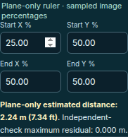

# Projective calibration mathematics — November 12, 2026

This record compares merged main
`66e6dd1cde9913e6c4f03fb94733e83dc3070c93` with the corrected planar solver.
All references, maps and test images are generated. No private footage, measured
site markers, physical cameras or detector execution are used.

Before publication, the branch also incorporates merged documentation main
`63b06ba2aab3adcffc38f52310b55969fb538afe` (PR #116). Its calibration source is
byte-identical to the historical comparison baseline above. All original
documentation receipts remain intact, and the new proof retains its original
baseline rather than relabeling it as a different experiment.

## Reproduced defects and correction

| Generated case | Baseline | Corrected solver |
| --- | --- | --- |
| `east = 1/u, north = v/u`, reference square `u,v = 0.2…0.8` | Rejects because the denormalized bottom-right matrix entry is zero | Accepts the finite, nonsingular region; the horizon at `u = 0` is outside the reference hull |
| Same map with a `1e-14` denominator offset | Rejects a safe region | Accepts with fitting and withheld residuals reported separately |
| Same map with `1e-10` offset | Exports coefficients around `1e10` after forcing the bottom-right entry to one | Keeps a bounded unit-Frobenius matrix |
| Five fit points on one ground line and a distinct withheld check | Tiny residuals pass the default declaration/tolerance gate; a distinct ruler pair collapses to zero | Refuses a degenerate ground plane |
| Sixteen noisy, non-collinear ground observations whose least-squares transform collapses to a line | Maximum fitting error is only 0.0072 m; the same gate can admit a zero ruler distance | Refuses the singular fitted transform independently of the destination hull |
| Multiply every matrix entry by `±1e-200` | Finite projections become unavailable because of an absolute denominator threshold | Equivalent matrix scales/signs preserve the finite projection |
| A projective horizon crosses the fitting hull | Refused | Still refused |

The strict [before/after reproducer](reproduce.py) and [numeric proof](proof.json)
bind both source hashes, expose the generated inputs and assert these outcomes.
The safe ruler endpoints are `(4,2)` and `(2,1)` metres; their distance is
`sqrt(5)`, displayed as **2.24 m** in the existing interface.



*Generated numeric example rendered in Chrome; no physical markers are measured
by this screenshot.*

## Mathematical basis and conservative guards

A homography is defined up to a nonzero global scalar. The
[OpenCV homography explanation](https://docs.opencv.org/4.13.0/d9/dab/tutorial_homography.html)
describes normalization by a bottom-right entry or by Frobenius norm. Requiring
that particular entry to be nonzero is unnecessary for a safe working region.
The [OpenCV calibration reference](https://docs.opencv.org/4.13.0/d9/d0c/group__calib3d.html)
also defines perspective projection in homogeneous coordinates.

The existing normalized Householder-QR fit remains. Method
`normalized-householder-dlt-v2` canonicalizes the final matrix to signed unit
Frobenius norm, scaling by the largest coefficient before taking the norm.
Projection compares denominator cancellation with the sum of the absolute
denominator terms; the hull horizon margin is relative to its largest vertex
denominator. Neither guard depends on arbitrary global matrix scale.

Ground collinearity is checked after point normalization. A separate normalized
matrix determinant screen rejects fitted rank collapse, including the noisy
two-dimensional destination example above. This screen uses `128 * Number.EPSILON`
on the unit-Frobenius normalized transform before world translation. These are
conservative numerical refusal heuristics, not a full singular-value condition
analysis or a bound on measurement error.

The independent-check requirement, operator plane declaration, both maximum
residual gates and refusal outside the fitting hull remain. Exports retain
schema `intelligent-dvr.planar-calibration.v1` and identify the changed method;
consumers must not assume that matrix entry `h33` equals one. There is no
calibration import or automatic persistent save introduced here.

## Independent arithmetic and browser evidence

The separate [oracle](oracle.py) computes expected points from exact `Fraction`
homographies and distances using 80-digit `Decimal` square roots. It never uses
either solver or projector to generate truth. The [candidate result](oracle.json)
and [baseline result](baseline-oracle.json) use the same input digest:

- 1,120 safe fitting/permutation cases across seven map families, five ground
  origins and four/six fitting-reference layouts;
- 880 direct projections, including positive/negative `1e-200` and `1e200` global
  matrix scales and exact-horizon refusals;
- 49 unsafe fits, including crossing/approaching horizons and collinear grounds.

The baseline fails 1,014 cases in this deliberately targeted corpus: 640 safe
fits, 350 safe projections and 24 unsafe fits. The candidate passes all 2,049.
This is not a sampled field failure rate. Maximum observed fitted point and
ruler errors are about `1.1e-12 m` in these exact generated cases; the comparison
tolerances and observed errors are not universal calibration-error bounds.

Studio browser cases enter the safe and collapsed references through the real
controls. They check the locked/declaration states, `sqrt(5)` measurement,
source-hashed export and outside-hull refusal. Correcting the collapsed references
restores the normal measured-declaration workflow. The generated image is a
small contrast fixture, not a physically observed reference plane.

## Reproduce and scope

From the repository root, with the existing Node environment and Python standard
library; output paths must be new:

```bash
node --test tests/facility-calibration.test.mjs
python3 docs/verification/calibration-projective-math-2026-11-12/reproduce.py \
  --output /tmp/new-dvr-calibration-proof.json
python3 docs/verification/calibration-projective-math-2026-11-12/oracle.py \
  --module src/facility-calibration.mjs --require-pass \
  --output /tmp/new-dvr-calibration-oracle.json
```

The before/after command needs the stated baseline Git object. Its temporary
baseline module is removed afterward. `--require-pass` makes the oracle return
nonzero for any failed case; the baseline comparison intentionally omits that
flag so its failures can be retained as diagnostic JSON.

[Validation](validation.json) records build, unit, Sites, browser, documentation
and preservation checks with their actual scope and source hashes. Full Python
native suites are not rerun for this browser-only numerical change. Existing
runtime/hosting sources, dependency pins, media and historical receipts remain
unchanged. No installed service is replaced, no camera starts, and no Wiki or
site is deployed by this record. Physical marker noise, optics, depth, survey
acceptance and recognition quality require separate representative evidence.
