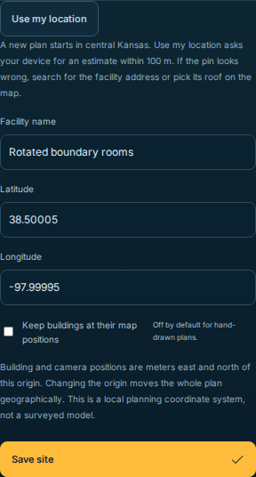
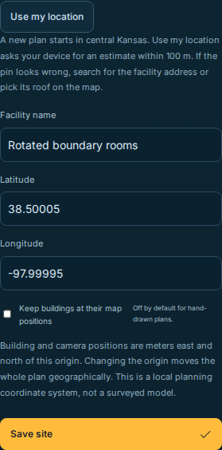

# Re-centering a generated boundary-sharing plan

This record isolates the origin-change correction from the other coordinate
checks in the [parent record](../README.md). It uses generated local planning
geometry only. No camera, location service, private media or surveyed site was
used; these results do not establish physical accuracy.

The frozen input is an exact 15 × 10 m rotated rectangle split into two rooms.
Room vertices sit at the midpoints of two exterior walls. Moving the origin
approximately 7.07 m previously rounded each transformed vertex independently.
That moved one boundary vertex about 0.3 micrometres outside its wall and caused
the unchanged containment check to reject **Save site**. The independent affine
reference remains valid. The correction changes the local grid directly, without
per-vertex rounding or a looser containment rule. Aperture widths transform as
wall-direction vectors before translation, avoiding endpoint cancellation.

The five modules in `baseline-src/` are exact public-source bytes from
`33fedd1bc364fc07cdb9331594aefef06bf52e6e`. The original receipt is unchanged.
[The baseline manifest](baseline-manifest.json) binds their hashes, the local
integration checkpoint and the original, machine-specific oracle script's hash.
That original script remains local because it embeds a home-directory path;
[the portable replay](replay.mjs) uses the same frozen input and algebraic
reference. It checks baseline hashes before importing the captured modules in a
temporary directory and removes that directory afterward.

From any checkout containing this record, run:

```sh
node docs/verification/coordinate-integrity-math-2026-11-12/reorigin/replay.mjs --repo . --require-pass
node --test tests/facility-reorigin.test.mjs tests/facility-doorways.test.mjs tests/facility-windows.test.mjs tests/facility-line-edit.test.mjs
```

The replay returns nonzero with `--require-pass` when the selected checkout still
rejects the fixture or differs from its affine reference. The committed replay
outputs distinguish the failing captured baseline from the passing candidate.
[The candidate check](candidate-check.json) also records the exact source and
unchanged frozen-input hashes. This one-case oracle is supplemented by
[25 focused Node checks](node-checks.log): 100 translated/rotated boundary
partitions across latitudes −79° to 79°, 80 successive changes/return trips,
all existing feature types and metadata, minimum aperture widths, no-op origins,
and invalid/out-of-grid recovery.

[The scoped browser report](browser-results.json) records two passing pinned
Playwright 1.56.1 Chromium cases at 1440 px and 375 px. Only the checkout prefix
was replaced with `<repo>`; test results, timings and counts are unchanged.
Its original unredacted report SHA-256 is
`c3b26fe212cd377237be74183cecdf63f927c8045af307d5acb381b67b7568e8`.
The cases reject an origin outside the 2 km grid without replacing saved work,
correct and save it, verify shared vertices and validation, Undo exactly, then
save again and reload. They block external providers. The screenshot crops show
the existing saved-site form, with no new controls.




Origin limits (longitude ±180°, latitude ±80°), the 2 km local grid, save guards
and Undo remain in force. Height/floor data and camera/stair physical dimensions
and poses retain their existing meaning; their anchors change grid coordinates.
The latitude-dependent grid scale is a planning projection. This record does
not claim an affine shear of parametrically rectangular stairs or survey-grade
geographic/dimensional preservation.
