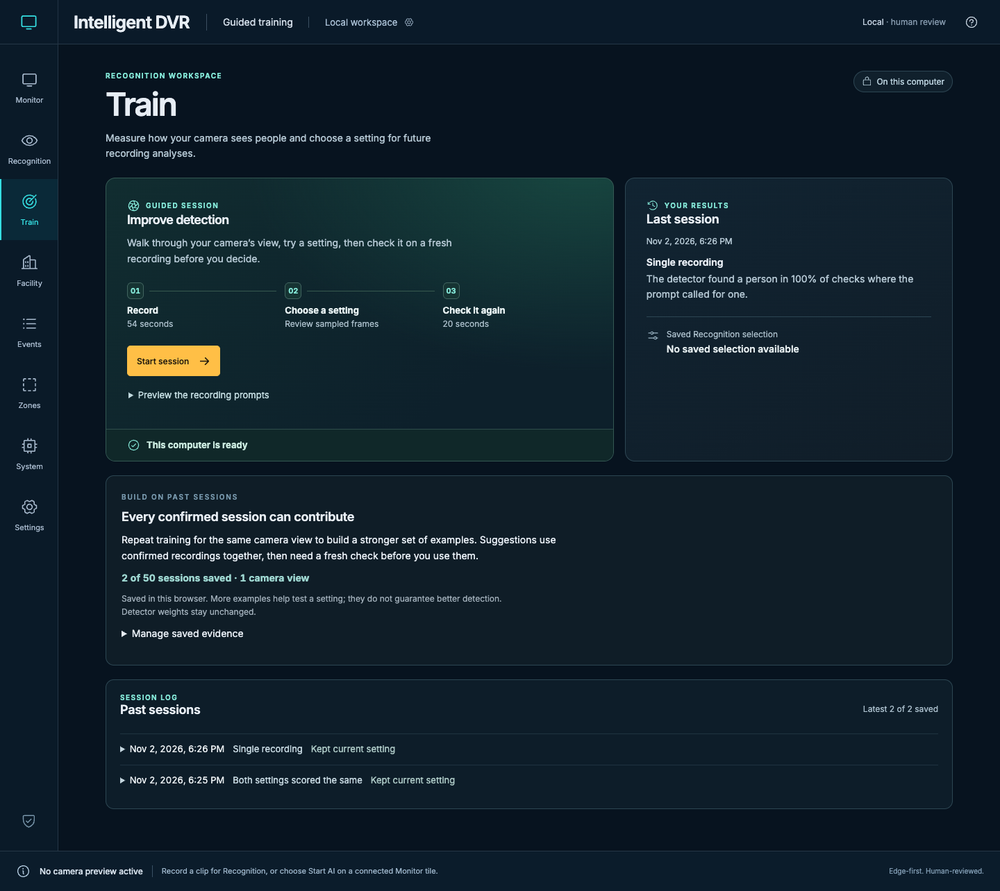

# Cumulative training verification — November 2, 2026

Implementation extends the fresh-recording training work merged in PR #78
(`a0b20e9`; original tested head `4d4d155`). The publication pass below tests
code commit `870e5f09fc7346ab7b73a00683db0d533a41c3d5` on that merged baseline.
[Source fingerprints](source-hashes.json) and [machine-readable results](summary.json)
bind the implementation and tests to this record. This is local software evidence,
not camera accuracy or capacity qualification.

## Publication checks

The final local run used macOS arm64, Python 3.12.15, Node.js 22.23.3,
OpenCV 4.14.0.94, NumPy 2.5.4, PyAV 19.0.2 and ONNX 1.23.2.

| Check | Passed | Failed | Skipped | Scope |
| --- | ---: | ---: | ---: | --- |
| Application frontend | 324 | 0 | 0 | Full suite with temporary loopback sockets enabled |
| Native Python | 337 | 0 | 114 | 451 total; platform/dependency skips on macOS remain skips |
| Sites packaging | 4 | 0 | 0 | Static/API routing and required build outputs |
| Training browser | 3 | 0 | 0 | Generated recording/import/inference, two saved sessions and reload, combined JSON receipt, explicit checked-rule selection and mobile recovery |

The production build, documentation checks, generated Wiki mirror and source
diff checks passed. Full platform CI is reported separately in the pull request's
GitHub Actions checks; local macOS results are not substituted for Linux/Windows CI.

The publication review also extended the browser lock through asynchronous
service checks and rule saving. A separate regression test queues another tab's
evidence write while a decision is in flight, then verifies that both records
survive without a nested-lock deadlock. Browsers without Web Locks require one
training tab at a time.



This capture and every displayed session use generated test inputs.
[Screenshot provenance](../../media/training-2026-11-02/cumulative-manifest.json)
records the code revision, dimensions and image hash. No owner session result
or private runtime file is published.

## Repeat the software checks

Use a prepared isolated runtime with the qualification dependencies and Chromium:

```bash
npm run build
DVR_TEST_SOCKETS=1 npm test
npm run test:sites
DVR_TEST_SOCKETS=1 python -m unittest discover -s tests -p 'test_*.py'
npx playwright test --config=playwright.analysis.config.mjs tests/analysis-browser/training.spec.mjs
python scripts/check-docs.py
python scripts/build-wiki.py --check
```

The browser configuration creates generated models and recordings under its
ignored test folders. It does not open physical cameras or operator recordings.

## Initial implementation checks

The earlier run at local commit `86050a4` is retained here with its
[original source fingerprints](initial-source-hashes.json); these counts are
not the newer publication counts above.

- Application unit tests: 322 passed, one existing skip. Includes pooling,
  compatibility across changed trained-rule hashes, per-recording regression
  guards, calibration-only fitting, distinct-source requirements, storage errors,
  the 50-session limit and actual scorecard apply gating.
- Three Chromium browser regressions passed on generated cameras and synthetic
  ONNX detectors. One records a calibration, a confirmed independent check and a
  second calibration; both sessions remain after reload, the second session
  uses the first, and existing history remains available. Another saves a checked
  improvement and verifies model/rule preselection in Recognition. The third
  checks unavailable-service recovery and mobile layout.
- Training timestamp tests: two passed. Local-service tests: 28 passed, six
  environment-dependent skips. Wiki checks: seven passed; generated companions
  match the guide sources.
- Production build and all four Sites packaging tests passed.

The browser checks use real recording/import/decode/inference contracts with
generated inputs. Their scores establish workflow behavior only. No physical
camera, owner recording, face template or private camera configuration was used.

## Product limits

Evidence belongs to this browser and exact origin. It retains up to 50 confirmed
sessions, refuses overflow and requires a matching named view, known camera key,
detector/label fingerprints, inference profile and non-threshold rule settings.
If the camera supplies no key, grouping relies on the operator's named-view
confirmation. Legacy summaries cannot be promoted into scored evidence.

Calibration sessions have equal weight; old fresh checks only guard regressions.
An apply decision requires a new confirmed fresh-check improvement and no loss
of person finds or increase in empty-room flags on any matching saved recording.
The service/model fingerprints are rechecked before saving a rule. This changes
thresholds for future recording analyses, not detector weights or old reviews.
Representative independently labeled footage is still needed to establish real
accuracy. Browser clearing, origin changes or user removal of evidence reduce
the available collection; exported count receipts cannot restore its raw scores.

The installed app's existing unsaved training result was left open during
implementation. After the operator chose to retain the current setting, its
summary was saved and verified after activation. Separate private readiness and
file-preservation receipts remain on the operator's computer. Browser evidence,
recordings, models, rules, templates and those private backups are excluded from
this publication.
