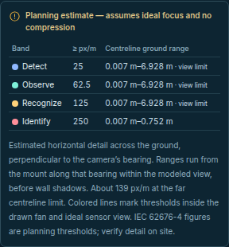
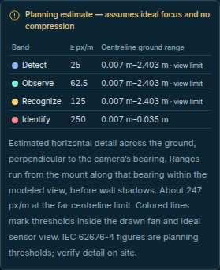

# Ground-detail projection — November 12, 2026

This correction starts from merged source
`63b06ba2aab3adcffc38f52310b55969fb538afe`. The previous DORI source has SHA-256
`ed5c69e046875a1eb69dc6a46674dca5d7d3d10664ae451a93e01ddacf85f098`;
the corrected module is
`323cee22e78d6663198e0a77c4c8db79b6f3c722a2625f1e981eb7253af2766e`.
All inputs below are generated. No camera, detector, private recording or
installed service is used.

## Reproduced error

The old planner substituted Euclidean slant distance for camera-axis depth in
perspective projection. Those distances agree on the optical axis, but differ
for general ground targets. Two valid camera configurations expose the error:

| Generated camera | Forward target distance | Previous density | Independent projected density | Corrected 250 px/m centreline interval |
| --- | --- | --- | --- | --- |
| 1920 px wide, 4 m mount, 60° tilt, 90° HFOV, 60° VFOV | 0.5 m | 238.1467 px/m | 258.4743 px/m | 0.006981–0.751797 m |
| 2000 px wide, same mount/FOV, 89° tilt | 0.02 m | 249.9969 px/m | 250.0163 px/m | 0.006981–0.034907 m |

Both transverse target endpoints lie inside the drawn fan and projected sensor.
The previous table reported **Not reached** for both 250 px/m bands.
[The strict before/after proof](proof.json) checks the old failures, corrected
intervals and new contours against separately projected 3-D endpoints.
[Reproduction script](reproduce.py):

```bash
python3 docs/verification/dori-projection-2026-11-12/reproduce.py
```

## One definition across the interface

The [science guide](../../science-and-algorithms.md#project-ground-detail-through-the-camera)
derives the transverse ground model from
[pinhole projection](https://docs.opencv.org/4.13.0/d9/d0c/group__calib3d.html).
The table and saved-plan installer show **centreline ground ranges**, including
the near limit. They describe the ideal view before wall shadows. Map labels
show band and px/m threshold, because equal-density contours are straight lines
perpendicular to the bearing, rather than fixed-radius arcs.

Contours are intersected with the actual drawn fan and both ideal sensor bounds.
Concave wall shadows retain disconnected fragments. A centreline band's
`reached`/`limited` flag does not suppress valid off-axis pieces. The numerical
screens retain positive-area boundaries, refuse isolated tangencies and merge
only within coordinate-scaled floating-point tolerance. Threshold contact within
arithmetic error does not create a positive interval. These are numerical
policies, not exact-rational or universal error guarantees.

The shared interval formatter adds decimal places when rounding would hide a
positive endpoint or collapse a positive interval. The default distance formatter
is unchanged. No controls or dependencies are added. Screenshots below are
actual Chrome output from generated 60° desktop and 89° narrow-screen cases;
extra displayed digits are not measured optical precision.





## Independent oracle

[The independent checker](oracle.py) uses a 3-D camera basis, two separately
projected transverse target endpoints, bisection for threshold roots and generic
polygon winding/cross-sections with sensor masks. Candidate helpers supply
observations, never expected projection, root or clipping results. It captures
the public module dependency closure before executing it.

The [compressed immutable corpus](inputs.json.gz) retains all 236 cases, including
tilts 0–89°, optical bounds, rotated/translated poses, concave shadows, sensor
clipping, collapsed views and invalid drafts. Its uncompressed SHA-256 is
`3bb534c91d32404bf42d0481984c45dad164945669a767c6378237fc1ae54bbd`.
[Baseline](baseline-oracle.json) and [candidate](oracle.json) use identical
checks and inputs: 4,621 failed baseline assertions versus zero candidate
failures. This deliberately targeted corpus is not a field failure rate.

The candidate checks 2,043 density queries, 908 table bands (507 positive and
401 empty), 227 valid contour cases, 143 fragments/715 sampled contour points
and nine invalid cases. [Coverage and actual tolerances](coverage-profile.json)
include horizontal sensor endpoints, vertical masks, fan boundaries and
off-axis-only pieces. Observed maxima and fixture tolerances are not universal
error bounds. The checker returns nonzero for failures with `--require-pass`.

```bash
dori_proof_dir="$(mktemp -d)"
python3 docs/verification/dori-projection-2026-11-12/oracle.py \
  --repo . --inputs docs/verification/dori-projection-2026-11-12/inputs.json.gz \
  --output "$dori_proof_dir/candidate.json" --require-pass
```

Adding `--revision 63b06ba2aab3adcffc38f52310b55969fb538afe` and a fresh output
path replays the historical baseline; its expected failing exit is **1**. Neither
command starts cameras, inference or network services.

## Validation and limits

[Validation](validation.json) binds application/test/record hashes to build,
583 Node passes with socket opt-in and no skips, four Sites checks, twelve
camera-planning Chrome scenarios, documentation/Wiki checks and independent
review. Python application suites are not rerun for this JavaScript change.
The existing large-chunk build advisory remains; it is not a measured latency
result. Hosted CI for the published head must be inspected separately.

The fan remains the existing radial-sector ground approximation with its
89.9° near-angle cap. This correction does not replace it with a calibrated
tilted rectangular frustum, change zone/route/rehearsal geometry, recover depth
from images or model elevated targets. Ideal optics, flat ground, zero roll and
entered pose/resolution remain assumptions. IEC pixel-density figures are
planning thresholds, not recognition, compliance or field-acceptance claims.
Physical detail, actual visibility, lenses, blur, focus and compression require
separate site measurements. Protected runtime/hosting sources, dependencies,
existing media and historical receipts remain unchanged. Wiki regeneration is
separate from publication; no merge, installation or deployment is performed.
