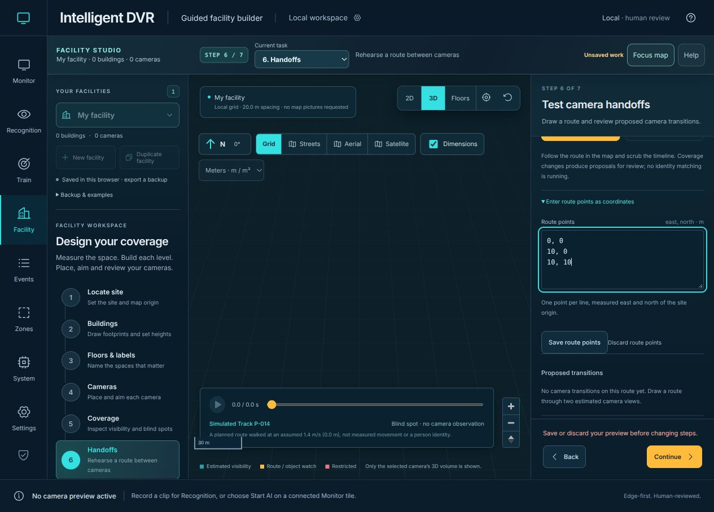
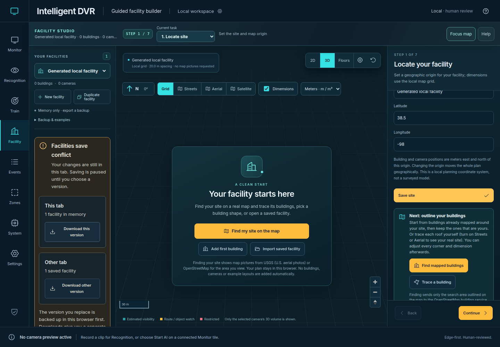

# Facility draft continuity and save recovery — November 9, 2026

[Verification index](../README.md) · [Implementation hashes](summary.json) · [Operator guide](../../saved-facilities.md)

This pass starts from main `c3f517851e05ea20d9c2def2dcd1365fb0e158d1`.
The summary binds the changed implementation files by SHA-256. Earlier dated
receipts and historical media remain unchanged.

## Captured flow and findings

1. **Open Facility in a narrow window — repaired.** The original fixed inspector
   left too little map and clipped map-layer choices at 662 px. The inspector now
   stacks below the full-width map at intermediate widths. All four map-layer
   buttons remain keyboard reachable. These screenshots use the blank local grid;
   no external map layer, location request or device was activated.

   [Before](01-narrow-before.png) · [After](02-narrow-after.png)

2. **Enter a route draft and try another task — protected.** Coordinates remain
   visible; task changes refuse the unfinished edit. Units and floor changes
   cannot reinterpret an existing list. Save and explicit Discard stay available.
   Pasted facility JSON and map extracts similarly retain unfinished work, and
   collapsed map panels retain reviewed candidates and partial area drawings.

   

3. **Recover a two-tab save conflict — verified with generated plans.** Failed
   local storage retains the in-memory plan. A different tab's save produces two
   downloadable versions and an explicit choice. The displaced version must be
   backed up before replacing or adopting a collection. Corrupt originals are
   preserved, ten occupied backup slots block replacement, and removal requires
   downloading the exact copy first. Valid copy downloads preserve directly
   importable collection bytes, including near-limit collections.

   

## Implementation and checks

- Shared exclusive browser locks serialize complete collection writes. Pending
  saves use the latest in-tab collection, and recheck remote bytes and local edit
  ownership after waiting. Recovery also rechecks any newly entered preview.
- Choosing another version remounts the editor even when the active facility ID
  is unchanged. Storage failures preserve the pending collection and offer retry.
- Explicit discard invalidates pending file/network generations; late results
  cannot replace a newer map lookup or resurrect discarded outlines.
- Losing window focus cancels a camera drag, restores map interaction and removes
  its release handlers without committing the cancelled movement.
- Local frontend/domain checks: **424 passed, zero skips**. Production build,
  four Sites packaging checks, documentation and generated Wiki checks passed.
- Full local browser regression result: **pending completion**.

The in-app browser captures were inspected from the saved files. Automated
browser cases use generated local plans and controlled responses. This is not
physical-site, survey, recognition-quality, endurance or 100-camera acceptance.
Keyboard/control checks do not establish full assistive-technology compliance.
No cameras, inference, installed services, recordings, models, deployment or
native GitHub Wiki publication were activated or changed. The five pinned
overload-evidence Python sources remain byte-identical to the base.
