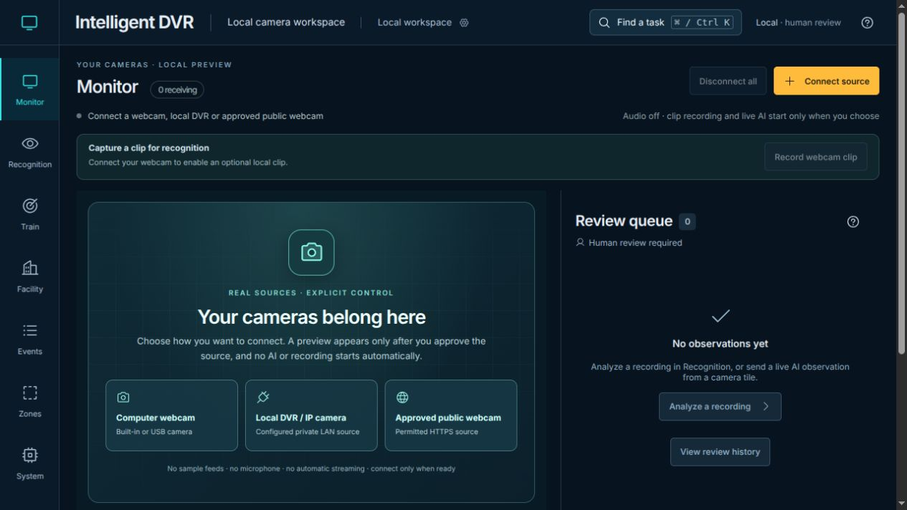
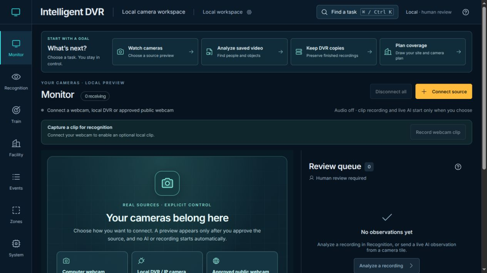
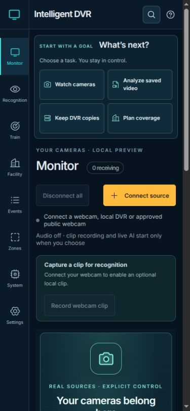
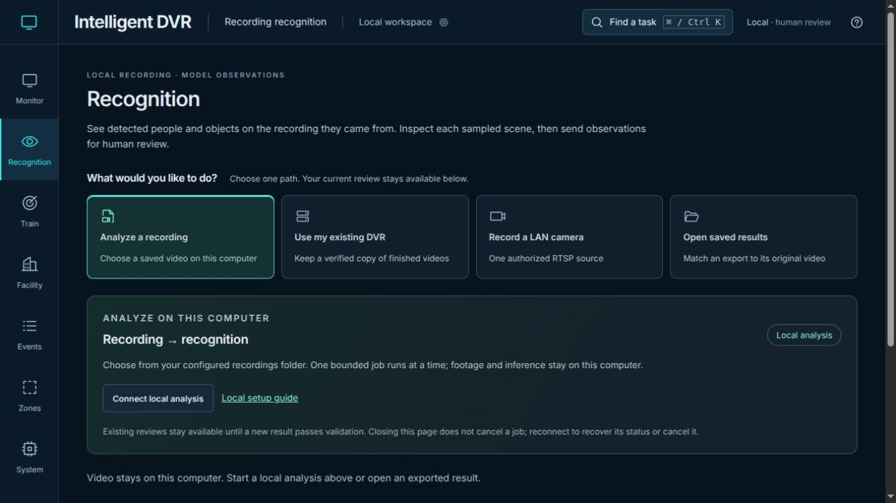
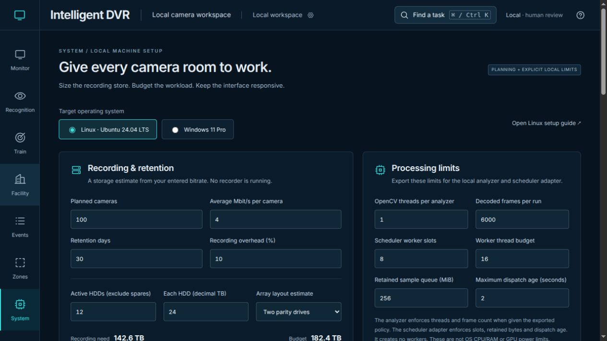
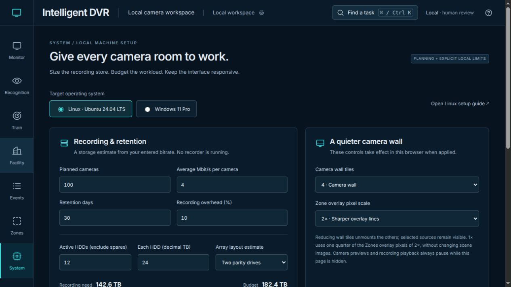
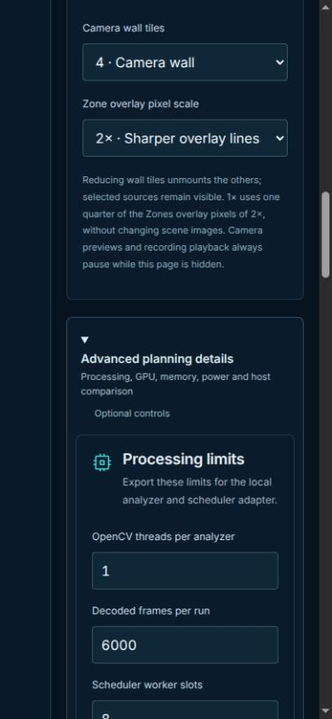

# Guided tasks, recovery and planning — November 11, 2026

Baseline: `5413ccb36dfc97f5ddd6c1e875e9c55ba3ab280d`, with the same file tree as final PR #108 review head `517df2529015689b2327b8513452cf9e6975580d`. All four hosted PR workflows for that baseline passed. This follow-up is isolated on `codex/seamless-experience-20261111`. It preserves the established navy/teal interface, explicit starts and unfinished work.

## Captured experience review

These screenshots were captured from the actual local app during this review. They show empty/generated software states, with no camera, recording, person template, credential or real site. Desktop images are 1265×712; mobile images are 375×812 pixels. They are viewport captures, not whole-page or human-study evidence.

1. **Monitor — clearer task entry.** The existing empty wall correctly asked for an explicit camera connection, but recording and backup users had no equally direct first step. A compact goal guide now opens existing guarded routes; Watch cameras focuses Connect source without activating it. Footer guidance follows the current workspace.

   
   
   

2. **Recognition — recovery and newer intent protected.** Existing task cards remain. Monitor's DVR chooser now opens the existing guided camera form, focusing explicit computer connection first and retaining the request and unfinished fields. Shared review intent prevents a slower job, segment or backup download from replacing a newer file/source choice, including rejected files. Leaving Recognition or hiding the page cancels review opening without cancelling background jobs.

   

3. **System — basic controls first.** Storage and camera-wall settings stay visible; processing, GPU, memory, power and host comparison live in Advanced planning details. Inputs remain mounted, unapplied advanced edits remain visible in the summary, and validation/save warnings remain outside the disclosure.

   
   
   

The separate [independent review](review.md) records visual/code scope and limitations. Keyboard, delayed-module, navigation cancellation and responsive assertions complement these screenshots; they are not a WCAG conformance or novice-usability study.

## Reproduced defects and repairs

- **Expired AI session.** A local-service restart rotates the token. Start/frame requests then returned SESSION, but Monitor retained ready setup and offered no recheck. It now exposes Check again, keeps preview and unsent stills, and requires a separate Start AI. A delayed old detector cannot invalidate a newer recheck.
- **Cross-source review race.** Panel-local cancellation did not protect the shared review. The new intent is claimed before file reads, session discovery and downloads, checked again at the final state mutation, and invalidated on hidden Recognition. Completed-job discovery cannot claim over a newer pending or rejected import. Existing single-flight bounds, timeouts, Stop and Cancel controls remain.
- **Narrow-zone arithmetic.** A validated 0.1×20 m zone could have zero sample centers and report 0% coverage even inside one enclosing fan. Fitted rectangular cells now sample that zone: one enclosing fan gives 100% coverage; two give 100% overlap. Blind overlays use actual cell extents. Irregular polygons still missed by the bounded grid report null/unestimated percentages instead of 0% or no blind areas. The 20,000-cell cap remains.
- **Training choice loss.** Changing combined evidence remounted the actual scorecard and discarded manual thresholds and expanded controls. The key no longer depends on evidence mode. Automatic choices follow recommendations; explicit choices persist; Reset restores automatic mode; fresh checks retain the tested pair. The actual threshold slider also now has an accessible name.
- **Cold task focus.** A Watch handoff could precede the lazy Monitor module. A navigation-bound request now waits for the real Connect button and completes only while the workspace still owns focus. User interaction or a newer navigation cancels it; no polling or operational start is introduced.

## Verification

- Baseline controlled probes: both new coverage Node cases fail; both expired-session browser cases fail; eight of nine cross-source intent browser cases fail (the existing local-analysis guard already protects one). The revised native training regression reaches the checkbox and fails because its manual editor disappears. The generated scorecard cases also expose automatic-selection and accessible-name defects in the baseline component.
- Candidate: **551 Node**, **545 Python** and **4 Sites contract tests** pass with no skips.
- Browser coverage: **300 distinct scenarios** across General/Facility (231), review/recovery (34), native analysis/training (19), feeds (13), native recorder (2) and native copied-backup analysis (1). All are covered by passing runs after the focused corrections below; this is not a single all-green 300-case execution.
- The initial General/Facility execution passed 227/231. Two new session tests incorrectly assumed one startup check under development StrictMode; they now assert exactly one additional check per explicit retry. System's exact label selector included option text; the corrected test uses the control's accessible combobox name. An existing source-handoff test expected hidden imports to complete; its replacement verifies the new cancellation contract, preserved review/sample/source request, ordinary-return focus and explicit retry. No production source changed in response to these four test failures. The complete recovery/System rerun passes **14/14**, and source handoffs pass **7/7**.
- Production build passes with the existing large Facility Studio chunk warning.
- [Source hashes](source-hashes.json) bind changed source/tests and seven byte-identical runtime files. No edge implementation changed.
- Documentation links, generated Wiki-source freshness and whitespace checks pass. [Structured results and log hashes](results.json) retain initial failures and their successful targeted resolutions separately.

## Reproduction

Use the prepared project environments; build before Python/native checks:

```bash
npm run build
DVR_TEST_SOCKETS=1 npm test
DVR_TEST_SOCKETS=1 python -m unittest discover -s tests -p 'test_*.py'
npm run test:sites
DVR_BROWSER_CHANNEL=chrome npx playwright test --config=playwright.facility.config.mjs
DVR_BROWSER_CHANNEL=chrome npx playwright test --config=playwright.library.config.mjs
DVR_BROWSER_CHANNEL=chrome npx playwright test --config=playwright.analysis.config.mjs
DVR_BROWSER_CHANNEL=chrome npx playwright test --config=playwright.feeds.config.mjs
DVR_BROWSER_CHANNEL=chrome npx playwright test --config=playwright.recorder.config.mjs
DVR_BROWSER_CHANNEL=chrome npx playwright test --config=playwright.library-native.config.mjs
python scripts/check-docs.py
python scripts/build-wiki.py --check
git diff --check
```

Browser transport replies and native model/video fixtures are generated. No private recording, physical camera, model download, owner-machine installation, Wiki publication or deployment is part of this pass. UI and CI evidence do not qualify field accuracy, OEM compatibility, CUDA execution or the 100-camera workload.
