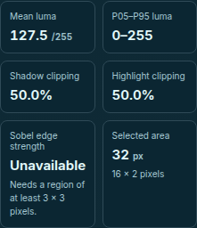
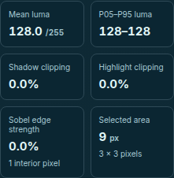
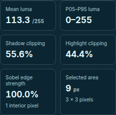
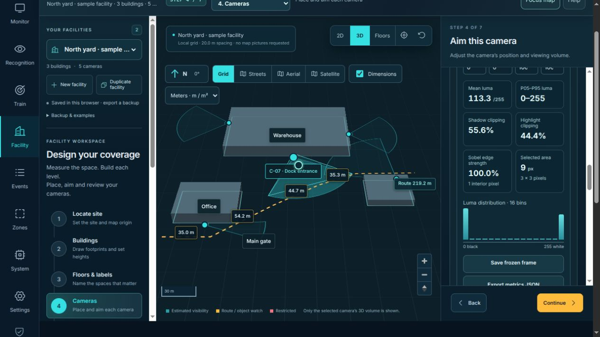

# Image diagnostics mathematics — November 12, 2026

This branch corrects two reproducible image-laboratory defects: a valid 3×3
patch could report **111.8%**, and a region with no 3×3 support reported the same
zero as a measured flat region. The corrected maximum is **100%**, and missing
support is **Unavailable / JSON null**. The existing interaction stays explicit
and local. This is proposed source until merged, not an installed/deployed update.

## Revision and implementation

Base: `63b06ba2aab3adcffc38f52310b55969fb538afe`, tree
`516e61057d4cf7b8ed31d855cbf24d5671f3ab8f`. The isolated branch is
`codex/image-diagnostics-math-20261112`. The commit containing this record binds
its complete tree; [source-manifest.json](source-manifest.json) independently pins
the three production and two regression files tested here. No earlier unmerged
calibration or DORI proposal is included in this branch.

| Module | SHA-256 |
| --- | --- |
| Baseline image science | `6f576c07939b35ed2a479494b1dc1ebdaeba8ba9fc1fe715dff814268124c7f9` |
| Candidate image science | `fbe7708e6226c5ece2310c2d71c8a1b703e7b5ff8461e19398ee2ee50b9cc001` |
| Independent Python checker | `7b7749a149334cc19df6438396a2eda25bf0047e0a048129aed0d2067e0eb2a7` |
| Decompressed immutable corpus | `8bd19566065866c46fbbfb5ba185b8b54935ea58397a9d0c82d6a5397f987591` |

The original 3×3 unscaled kernels and ROI policy are retained. Instead of dividing
by `4 × 255`, each Euclidean response is normalized by the tight maximum
`255 × √20`; the mean is then expressed in percent. This keeps results in range
without a clamp. It is a mean of magnitudes, not RMS or a percentage of edge pixels.
The UI adds the interior-pixel count, effective ROI dimensions and an enlargement
hint when support is absent. A valid zero still displays **0.0%**.

Exports keep their filename and prior frame/source/ROI fields, bump the schema
to `intelligent-dvr-image-diagnostics-v2`, and identify
`srgb-luma-sobel-max-v2`, raw mean magnitude, denominator, sample count and
processing semantics. No v1 file is rewritten. See the [operator contract](../../facility-image-diagnostics.md#export-version-and-compatibility).

## Mathematical proof and independent comparison

[OpenCV's kernel equations](https://docs.opencv.org/4.13.0/d2/d2c/tutorial_sobel_derivatives.html)
supply the standard Sobel matrices and Euclidean magnitude. The implementation
is JavaScript; no OpenCV runtime or example blur/border/display pipeline was run.
Our bound follows from convexity: squared norm of the linear kernel map on the
continuous cube `[0,255]^9` cannot exceed its largest binary-vertex response.
[proof.json](proof.json) enumerates all 512 vertices exactly. Maximum squared
response is `1,300,500 = 20 × 255²`, attained by 16 patches including the unused
centre bit. The patch `[0 0 255; 0 0 255; 0 255 255]` has gradients `(1020,510)`
and achieves the bound. This proof covers all rounded luma bytes.

The independent checker uses flattened matrix dot products, rational
black-composited channel-weighted sRGB luma and 70-digit Decimal square roots.
It does not import application geometry or use the candidate's indexed gradient
expressions. Random color fixtures exclude exact rational half-luma ties so the
existing JavaScript floating rounding convention is not silently redefined.
The all-byte kernel bound is independent of that corpus restriction.

| Check | Strict baseline | Frozen candidate |
| --- | --- | --- |
| Cases / generated images | 611 / 606 | Same corpus |
| Assertions | 10,472 | 10,472 |
| Failed assertions | 3,031 | 0 |
| Process exit with `--require-pass` | 1 | 0 |

Baseline failures include 555 Sobel-value assertions, 32 bound assertions, and
611 each for method, maximum, raw magnitude and support metadata absent in v1.
They overlap and include new-contract checks; they are neither distinct bugs nor
a field failure rate. The same checker and frozen corpus are used on both sides.
The strict exit gate existed before the candidate run. Contract-key confirmation
preceded the strict comparison; a later gzip-loading-only adaptation preserved
all case bytes and mathematical checks. Root independently replayed both packaged
runs and obtained identical receipts: [root-replay.json](root-replay.json).

Groups: 512 binary, 21 constant, 16 grayscale-invariance, eight alpha-invariance,
40 random-RGBA, two ROI-boundary, six structured and six large-ROI cases. There
are 35 no-support cases, 56 supported measured-zero cases and 53 that distinguish
mean magnitude from RMS. The corpus includes a 720×720 thin-region example,
rotations/reflections/complements, crop isolation and unchanged input checks.

Comparison tolerance is `max(2e-10, abs(expected) × 3e-12)` per numerical field;
support/method/null checks are exact and the 0–100 range is checked separately.
Largest observed candidate discrepancies were about `1.835e-13` raw magnitude
and `1.332e-14` percentage points. These are finite-corpus observations, not
universal floating-point or camera-error guarantees.

## Reproduce without cameras or external data

From the repository root, with Python 3 and Node available, use fresh output
folders. The second command is intentionally expected to exit **1**.

```sh
python3 docs/verification/image-diagnostics-math-2026-11-12/check-sobel.py --module src/image-science.mjs --output /tmp/dvr-sobel-candidate-replay --require-pass
python3 docs/verification/image-diagnostics-math-2026-11-12/check-sobel.py --module docs/verification/image-diagnostics-math-2026-11-12/baseline-source.mjs --output /tmp/dvr-sobel-baseline-replay --require-pass
```

[check-sobel.py](check-sobel.py) defaults to the adjacent [inputs.json.gz](inputs.json.gz)
and accepts `--inputs` for an explicit JSON/gzip path. It snapshots decompressed
inputs and executed module bytes before invoking [runner.mjs](runner.mjs). It
writes expected values, observations, proof and a hash-bound receipt before the
strict exit decision. Gzip uses mtime zero and no embedded source filename;
compressed corpus SHA-256 is
`10da3f2fa766ce7e2d1a085529cfcdfd847543c75e22bf1877fc9c66684f8622`.
No corpus cases were removed to reduce size.

Retained results: [candidate receipt](candidate-receipt.json),
[baseline receipt, gzip](baseline-receipt.json.gz),
[candidate observations](candidate-observations.json.gz),
[baseline observations](baseline-observations.json.gz),
[candidate expected values](candidate-expected.json.gz) and
[baseline expected values](baseline-expected.json.gz). Hashes in the receipts
refer to decompressed JSON bytes. The baseline source snapshot is
[baseline-source.mjs](baseline-source.mjs); the candidate hash binds the live
repository module. Replays create their own immutable module snapshot.

## Local software validation

Build completed before the full Node suite. Local versions: Node 22.13.1,
npm 10.9.2, Python 3.10.9, Playwright 1.61.1 with Chrome 157.0.8103.50. Hosted
browser CI pins a different Playwright/Chromium pair and remains separate evidence.

| Command | Result |
| --- | --- |
| `npm run build` | Pass; Sites client/server/hosting outputs prepared |
| `DVR_TEST_SOCKETS=1 npm test` | 580 passed, zero failed/skipped |
| `npm run test:sites` | Four passed |
| `DVR_BROWSER_CHANNEL=chrome ./node_modules/.bin/playwright test --config=playwright.facility.config.mjs facility-studio.spec.mjs` | 11 distinct Studio cases passed |
| Independent checker, plus root replay | 611 cases / 10,472 assertions, zero candidate failures |

[Build log](build.log), [Node log, gzip](node.log.gz), [Sites log](sites.log) and
[browser log](browser.log) retain the actual runs. Existing bundle-size and color
environment warnings are retained. Full Python application suites were not rerun
for this browser JavaScript change. Final documentation and preservation results
are recorded in [validation.json](validation.json).

The three new browser scenarios verify unavailable and measured zero at 1440/375
pixels, recovery with Full frame, Frame B independence, mismatched A/B sizes,
no horizontal overflow, actual JSON downloads and the maximum 100% response.
Eight existing Studio cases also pass, including keyboard/focus recovery, alpha
composition, capture comparison and calibration flows. This is not the entire
Facility browser suite. New scenarios record no page errors.

Actual rendered metric crops, using only generated pixels:

| No support at 375 px | Measured zero at 375 px | Maximum response |
| --- | --- | --- |
|  |  |  |

Desktop crops: [unavailable](sobel-unavailable-1440.png) and
[measured zero](sobel-measured-zero-1440.png). The root also started port 4317,
opened the preview through the available browser, chose the built-in offline
example explicitly and opened a generated 3×3 PNG. The visible result was
100.0% with one interior pixel and no camera connected:



Independent final review found no blockers. The numerical reviewer replayed both
packaged strict runs, matched both retained receipts exactly, checked all five
source/test hashes and 23 artifact hashes, verified receipt/proof bindings and
repeated protected-file/historical-media preservation checks. A separate UX
review inspected mobile, maximum and actual-preview captures plus the export
contract and operator guides; no UX or documentation blockers were found.

## Preservation and remaining limits

[preservation.json](preservation.json) confirms the five protected runtime
sources, four protected hosting/Sites files and both dependency manifests remain
byte-identical to base. Primary checkout, earlier isolated work, original footage,
model files, historical evidence and existing media remain untouched. The Wiki
companions are regenerated as repository source; that does not publish the
separate Wiki. This work starts no camera, recording, AI job or model download,
replaces no installed service, and performs no merge or deployment.

The pure API still accepts generic array-like inputs with dimension/length checks;
this evidence covers valid byte RGBA, not malformed NaN/out-of-range arrays.
The existing percentage ROI fields round their displayed values to whole
percentages; sub-percent entry precision remains a separate issue. Actual sampled
width/height is now visible, without changing that control in this patch.
Browser resizing/codec effects and physical focus/noise/recognition performance
need separate evidence. No 100-camera, identity, optical or field accuracy claim
follows from these numerical checks.
