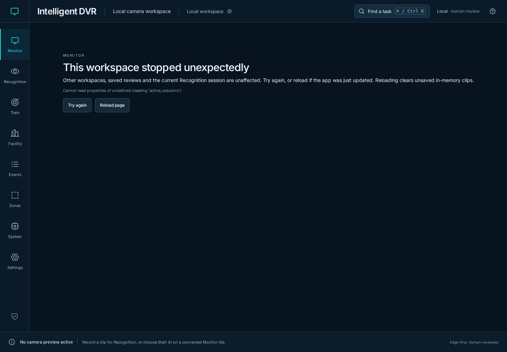
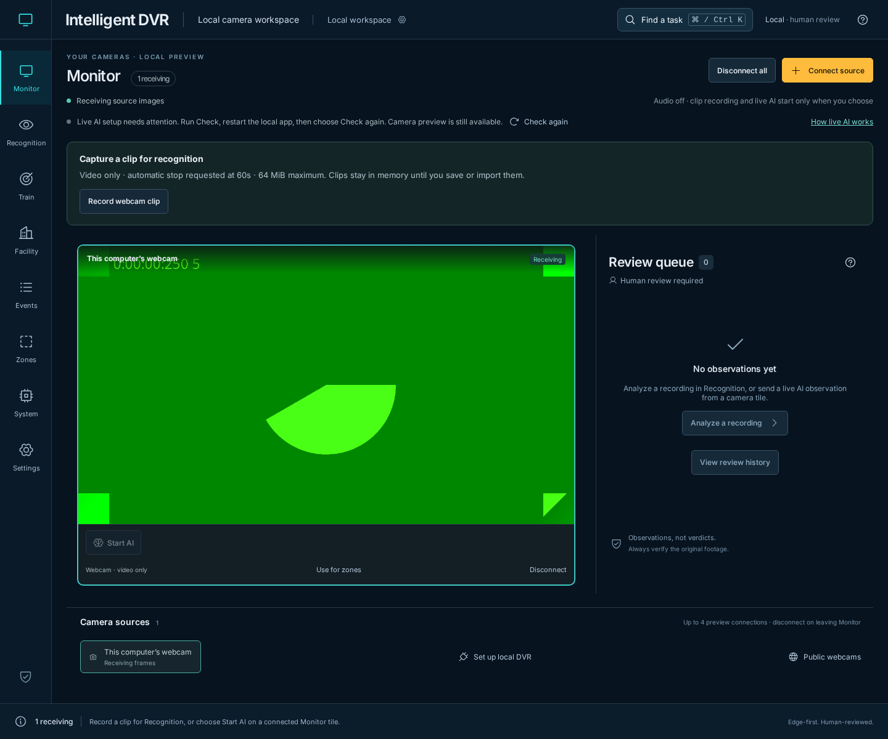
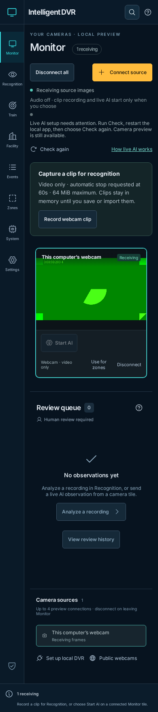

# Monitor setup recovery — November 11, 2026

[Verification index](../README.md) · [Live AI guide](../../live-detection.md) · [Source fingerprints](source-hashes.json)

The baseline is merged PR #101 at `7f69d02c90da2fd9c46be237ea2285272a9ec2b4`.
Its [complete browser workflow](https://github.com/bartytime4life/Intelligent-DVR-Tool/actions/runs/42929634248)
passed 190 UI cases and the native analysis, feed, recorder and OEM backup checks.
Linux/Windows validation, Mac source installation and PC-kit installation also
passed. This record covers the next, separately scoped local recovery changes.

## Reproduced problems and resulting behavior

| Trigger | Baseline | Updated behavior |
| --- | --- | --- |
| The local AI reply omits session limits | Connecting a camera crashes Monitor and stops its preview | AI setup is unavailable, the preview stays connected, and Check again can restore valid choices |
| A rule's compatible-model list is malformed | Monitor crashes while rendering choices | The reply is rejected before it reaches rendering or Start AI |
| An older check finishes after a newer successful check | Older choices can replace the newer result | Replaced requests are aborted and late completions are ignored |
| Narrow camera tile with AI controls | The old 270 px height clips Disconnect | Live tiles grow to fit their controls; the Disconnect bounds stay inside the tile |

No camera or inference starts from a setup check. Recovery tests confirm that the
same generated video track remains live after rechecking and no live-AI request
is submitted. Disabled or older service replies without live AI remain readable
as unavailable; missing choices are never invented.

## Inspected captures

These are actual Chromium captures from the local app. The green video is
Chromium's generated camera pattern, not a physical camera or private footage.
Both desktop and narrow captures were opened and inspected after saving.

## Validation and limits

- All three new browser scenarios first failed against the baseline: missing
  limits, invalid rule choices and a late reply. The mobile control-bounds
  assertion also failed before removing the fixed live-tile height.
- **513 Node tests passed**, including catalogue validation, compatible choices,
  independent copies, Unicode names, missing fields and invalid reference lists.
- **22 focused browser cases passed** across Monitor, AI feedback, review,
  navigation, unfinished training and browser-save protection. The nine Monitor
  cases were rerun successfully after the mobile height correction.
- **Three native live-AI browser cases passed** with the generated webcam and
  constant-output ONNX fixture: explicit start, boxes/tracks, Send to Events,
  stop/restart and refusal when the still cannot be saved. The local smoke run
  used the existing isolated environment: OpenCV 4.14.0, ONNX 1.23.2 and NumPy
  2.5.4. This differs from the qualification requirements' OpenCV 4.13.0.92 pin;
  it is a local compatibility smoke check, not a replacement qualification.
- Production build, four Sites packaging checks, documentation links and generated
  Wiki consistency passed. A packaging check initially ran before the build had
  finished and was rerun successfully after the build.
- The protected inference, journal, supervision, scheduler and profiling files
  remain unchanged from the baseline.

No physical device, enrolled person, external camera provider or CUDA execution
was exercised. These checks do not establish detection/tracking quality,
endurance, survey accuracy, physical touch behavior or 100-camera capacity.
