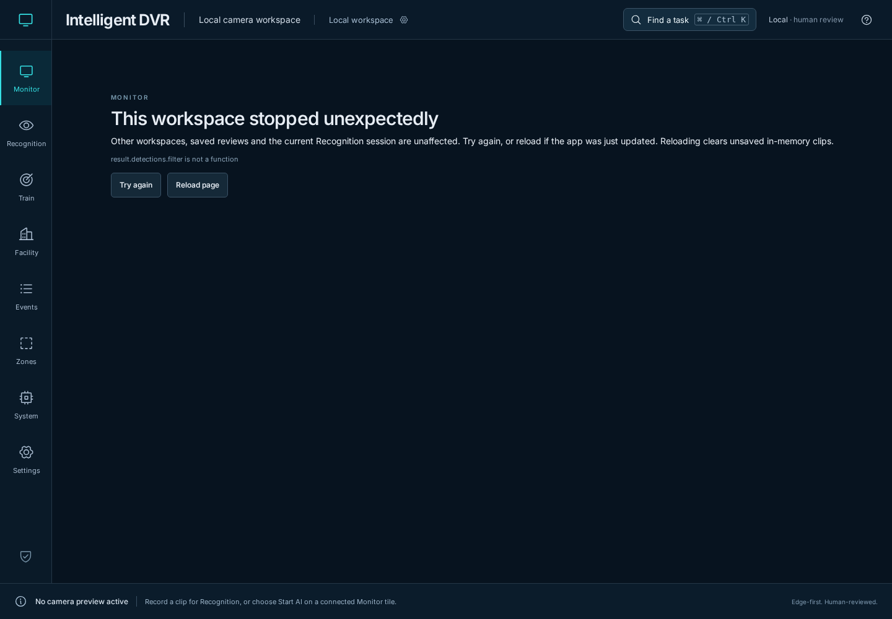
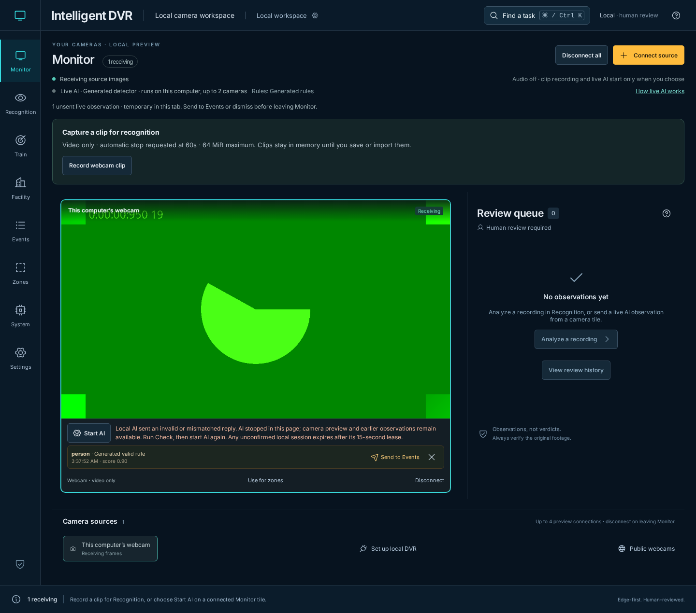
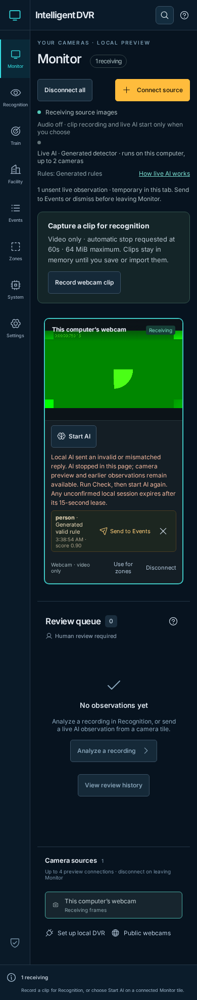

# Live AI reply validation — November 11, 2026

[Verification index](../README.md) · [Live AI guide](../../live-detection.md) · [Source fingerprints](source-hashes.json)

The baseline is merged PR #103 at
`8f6d3d58d132cf136b08e027d2a23200d771e579`. All four PR workflows passed,
including the [full browser workflow](https://github.com/bartytime4life/Intelligent-DVR-Tool/actions/runs/42950576988)
and its native analysis, feed, recorder and backup stages. This record covers the
next scoped change identified by the adjacent SHA-256 manifest.

## Reproduced failure and resulting behavior

A successful frame reply containing an object in `detections`, rather than an
array, reached the overlay renderer and crashed Monitor with
`result.detections.filter is not a function`. Its camera preview stopped and the
earlier unsent observation became inaccessible. That regression failed against
the baseline before the implementation changed.

Startup and frame replies now pass through a validation boundary before entering
Monitor state. Invalid data stops only that AI run in the page, clears its boxes
and counts, and leaves the same camera track and earlier unsent review available.
The operator can explicitly restart AI and send the earlier analyzed still to
Events. An invalid reply cannot prepend partial observations or replace that
still. No AI restart or Event transfer happens automatically.

| Boundary | Checks |
| --- | --- |
| Startup | Live state, canonical run/model hashes, camera/model/rule names and supplied model/rule IDs; the requested camera and supplied selections must match |
| Frame provenance | Accepted session ID, camera, model hash and model/rule names; supplied selection IDs cannot change or disappear |
| Rendered data | Worker-sized dimensions, finite scores/timings, normalized boxes and optional positive track IDs; safe metadata copies rather than raw payload objects |
| Collections | At most 100 reported detections and 100 observations per frame; track summary at most the model's 1,000-label ceiling |
| Review | Valid unique observation IDs, numeric scores/times, labels/rules and optional matching camera; duplicate retained IDs reject the whole reply |
| Compatibility | Missing optional older metadata stays optional; five-decimal box rounding, six-decimal event times and null idle inference timing remain valid |
| Stop | Invalid frames request Stop for the already accepted session, never an identifier from the invalid frame; late startup replies must validate before choosing a Stop path |

Malformed successful startup replies send no camera frame. If no trusted session
can be established, the existing backend lease expires without frames. Stop
requests retain their existing timeout and lease fallback. These consistency
checks do not authenticate a physical camera or establish recognition quality.

## Inspected captures

These are actual Chromium captures from the local app. The green webcam pattern
is Chromium-generated video; no physical device or private footage is used.
The baseline, desktop recovery and 390 px recovery captures were opened and
inspected. Narrow screens give the recovery message its own row.

## Validation and limits

- **528 Node tests passed.** New cases cover malformed/mismatched sessions,
  invalid JSON, shape/number/collection bounds, duplicate observations,
  independent copies, worker rounding and trusted Stop paths. Controller checks
  verify atomic preservation of earlier review and zero frame submission after
  a malformed start.
- **34 focused UI cases passed** across live feedback/review, setup recovery,
  Monitor cancellation, review workflows, navigation, unfinished training and
  save conflicts. The eight live-feedback cases passed again after the rounding
  correction; the narrow recovery case was repeated after its message layout
  adjustment. New cases also verify the same generated camera track remains live,
  explicit restart, successful earlier-still handoff and no horizontal overflow.
  These cases are included in the existing early browser CI preflight.
- **Three native live-AI browser cases passed** against the final production
  build, using generated webcam input and a constant-output ONNX fixture:
  explicit start, tracked boxes, still handoff, stop/restart and failed storage.
  The local compatibility smoke uses the existing isolated OpenCV 4.14.0,
  ONNX 1.23.2 and NumPy 2.5.4 environment. It differs from the qualification
  requirements' OpenCV 4.13.0.92 pin.
- Production build, four Sites packaging checks, documentation links and
  generated Wiki consistency passed. The existing Facility chunk-size warning
  remains. Protected inference, journal, supervision, scheduler and profiling
  sources, Sites runtime files and private runtime folders remain unchanged.

These generated checks do not qualify physical cameras, detection/tracking
accuracy, CUDA execution, endurance or 100-camera capacity.
