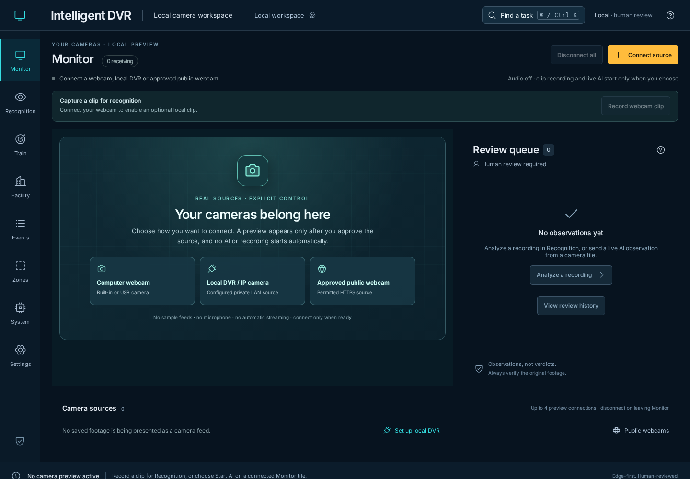
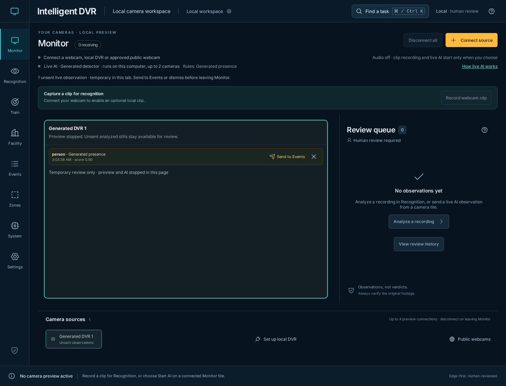
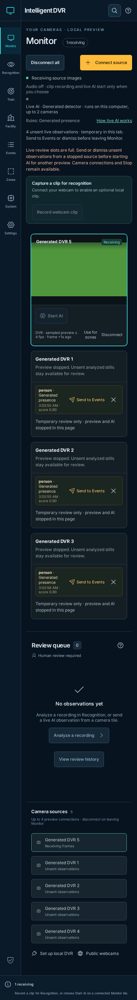

# Live review after disconnect — November 11, 2026

[Verification index](../README.md) · [Operator guide](../../live-detection.md) · [Source fingerprints](source-hashes.json)

The baseline is merged PR #102 at
`19682dd0c5ca48c9d6c8d84ca923c3fa1ac1bc13`. Its
[browser workflow](https://github.com/bartytime4life/Intelligent-DVR-Tool/actions/runs/42946070998),
cross-platform checks, Mac smoke and PC package smoke completed successfully.
This record covers the next scoped change, using the files identified by the
adjacent SHA-256 manifest.

## Behavior and bounds

Disconnecting a DVR source previously removed its tile while leaving its unsent
observations in an inaccessible in-memory snapshot. The new disconnected-source
card keeps those observations sendable or dismissible without a camera image or
AI controls. Sending the last pending observation saves its analyzed still to
local IndexedDB, adds the observation to Events and removes the disconnected card.
Failure to save leaves the item unsent for retry.

At most four sources can reserve live review, including starting/running AI and
stopped sources with unsent observations. Each existing detector keeps at most
20 observations, so unsent review is bounded to 80 records. Full review slots
refuse another source's AI start while allowing camera preview and Stop.
Sending or dismissing all unsent items from a stopped source frees its slot.
Disconnected empty snapshots are pruned; successfully sent items release their
tile's still reference.

One live still save can be in flight across the application, including after
Monitor unmounts and returns. During that save, other Send buttons and that
item's Dismiss button wait. Camera Stop and Disconnect remain available. A Send
already submitted can finish after explicitly leaving Monitor; the leave dialog
says so. No observation is sent automatically.

Unsent review warns before workspace navigation, close or reload discards it.
Canceling navigation keeps Monitor and its active preview; confirming leaves
and stops the source. Disconnect all and hiding the page stop immediately without
a discard prompt, retaining temporary review until Monitor is left. Returning
from a hidden page does not reconnect or start inference. Review is memory-only
until explicitly sent, and does not survive reload or app restart.

## Inspected captures

These are Chromium captures from the local app with generated sources and a
solid-color 32×18 JPEG fixture. No private or physical-camera footage is used.
All three captures were opened and inspected.

## Validation

- The disconnect regression first failed against the baseline because its Send
  button disappeared. The updated check follows the retained item through an
  actual browser still save into Events and opens the saved analyzed frame.
- **519 Node tests passed**, including occupied-slot admission before a first
  result, release after send/dismiss, 80 pending records, pruning 1,000 empty
  disconnected snapshots and releasing a successfully sent Blob reference.
- **29 focused browser cases passed** across live review, catalogue recovery,
  live counts/overflow, Monitor cancellation, event review, unfinished training
  and browser save protection. The new live review cases cover Disconnect,
  Disconnect all, hidden-page shutdown, failed-save retry, a slow save across
  navigation, close warnings and narrow-window capacity recovery. They run in
  the early browser CI preflight as well as the full suite. The seven live review
  cases were rerun after explicitly clearing snapshot refs during unmount, so a
  submitted Send cannot keep the old view's full review map alive.
- **Three native live-AI browser cases passed** against the production build,
  using a generated webcam and constant-output ONNX model. Explicit Start,
  tracks/boxes, still handoff, stop/restart and failed storage remain functional.
  This local compatibility smoke uses the existing isolated OpenCV 4.14.0,
  ONNX 1.23.2 and NumPy 2.5.4 environment; it differs from the qualification
  requirements' OpenCV 4.13.0.92 pin.
- Production build, four Sites packaging checks, documentation links and
  generated Wiki consistency passed. The existing Facility chunk-size warning
  remains. Protected inference, journal, supervision, scheduler and profiling
  sources, Sites runtime files and private runtime folders remain unchanged.

These generated checks do not qualify physical cameras, detection/tracking
accuracy, CUDA execution, endurance or 100-camera capacity. Browser leave
warnings depend on browser policy and user interaction; they are not durable
storage. Backend Stop still uses its existing bounded requests and lease expiry.
