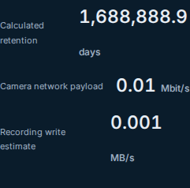
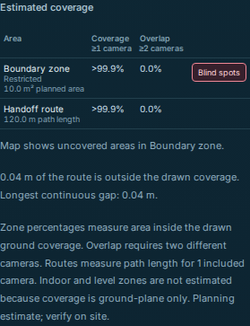
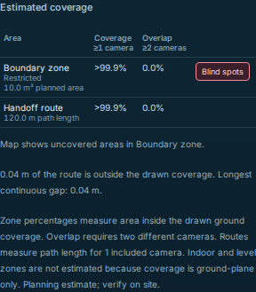

# Small planning readouts retain their meaning

This local proposal starts from published source
`6ce57a5180655693f7d3d6d2e91d8c68693f1961`. It changes presentation in System,
facility measurement labels/summaries, coverage percentages and printable
installer rows. The calculations, validation, geometry, plan/setup schemas,
Save/Undo controls and physical-qualification limits keep their existing meaning.
These are generated software checks; no camera, inference, provider lookup,
private media or physical-site measurement was used.

## Frozen counterexamples

[The before receipt](frozen/before.json), [independent inputs](frozen/inputs.json)
and [manifest](frozen/manifest.json) were frozen before production edits. The
five accompanying source snapshots retain their exact published bytes.

- A valid one-camera plan at **0.01 Mbit/s** displayed **0 Mbit/s**. Its nonzero
  recording need, write rate, annual disk workload and small worker/GPU memory
  quantities also displayed zero. Setup JSON still retained the entered values.
- A bearing-45°, tilt-0°, HFOV-90° camera has side planes at `x=0` and `y=0`.
  With the other optical/range limits nonbinding, the route from `(-0.04,20)` to
  `(120,20)` has exactly **0.04 m** uncovered: covered fraction `3000/3001`.
  It displayed **100.0%** coverage and **0.0 m** uncovered/longest gap.
- The valid 10 m² zone at `x=10…20`, `y=−0.0001…0.9999` has **0.001 m²** below
  the side plane and fraction `9999/10000` covered. The blind overlay retained
  that positive polygon, while the percentage displayed **100.0%**.
- A valid steep camera's printable generic ground interval displayed
  **0.0 m–0.0 m**, beside DORI intervals that correctly retained its positive
  approximately 0.031 m far limit. Small negative coordinates could read
  **−0.0 m**.

## Display contract

Ordinary facility lengths/areas keep one decimal; System keeps its usual maximum
decimal count; stair summaries keep their existing maximum three decimals.
Additional decimals appear only when rounding would erase a nonzero value/sign.
Work is bounded at 12 fractional digits, then a compact scientific label is
used. Exact signed zero becomes ordinary zero. Invalid/nonfinite values are
withheld as **—**, including values that JavaScript arithmetic could coerce to zero.

Coverage and overlap fractions strictly between zero and one never display an
endpoint: small positives read **<0.1%**, and values just below one read
**>99.9%**. Exact calculated fractions zero/one retain **0.0%**/**100.0%**.
This concerns the represented numerical fraction; it is not a physical-coverage
guarantee. Short installer ground intervals use the existing distinct-endpoint
formatter, shared with DORI. Units, coordinates and stored numerical values are
not quantized by formatting. Extra decimals do not imply surveying or hardware
measurement precision.

## Checks and actual exports

The [focused Node log](node-checks.log) records **67 passed, no skips**: eight new
readout checks plus existing resource, measurement and planning checks. The new
checks include 2,005 positive/noncomplete percentage inputs, the smallest positive
represented value, the value immediately below one, signed/invalid values,
metric/imperial conversion, extreme finite labels, the independent route/zone
truth and model/JSON preservation.

[Four baseline browser cases](before/browser-results.json) intentionally fail at
the reproduced readouts: two receive `0 Mbit/s`, two receive `100.0%`. They run
against an untouched public-source copy at the published revision. The
[before log](before/browser.log) and [exact test source captured in the trace](before/browser-spec.mjs.txt)
preserve that result. The final tests additionally check component width.
[Four final browser cases](after/browser-results.json) pass at 1440 px and 375 px
with pinned Playwright 1.56.1 Chromium. Device access and external/API requests
are blocked. Browser-report checkout/tool prefixes and log ANSI codes are
redacted; fixture values, outcomes and timings are retained.

Each browser case captures its readouts and actual downloads before checking the
display. At both widths, [export comparison](export-comparison.json) confirms
byte-identical setup JSON, analyzer-policy JSON, facility JSON and installer SVG
before/after. The printable HTML's numeric labels change. The browser route adds
a collinear vertex at `(0,20)` to exercise its 4 cm edge label without changing
path geometry. Small edge labels still obey the existing map collision budget.
The same tests verify the positive blind-overlay status, metric/imperial labels,
the unchanged saved plan and unapplied System draft behavior. They add no controls.

Reviewed, unmodified crops from the final browser checks:





## Reproduce

```sh
node docs/verification/planning-readouts-2026-11-12/replay.mjs --repo .
node --test tests/readout-format.test.mjs tests/facility-measurements.test.mjs tests/resources.test.mjs tests/facility-planning.test.mjs
npm run test:facility:browser -- tests/browser/planning-readouts.spec.mjs
```

The [portable replay](replay.mjs) checks the frozen manifest, evaluates only the
hash-verified old formatter expressions, and compares the current planning
calculation against the independent rational inputs. [Its result](proof.json)
binds current helper/consumer source hashes. The [source manifest](source-manifest.json)
also binds direct/indirect measurement consumers and unchanged numerical model
sources; the [artifact manifest](artifact-manifest.json) binds this record's
files. Neither a passing replay nor browser tests qualify physical visibility,
hardware capacity, installed software or deployed behavior.
