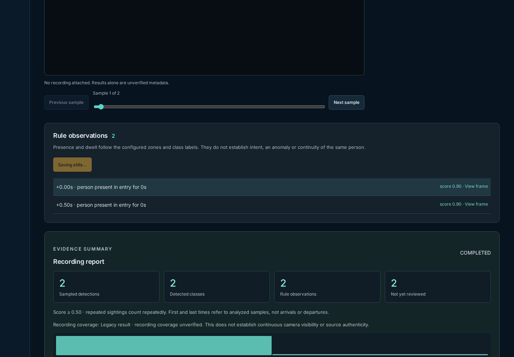
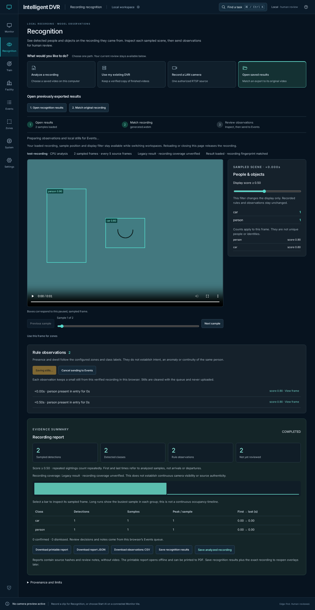
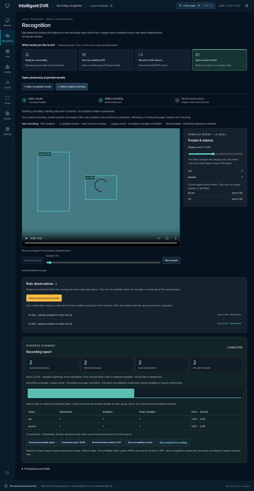

# Cancellable Recognition handoff — November 11, 2026

[Verification index](../README.md) · [Recognition guide](../../recording-recognition.md) · [Source fingerprints](source-hashes.json)

The baseline is merged PR #105 at
`914f0649b671e31879e5870808959a393dd004db`. All four PR workflows passed,
including the [complete browser workflow](https://github.com/bartytime4life/Intelligent-DVR-Tool/actions/runs/42959336615)
and its native analysis/feed/recorder/backup stages. This record covers the next
scoped change identified by the adjacent SHA-256 manifest.

## Failure and resulting behavior

Recognition's Send function captured a run and recording, awaited still capture
and storage, then imported those observations without checking whether that
review was still current. Replacing results during a held still save left the
new review showing **Saving stills…**, without Cancel. The regression failed
against the baseline; same-turn duplicate clicks could also start two batches.

The handoff now uses the existing bounded review-transfer controller. Its
synchronous reservation refuses duplicate Send, **Cancel sending to Events**
releases the controls, and a cancelled operation cannot import observations or
clear a newer transfer's busy state. Both result and recording generations must
still match before Events receives the observations.

| Trigger | Result |
| --- | --- |
| Explicit Cancel | No Events handoff; the loaded review stays available for retry |
| Results/recording replacement begins or completes | Old handoff is cancelled, including a Send begun while a results-file read was pending |
| Local job/backup/segment opens another result | That result invalidates the previous handoff |
| Leave Recognition or hide the page | Active Send cancels; loaded review stays available and playback stays paused |
| Two-minute transfer deadline | Controls release with a timeout message; late work cannot send observations |
| Cancelled media load, seek or encode wait | Listeners and temporary media resources are released; late encoded output is ignored |
| Cancel during an image write | That submitted write may finish locally, but no remaining writes or Events handoff follow from the cancelled batch |

Result-load start and completion both cancel pending work. A separate browser
regression reproduced the completion race before adding that second guard.
Successful explicit Send still opens Events with cleared filters; existing queue
decisions, capacity checks, exact-source matching, the 200-still capture limit and
image retention policy remain unchanged. Background analysis, backup and LAN
recording retain their own controls. The same capture cancellation now also
stops remaining still work for an already-cancelled LAN review transfer.

## Inspected captures

These are actual Chromium captures of generated canvas footage and fixture
observations, not physical-camera recognition. All three were opened and
inspected. The baseline viewport shows replacement results still blocked by the
old save; the updated captures show an explicit cancellation path and preserved
review after using it.

## Validation and limits

- **542 Node tests passed.** Capture cases cover pre-abort, load/seek/encode
  cancellation, late encoded output, seek setup failure, resource cleanup and
  ownership of borrowed URLs. Existing transfer-controller checks cover its
  deadline, duplicate refusal, unmount and late-finally isolation.
- **32 focused UI cases passed** across six new Recognition transfer scenarios,
  matched-recording still handoff, maximum queue/review recovery, notes, workspace
  continuity, save conflicts and live still review. Chromium's real IndexedDB
  completion is withheld to test duplicate clicks, cancel/retry, no late imports,
  no additional old-batch writes and newer-transfer isolation. The six new cases
  run in the early browser CI preflight too, and passed again after the final
  current-visibility guard, which prevents a handoff before a queued navigation
  cancellation effect has run.
- **Nine native recording-analysis cases and two native LAN-recorder cases
  passed** against the final production build with generated recordings,
  constant-output ONNX fixtures and controlled RTSP input. These cover CPU jobs,
  media validation, successful still handoff, malformed-result preservation,
  failure/retry, progress/cancellation and recorder Stop/status recovery.
- The initial native attempt used the older environment without PyAV and failed
  service readiness. A separate environment was then installed from
  `edge/requirements-qualification.txt` with `--require-hashes`; `pip check`
  passed. Final native checks use OpenCV **4.13.0.92**, NumPy **2.5.4**, ONNX
  **1.23.2** and PyAV **19.0.2**, matching the declared pins. The older environment
  was left intact.
- Production build, four Sites checks, documentation links and generated Wiki
  consistency passed. The existing Facility chunk-size warning remains. Protected
  inference, journal, supervision, scheduler and profiling sources, Sites runtime
  files and private runtime folders remain unchanged.

These generated checks do not qualify physical cameras, recognition/tracking
accuracy, CUDA execution, endurance or 100-camera capacity.
