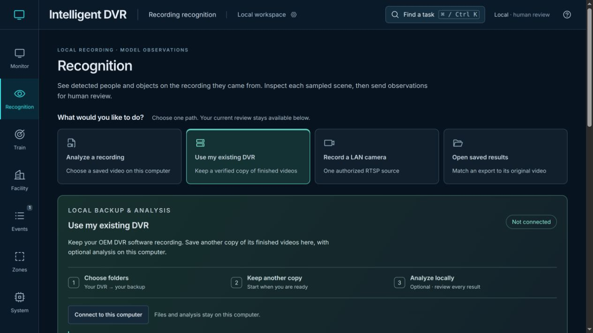
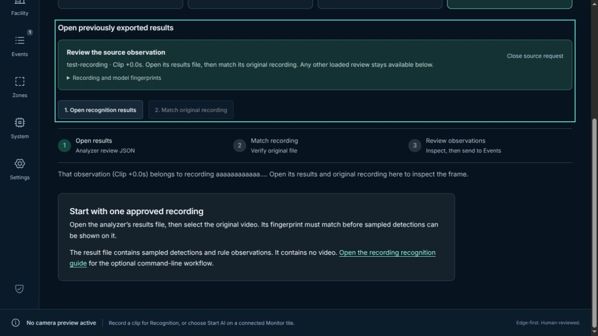
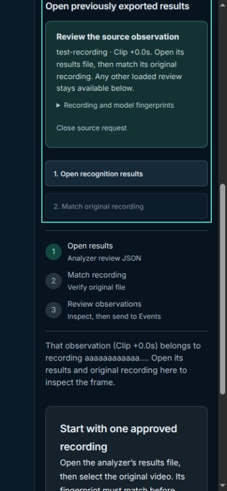

# Source handoffs and runtime recovery — November 9, 2026

[Verification index](../README.md) · [Recording review](../../recording-recognition.md) · [Training](../../training.md) · [Person enrollment](../../person-enrollment.md)

This pass starts from merged PR #93 (`9ae03ce597f2688d8c4f5a2fce0d13954617e0f4`).
It improves the selected navy/teal/amber interface without changing its eight
workspaces or automatically starting a device, analysis or recording.

## Operator-visible changes

- **Events → Open in Recognition** reveals the next source-review step, with
  camera/time and recording/model fingerprints. Matching results focus the
  original-video chooser; a matched source opens its sampled frame with original
  detections. Missing or unrelated results remain intact until explicitly opened.
  Ordinary returns preserve the operator's subsequent task and sample choices.
- Task search ignores Enter and arrow keys during text composition.
- Saved-person reads validate complete replies, reject stale responses and keep
  the last verified list when refreshing fails. Unknown initial state is distinct
  from a verified empty list.
- Template deletion is single-flight and bounded. Completion requires its exact
  acknowledgement plus verified fresh absence. Lost replies and unreadable-file
  omissions remain uncertain; affected controls stay blocked during this Train
  visit. A later read can reconcile an acknowledged deletion. Native storage I/O
  errors now report uncertainty instead of incorrectly claiming “not enrolled.”
- A lost or unverifiable training-analysis start retains a downloadable clip.
  Recovery reads status, never adopts or cancels an unknown job, and requires an
  inactive verified status before offering explicit retry.
- Monitor loads when chosen. Shared CSV quoting no longer pulls report code into
  unrelated workspaces. CSV escaping and the existing report API are preserved.

## Browser inspection

These are actual local UI screenshots using generated observation metadata only.
No original video, camera or detector was connected for these captures. The
baseline handoff incorrectly left the Backup task selected; the corrected
handoff reveals and focuses its source guidance. The 390px check has no horizontal
page overflow. Screenshots show the focused step after automatic scrolling.

| Before | After |
| --- | --- |
|  |  |

## Verification

- [Node checks](node-tests.log): 476 passed, zero failures/skips, with test sockets
  explicitly enabled.
- [Native people checks](people-tests.log): 19 passed, zero failures/skips using
  the existing isolated OEM-backup Python environment; no installation or model
  execution. This includes retained-file permission/error tests.
- [Sites packaging](sites-tests.log): four passed. [Production build](build.log)
  passed and emitted the required Sites files. The existing large Facility chunk
  warning remains visible.
- [Production dependency audit](production-audit-summary.json): zero reported
  vulnerabilities at the recorded check; dependency versions are unchanged.
- [Browser checks](browser-checks.log): all 169 distinct cases passed, with zero
  failures/skips/flaky cases across completed 56-, 36- and 77-case batches.
  [Summary](summary.json) and [exact case coverage](browser-cases.json) retain the
  batch results without adding overlapping preflight tests to the distinct count.

The first seven-case handoff attempt had six failures: focus was consumed before
the selected task committed, and an unrelated-result fixture had inconsistent
camera fields that the parser correctly rejected. Focus now runs after the
visible task commits, and the fixture obeys the existing contract. The subsequent
17-case handoff/composition/navigation batch passed without weakening assertions.
Initial artifacts remain in the local QA directories; summaries retain the failed
attempt separately from accepted results.

A long Facility attempt was interrupted with exit 143 after 84 reported passes.
It did not produce a completed JSON receipt. Two smaller completed batches then
verified all 92 Facility cases; the interrupted attempt is excluded from the
accepted distinct-case count.

An initial system-Python attempt encountered an incompatible NumPy C extension
under Python 3.12 (17 passed, two errors). The default Python run passed 15 and
skipped four dependency cases. The verified existing isolated interpreter then
passed all 19. These attempts are environment evidence, not changes to installed
dependencies or an inference qualification.

## Loading measurement and tradeoff

[Paired build output](bundle-comparison.json) records every source hash and the
aggregate snapshot. [The comparison script](compare-bundles.mjs) runs two in-memory
production builds from that same snapshot, reversing only the CSV/Monitor patch
for the baseline. Run from the repository root with
`node docs/verification/runtime-and-handoffs-2026-11-09/compare-bundles.mjs`.

| Static assets | Baseline | Updated |
| --- | ---: | ---: |
| Entry JavaScript | 448,094 bytes | 367,387 bytes |
| Entry JavaScript, gzip | 137,186 bytes | 112,190 bytes |
| First Monitor JavaScript closure | 448,094 bytes | 439,721 bytes |
| First Monitor JavaScript, summed per-file gzip | 137,186 bytes | 136,841 bytes |
| First Monitor JavaScript + CSS, summed per-file gzip | 146,625 bytes | 147,025 bytes |

Direct Settings/System navigation avoids Monitor/report implementation imports.
First opening Monitor adds five JavaScript requests and one stylesheet request;
its combined compressed assets increase 400 bytes. These are build sizes, not
measured startup times or a claim of universal runtime improvement. Facility's
Three.js/MapLibre loading is outside this patch.

## Evidence boundaries

[Protected hashes](protected-hashes.json) establish byte identity for the five
protected edge modules and four Sites packaging sources. [Source fingerprints](source-hashes.json)
and the [check summary](summary.json) bind accepted checks to this pass.
Historical receipts and media are unchanged.

All new browser operations use generated metadata, canvas footage or mocked
local replies. Local checks do not establish owner-device installation, physical
camera/OEM compatibility, recognition quality, sustained runtime, deletion from
filesystem backups, 100-camera capacity, hosted deployment or native Wiki
publication. Hosted PR checks remain a separate state.
