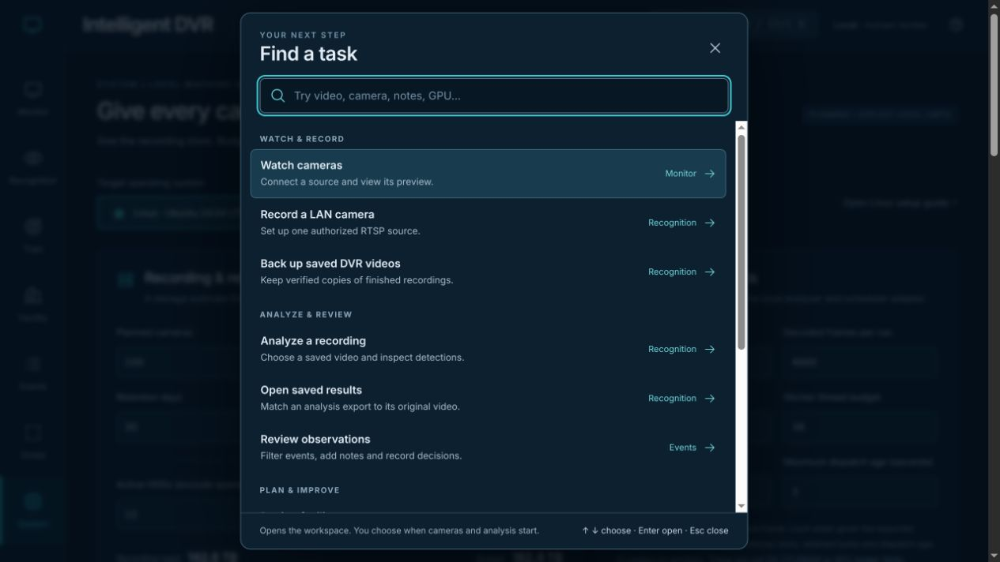
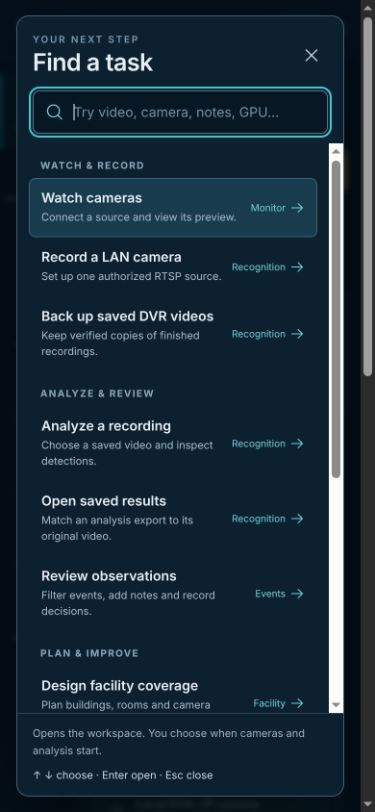

# Workspace navigation, recovery and runtime continuity — November 9, 2026

[Verification index](../README.md) · [Source and result bindings](summary.json) · [Visual handbook](../../how-to.md)

The walkthrough starts from main `4a105a1`. Implementation and regression tests
are committed at `94534e2`; the summary records exact file hashes. Historical
receipts and protected native runtime sources remain unchanged.

## Captured flow and repaired findings

1. **Find the right starting point.** Eight workspaces previously required
   knowing which one contained a job. **Find a task** now groups eleven common
   jobs into Watch & record, Analyze & review, Plan & improve, and Set up.
   Search understands everyday terms such as notes, floor plan, backup folders
   and GPU. Recognition destinations open the chosen panel while keeping the
   current result, source and in-progress controllers mounted. Selection never
   starts a camera, recording or analysis.

   [Before: Recognition without global task search](01-recognition-before.jpg)

   

2. **Move between workspaces without losing position.** The original
   Settings → System handoff left keyboard focus on the document body and kept
   the generic page title. Accepted transitions now focus the named workspace,
   return to its top, update the title and announce the destination. Back/Forward
   follows the same rules. Canceled leave warnings keep the editor, search and
   keyboard controls available; dismissing a dialog restores its opener.

3. **Write a note while inspecting evidence.** Notes previously disappeared on
   Next/Previous, Escape, closing the dialog or opening Recognition. Drafts now
   stay bound to the exact observation evidence, with separate Save/Discard
   actions. Saving a note preserves the verdict and review timestamp and gives
   it a fresh human-edit revision. Reimports and bulk Undo cannot erase that
   later edit. Changed/removed evidence leaves a read-only draft, reachable and
   downloadable from the global draft tray. These drafts are tab-local memory;
   closing the page still needs a save or download.

4. **Recover machine plans after a failed save.** Machine plans now use the
   shared locked save mechanism: failed local edits survive another tab's save,
   both versions can be downloaded and adopting either requires an explicit
   choice. Unapplied form drafts block conflict adoption. Valid preserved-copy
   downloads remain importable setup JSON. Unreadable originals stay untouched
   until an explicit Apply; applying unchanged defaults also preserves the
   original before repairing the primary save.

5. **Leave or recover a stalled person session.** Leaving during clip import
   cancels the session before it can submit a later enrollment/refinement write.
   Import/result transfers and live-AI startup/frame/stop calls have deadlines.
   Startup allows the existing GPU-to-CPU fallback window. A lost, timed-out,
   server-error or unverifiable submitted person write remains explicitly
   uncertain: the recording can be saved, and duplicate retry is withheld.
   Confirmed pre-write refusals allow retry of the retained recording.

6. **Change a connecting webcam source.** Switching from a pending webcam
   permission request to DVR/public setup invalidates the request; a late stream
   is stopped. Changing setup while a webcam is already connected leaves that
   explicit connection available.

## Interface health and verification limits

- **Navigation:** keyboard search, arrows/Enter/Escape, no-match recovery,
  canceled handoffs, browser history, destination focus and dialog focus return
  have generated browser regressions.
- **Responsive layout:** automated task-finder checks cover 320, 390, 662, 1024
  and 1440 px. Actual in-app captures were inspected at desktop size and 390 px;
  the complete eight-workspace browser walkthrough also checks desktop/mobile
  overflow. These are keyboard/control checks, not a full assistive-technology
  compliance assessment.
- **Continuity:** quota failures, corrupt storage, multiple tabs, orphan notes,
  late imports, stalled requests and deferred generated webcam streams are
  exercised with controlled fixtures. They are separate from physical-device
  and installed-service behavior.
- **Runtime/performance:** the production build and Sites packaging checks
  pass. The existing large Facility bundle warning remains; no faster startup,
  inference, representative recognition quality or 100-camera throughput is
  claimed by this pass.

Final local test counts and exact media/source hashes are recorded in
[summary.json](summary.json). Frontend checks passed **451 tests**, Sites
packaging passed **4 tests**, and all **151 distinct browser cases** passed at
completion. The main browser process was interrupted after 141 attempted cases
(139 passes, two failures); remaining cases ran in short batches. The pasted-JSON
test now waits for cascading draft-cleanup effects. That case and map-abort
recovery each passed five repeated runs; the initial map-abort timing failure did
not recur in six reruns. The [case ledger](browser-cases.json) and
[browser log](browser-checks.log) retain these distinctions. A separate denied
webcam permission/recovery case passed with Chrome's generated device and the
frontend alone. Full native inference/RTSP suites remain for CI.

Browser checks use generated recordings, plans,
canvas tracks and mocked service replies. No owner camera, private recording,
model download or installed runtime was activated. Local verification, CI,
installation, deployment and native Wiki publication are separate states.
