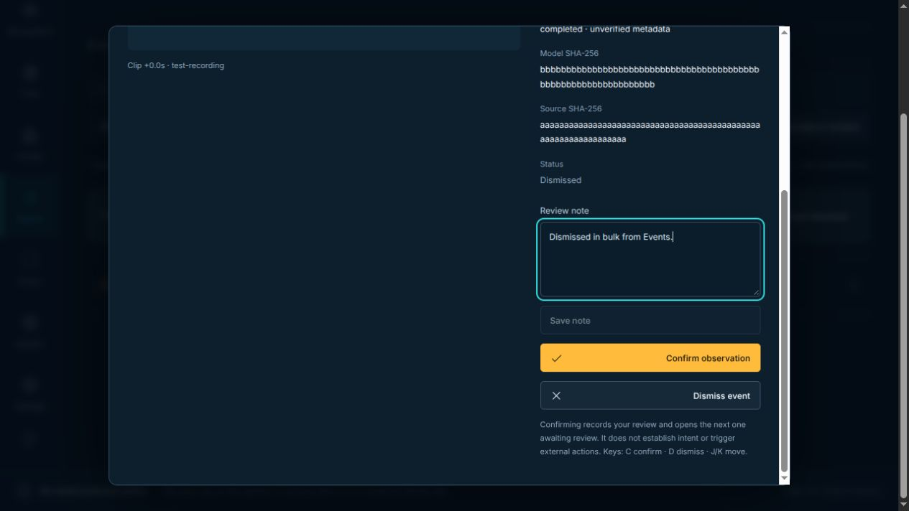
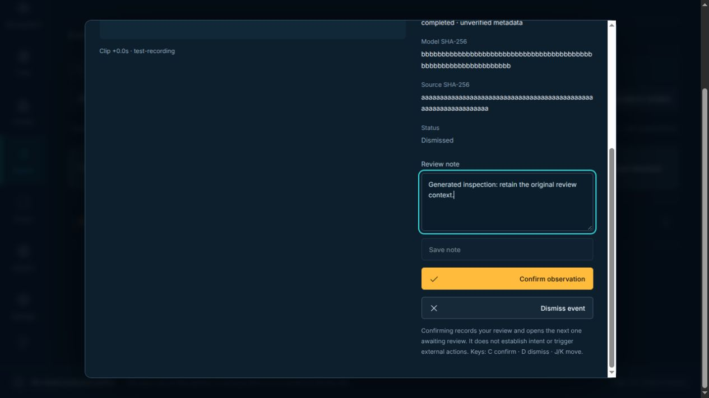
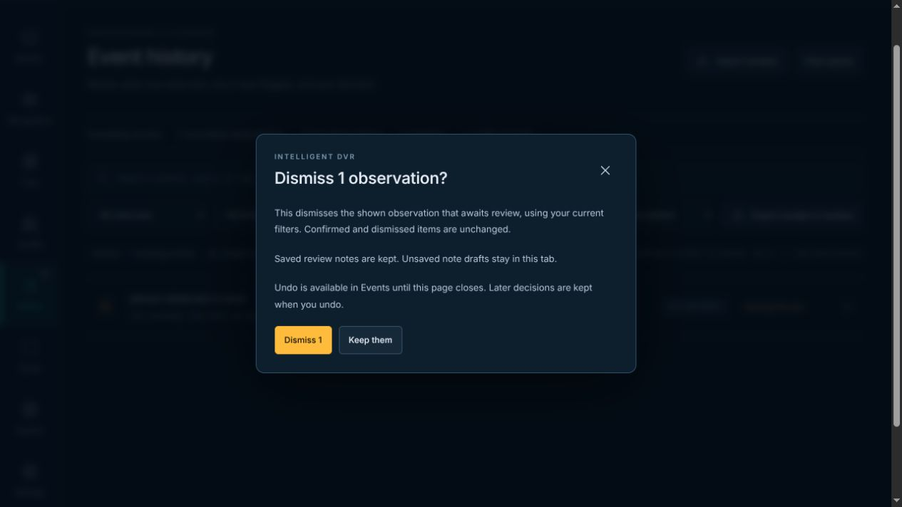
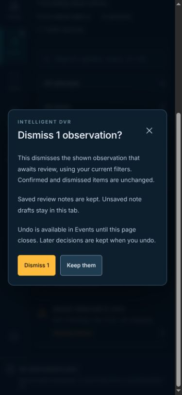

# Review and image preservation — November 9, 2026

[Verification index](../README.md) · [Review guide](../../recording-recognition.md) · [Zones](../../zones.md)

Follow-up to merged PR #95 (`3f78302`), whose tree matches its tested head
`84e6ca8`. The rebased source tree is identical to the tested source tree.
The source revision and accepted
checks are bound in [summary.json](summary.json), [source hashes](source-hashes.json)
and [protected hashes](protected-hashes.json). No merge, installation, deployment
or native Wiki publication is implied.

## Problems reproduced and fixed

| Trigger | Previous result | Updated behavior |
| --- | --- | --- |
| Bulk-dismiss pending observations with saved notes | Each note became “Dismissed in bulk from Events.” | Decisions change; saved notes remain intact in the UI, exports and Undo. Later individual edits survive Undo. |
| Same observation ID at 0s and 0.04s | Both displayed “Clip +0.0s”; an earlier decision could transfer to a different sampled frame and report. | Exact numeric times must match. Both-missing historical times remain readable; one missing exact time cannot borrow another record's timestamp. |
| Another tab cleans images after a queue clear | An older live image still needed by the first tab's Undo could be deleted. | Current tabs hold shared reference leases; cleanup runs only with exclusive protection and the review-save lock. It also preserves drafts, open reviews and saved conflict copies. |
| A newer image arrives while an earlier image saves | The older completion dismissed the newer unsaved offer. | Serialized writes capture their exact plan and offer; a newer offer remains available. Failed removal keeps its image. |
| Switch plans while an image read is delayed | The previous plan's pixels stayed underneath the next plan's rule. | Plan identity is checked during rendering, with a loading message and visible planning canvas until the correct image is ready. |
| Right-button, secondary-pointer or cancelled zone draw | A secondary drag could change the rectangle; tentative state could survive interruption. | Only the primary left-button pointer owns the draw. Escape, cancellation, lost capture and blur abandon it without discarding numeric edits. |

## Captured review flow

Actual local UI captures use one generated observation and a generated review
note. No camera, recording or inference was opened. The selected dark/teal
interface and eight workspaces remain the visual target.

1. **Save a review note — healthy.** The pending observation retains the note
   without requiring a decision. [Original saved note](02-note-before-bulk.jpg).
2. **Confirm a bulk dismissal — improved.** The confirmation explicitly states
   that saved notes and unsaved drafts are kept. Both actions remain reachable.
3. **Inspect the dismissed observation — repaired.** The same saved note now
   survives. The paired captures show the previous replacement and corrected
   result at the same desktop size.
4. **Undo — healthy.** The generated action was undone; automated checks also
   compare the original exported records and preserve later individual edits.
5. **Narrow confirmation — healthy.** At 390×844 CSS pixels the dialog is about
   376px tall, its actions remain visible and the page has no horizontal overflow.

| Before: note replaced | After: note kept |
| --- | --- |
|  |  |

These captures support the review-flow findings. Pointer ownership, storage races
and cross-tab timing additionally require the generated tests below; screenshots
alone cannot establish them. Real screen-reader, device and full accessibility
qualification were not performed.

## Checks and evidence

- [Node checks](node-tests.log): **496 passed**, zero failures/skips, with test
  sockets enabled. Exact-time tests first reproduced three failures against the
  previous matcher; all 19 recognition/report checks passed after correction and
  were independently rerun.
- [Browser checks](browser-checks.log): **98 distinct cases passed**, listed in
  [the case manifest](browser-cases.json). This covers all 92 non-Facility cases
  plus six Facility smoke cases. The other 86 Facility geometry cases were not
  rerun in this pass.
- The first 92-case run passed 90 and failed two test assertions: status text was
  checked with incorrect capitalization, and an empty zero-size grid marker was
  checked for visibility instead of the actual fallback canvas. The corrected
  assertions check the status definition and visible canvas while retaining all
  evidence/absence checks. The completed 16-case focused run passed all cases.
- Singular/plural wording was polished after the broad run; the focused rerun and
  final desktop/narrow captures followed that change. Functional runtime logic
  did not change between these runs.
- [Production build](build.log) and [four Sites packaging checks](sites-tests.log)
  passed. The existing large Facility chunk warning remains. Documentation links
  and the repository's generated Wiki mirrors were checked separately.
- Independent reviews covered the retention locking, startup gate, image callback
  ownership, exact-time match and guide accuracy. No blocking finding remained.

The browser cleanup checks wait for the prune lock to drain before examining an
image; an unfinished destructive operation cannot pass merely because its result
has not arrived. Native edge and Sites packaging sources remain byte-identical
to the base. Native models, owner devices, private footage and external providers
were not exercised.

## Retention and compatibility limits

Cleanup waits while another tab running this version holds a reference lease,
including hidden tabs. Simultaneous cleanup attempts cannot both drop their
leases. Startup waits for a lease before reading the review workspace. Cleanup
also preserves current persisted reviews, Undo, note drafts, open review snapshots
and the bounded saved conflict copies; malformed references skip cleanup.

Without Web Locks, automatic cleanup is skipped. Images can remain longer than
their visible queue entries. Older already-open code does not hold the new lease:
preserve or export its unfinished work before reloading those tabs. Protection
does not retroactively apply to older clients. Browser metadata exports do not
include the local images, and clearing browser storage still removes them.

These are generated software checks. They do not establish camera/OEM acceptance,
recognition quality, sustained operation, capacity or installed-device readiness.
