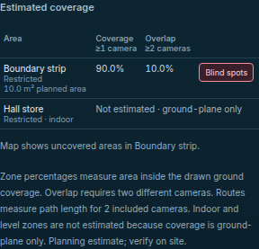
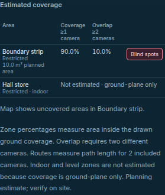
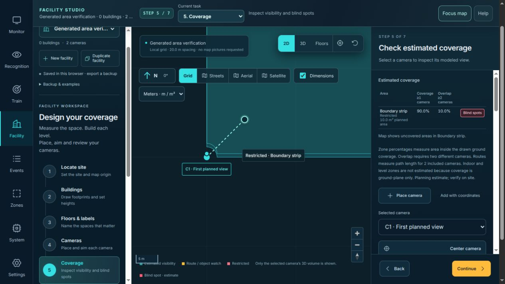

# Zone coverage by area — November 12, 2026

This proposed branch replaces outdoor-zone sample counts with polygon-area
measurements. The previous grid can report 100% coverage and no blind cells even
when the drawn camera fans leave substantial gaps. A two-camera generated plan
reports 100% coverage / 0% overlap instead of **90% / 10%**; a valid sparse
500-camera fixture reports 100% instead of about **0.175%**. These are numerical
counterexamples, not field failure rates or camera-capacity tests.

The interface retains the same table and Blind spots toggle, adds the planned
zone area, and calculates in a cancellable background worker. Failed or outdated
results never become displayed zero, full coverage or an empty successful overlay.
Source under review is distinct from merged, installed and deployed behavior.

## Revision and algorithm

Base: `63b06ba2aab3adcffc38f52310b55969fb538afe`, tree
`516e61057d4cf7b8ed31d855cbf24d5671f3ab8f`. Isolated branch:
`codex/zone-area-math-20261112`. [source-manifest.json](source-manifest.json)
binds all 14 changed production/test/script files. Coverage module SHA-256:
`0477c12aec149d25c1aa41a8f85df41bc92f415eeb0cd11ddaac9391c5d771eb`.
The commit containing this record binds the complete published tree. Earlier
unmerged calibration, camera-projection and image-diagnostics proposals are not
included in this branch.

For disjoint camera-ID groups A/B, retain union `U` (at least one camera) and
mask `O` (at least two). Merge with:

```text
U = U_A ∪ U_B
O = O_A ∪ O_B ∪ (U_A ∩ U_B)
coverage = area(zone ∩ U) / area(zone)
overlap  = area(zone ∩ O) / area(zone)
blind    = zone \ U
```

Group fragments of one camera before balanced merging, so duplicate fragments
and triple overlaps do not overcount. The already pinned
[polygon-clipping library](https://github.com/mfogel/polygon-clipping)
performs Boolean operations. Locally anchored, compensated cross products
measure components and subtract holes; [signed-area conventions](https://doc.cgal.org/latest/Polygon/group__PkgPolygon2Functions.html)
are distinct from geometric visibility. No geometry dependency is added.

Each fan is first clipped to a strictly expanded, axis-aligned guard containing
the zone: `Z ∩ F = Z ∩ (F ∩ guard)`. Padding is 1% per normalized bounding-box
span, with a 32-machine-epsilon minimum. Final masks and blind geometry are clipped
to the actual zone. This removes irrelevant arcs and avoids reproduced floating
boundary-reconstruction failures; it does not enlarge or snap the zone. Collapsed
fans are excluded. Area consistency is checked with tolerance
`128 × Number.EPSILON × (subject area + subject cross-product magnitude + result cross-product magnitudes)`.
Only closure error within that tolerance is absorbed; inconsistent/nonfinite
results are unavailable. This is floating arithmetic, not exact rational Boolean
geometry or a universal error bound.

Method `polygon-area-v1` returns square-metre `area`, `coveredArea`, `overlapArea`,
`uncoveredArea`, fractions `coverage`/`overlap`, and full `blindSpots` MultiPolygon
topology. The map keeps outer/hole rings grouped and renders disconnected pieces.
The selected overlay comes from that same successful metric calculation. Saved
zone footprints remain single rings; no plan/rule/installer schema migration is
introduced. The existing route arclength function is byte-identical to base,
SHA-256 `20c2a2b968b63398f3216ceee4101a786f5eb682c8845b275f7bfbb184c107cd`.
Ground fans, sampled wall rays, DORI and simulated rehearsal remain separate.

## Independent numerical evidence

[Full oracle method and reproduction](oracle.md), [exact proof](proof.json),
[immutable gzip corpus](inputs.json.gz), [checker](check-zone-area.py) and
[second convex reference](check-convex-reference.py) retain every case and strict
gate. The oracle uses exact rational horizontal-slab integration on represented
coordinates, independently of production clipping. A second convex half-plane /
inclusion-exclusion reference agrees on 55 cases and 220 scalar equalities.

| Same 114 frozen cases | Baseline | Candidate |
| --- | --- | --- |
| Assertions reached | 3,282 | 8,437 |
| Failed assertions | 1,283 | 0 |
| Strict process exit | 1 | 0 |

The larger candidate count includes complete MultiPolygon checks that malformed
legacy output cannot reach. Failures overlap and include new metadata-contract
checks; they are not distinct bugs. All 114 cases have exact scalar expectations,
111 have exact blind-geometry XOR integration, and every case checks returned
polygon area plus independent membership points (5,586 total). The three largest
fan cases omit expensive XOR integration but retain scalar, full-area and point
checks. The corpus was frozen before implementation and was not narrowed.

Comparison tolerances and limitations are in the oracle guide. Largest observed
errors were about `1.577e-11 m²` for scalar area, `4.667e-15` for a fraction and
`3.661e-12 m²` for blind XOR area. They are corpus observations, not universal
bounds. Retained [baseline receipt](baseline-receipt.json.gz) and
[candidate receipt](candidate-receipt.json) bind six source modules, frozen inputs,
expected/observed bytes, checker, runner and installed public dependency bytes.
[oracle-artifacts.json](oracle-artifacts.json) binds packaged sizes/hashes; the
original oracle README bytes are preserved under `oracle.md`.

An earlier candidate failed the ordinary two-camera union and refused the
500-camera case. Its [failure metadata](first-candidate-failure.json) and
[receipt](first-candidate-failed-receipt.json.gz) are retained. The final guard
operation order handles both without changing the corpus or numerical checks.
The per-operation geometry cap was raised to 65,536 after a source-bound sparse
500-fan calculation required 49,505 vertices before guard optimization. The guard
reduces the final fixture peak to 2,505 vertices. Root replay results are recorded
in [validation.json](validation.json).

## Resource and response limits

| Budget | Per zone | Shared per plan |
| --- | --- | --- |
| Clipping operations | 3,000 | 12,000 |
| Submitted input-vertex visits | 2,000,000 | 4,000,000 |
| Observed output-vertex visits | 600,000 | 1,200,000 |
| Vertices in one submitted operation / observed result | 65,536 | 65,536 |

Output costs are known after a library call returns; an oversized result is
counted then discarded, so an observed counter can exceed its threshold. These
are not hard memory or per-call timing guarantees. Later unique zones may remain
unestimated after the shared budget is exhausted. Identical successful footprints
reuse one calculation within the plan. The ordinary 500-camera sparse fixture
is an actual successful estimate, not merely a graceful refusal. A single local
Node diagnostic recorded about 110 ms; [receipt](frozen-five-hundred-receipt.json).
That timing is not a browser percentile, target-host benchmark or live workload.

The worker has a ten-second **acceptance** deadline checked with monotonic time
when a response arrives, as well as a scheduled termination timer. Browser
scheduling may delay termination itself. Changing the settled plan, leaving
Coverage or retrying closes the old response gate before termination. Rendering
also checks plan identity and attempt, so old numbers cannot paint during the
next effect. Reply validation rejects missing/null/nonfinite successful values,
wrong zone IDs and wrong request/schema. Unavailable geometry keeps null values;
indoor zones retain their separate ground-plane-only reason. The UI offers a
plain recovery action for worker errors and keeps editing/Save/Undo available.

## Local software validation

Build ran before the full Node suite. Node 22.13.1 / npm 10.9.2, Python 3.10.9,
local Playwright 1.61.1 / Chrome 157.0.8103.50. Hosted browser CI uses its own pinned
Playwright/Chromium and is separate evidence for the eventual PR head.

| Check | Result |
| --- | --- |
| `npm run build` | Pass, including bundled coverage worker and Sites outputs |
| `DVR_TEST_SOCKETS=1 npm test` | 601 passed, zero failed/skipped |
| `npm run test:sites` | Four passed |
| `DVR_BROWSER_CHANNEL=chrome ./node_modules/.bin/playwright test --config=playwright.facility.config.mjs facility-camera-planning.spec.mjs facility-studio.spec.mjs` | 20 distinct cases passed: 12 planning and eight Studio |
| Independent oracle | 114 cases / 8,437 assertions / zero candidate failures |
| Second exact convex reference | 55 cases / 1,745 subset intersections / 220 equalities |

[Build](build.log), [Node](node.log.gz), [Sites](sites.log), [browser](browser.log)
and [ten controller tests](task.log) retain actual output. The first eight Studio
cases from base remain present; the targeted run is not the entire browser suite.
Existing bundle-size/color-environment warnings are retained. Full Python
application suites were not rerun for this JavaScript change. Final documentation
checks and independent review results are in [validation.json](validation.json).

Browser checks use the real worker, with an explicit request delay only in the
supersession test. They cover actual 90/10 results at 1440/375 pixels, no horizontal
overflow, planned area, draft/Save/Undo, pending edits/navigation, failed worker
loading and real retry, diagonal zones, indoor exclusions and prior Studio flows.
Unit cases cover shared/per-zone/output limits, failed partial calculations,
500-camera/500-zone metadata plans, cached geometry, holes/components, malformed
replies, cancellation and a late response delivered before a delayed timer.

| Desktop generated result | Phone generated result |
| --- | --- |
|  |  |

Root also started the built preview at port 4318, explicitly imported
[preview-plan.json](preview-plan.json), opened Coverage and toggled its blind area.
The built worker returned 90%/10%; no source was connected or AI started.



## Preservation and limits

[preservation.json](preservation.json) verifies the five protected runtime sources,
four protected hosting/Sites files and dependency lock remain byte-identical to
base. `package.json` changes only to register two new test suites; dependency pins
remain identical. Primary checkout, other isolated work, private runtime/model/
footage, historical receipts and existing media are preserved. Wiki source is
regenerated separately; that does not publish the separate Wiki. No camera,
recording, detector, model download, installed-service replacement, merge or
deployment is part of this work.

This improves measurements of the drawn ground-fan polygons. It does not correct
the radial-sector approximation, qualify actual visibility, optical DORI,
recognition/identity quality, surveying accuracy or the 100-camera workload.
Unsupported indoor calculations and complex/unresolved geometry remain explicit.
