# Explore Intelligent DVR visually

[Guide index](README.md) · [Step-by-step handbook](how-to.md) · [Product status](product-status.md) · [Image provenance](media/guide/README.md)

**Choose a workspace, then follow its job.** The captures below show merged
source `2566d845` in a clean local browser on November 1, 2026. No real camera,
person, private recording or actual site was used. Example detections come from
a constant-output test model on generated flat-color video. These images explain
controls; they do not measure recognition quality or operating capacity.

## Monitor · connect deliberately

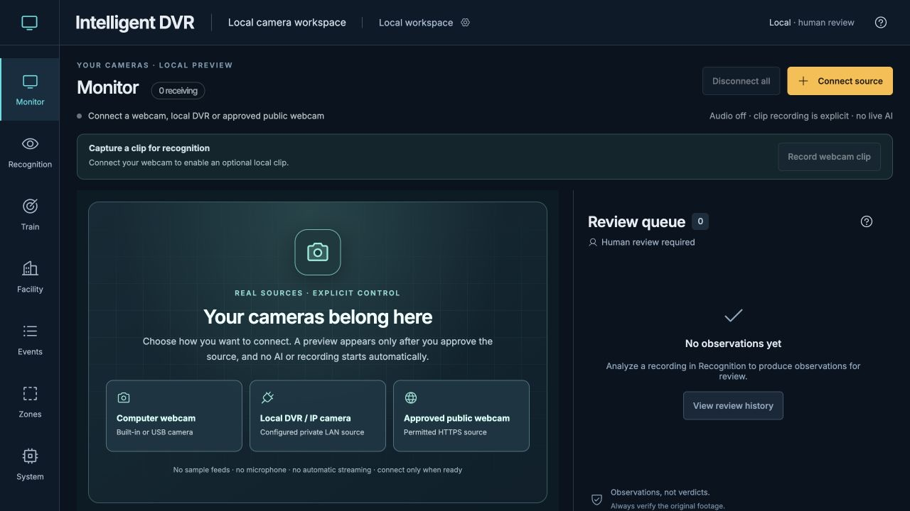

Choose a webcam, configured private DVR channel or permitted public source.
Check status, then disconnect when done. Preview alone runs no AI.
[Connect one source](how-to.md#2-connect-one-source) · [Connection details](local-camera-feeds.md).

## Recognition · inspect the exact clip

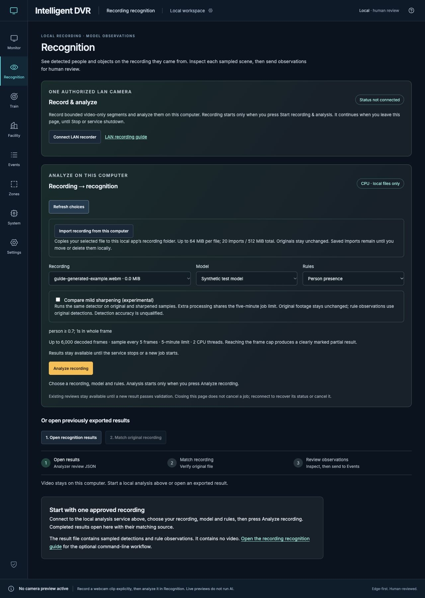

Choose recording, model and rules; start analysis explicitly. Read progress and
coverage status before using the result. [Recording workflow](recording-workflow.md).

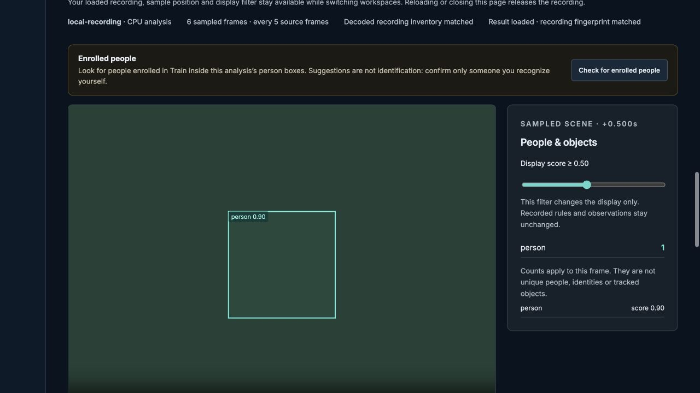

The box is deliberately produced by a fixture model. It is not recognition of a
person in the image. Display filtering does not change recorded rules.

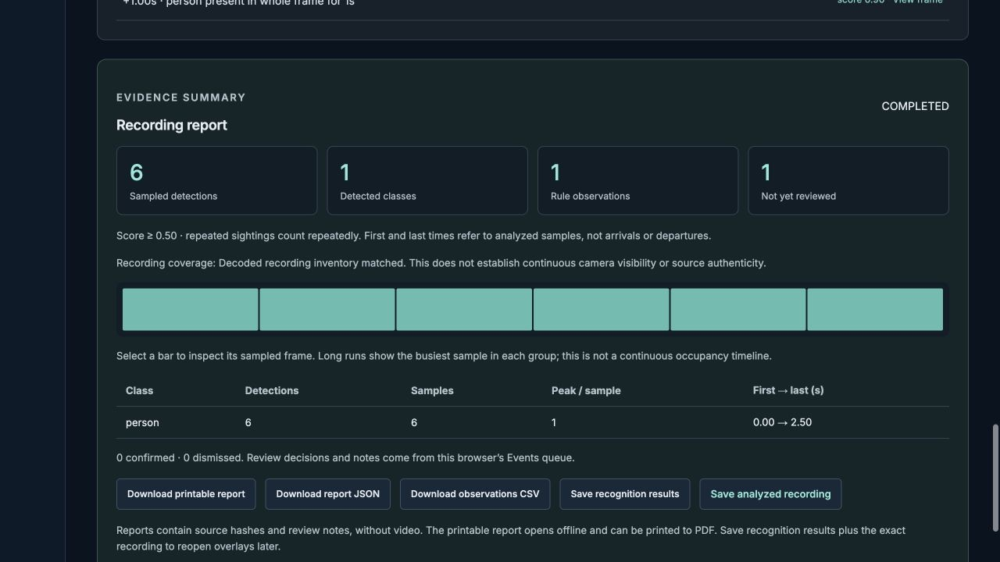

The six detections are six repeated fixture samples, not six real people. Save
both **recognition results** and the **analyzed recording** to reopen overlays.
[Review and export](how-to.md#4-review-and-export).

## Train · tune a view or enroll with consent

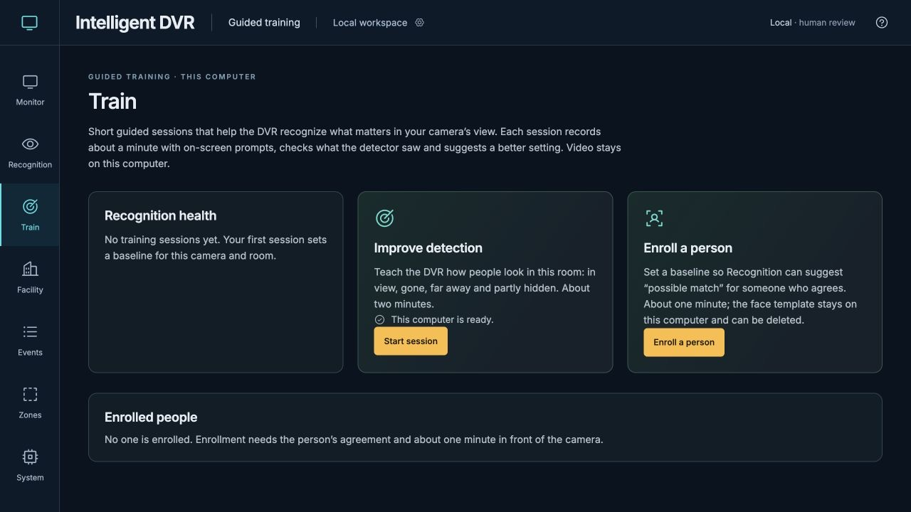

**Start session** tunes a rule threshold for this view. **Enroll a person** starts
a different consent-based baseline task. [Guided training](training.md).

| Camera check before detection tuning | Consent before enrollment capture |
| --- | --- |
| 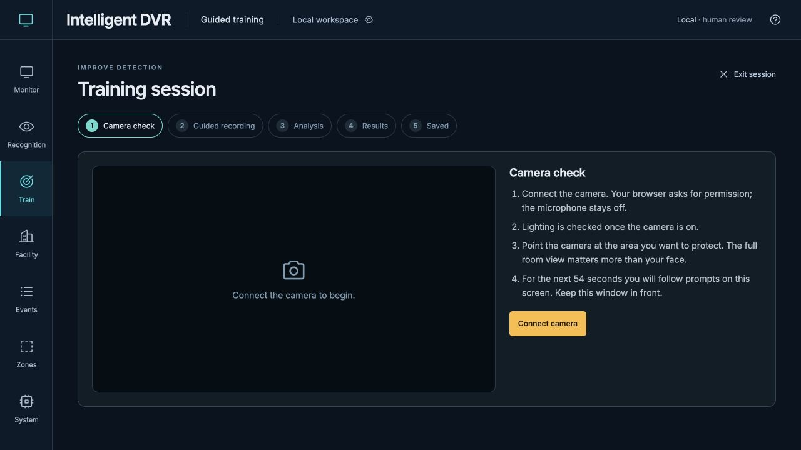 | 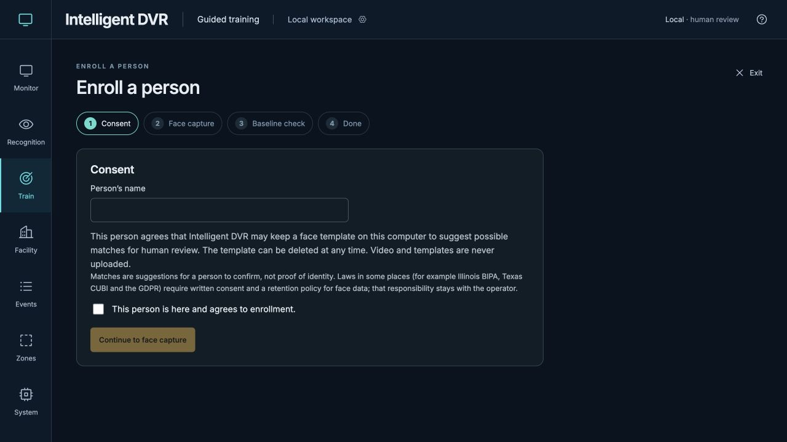 |
| Connect explicitly; follow visible prompts. | Obtain agreement before capture. Templates remain local and deletable. |

[Enrollment and possible matches](person-enrollment.md). A possible match is a
human-review suggestion, never an identity or access decision.

## Events · decisions and notes

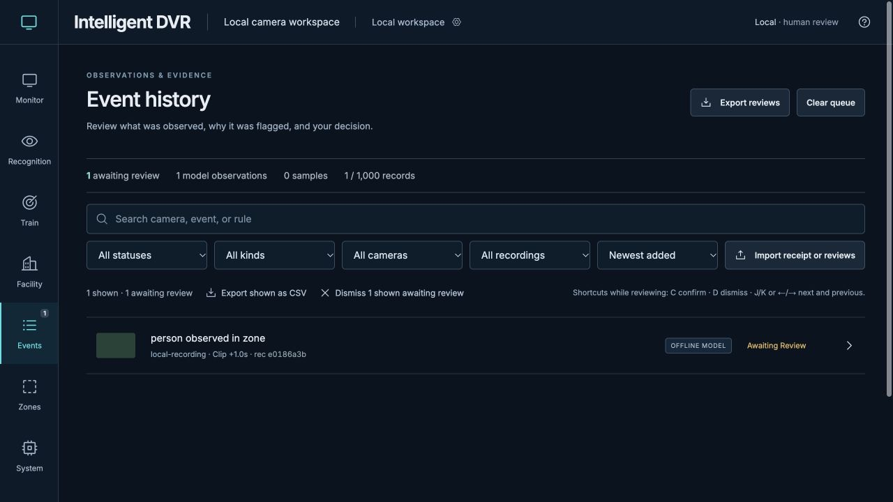

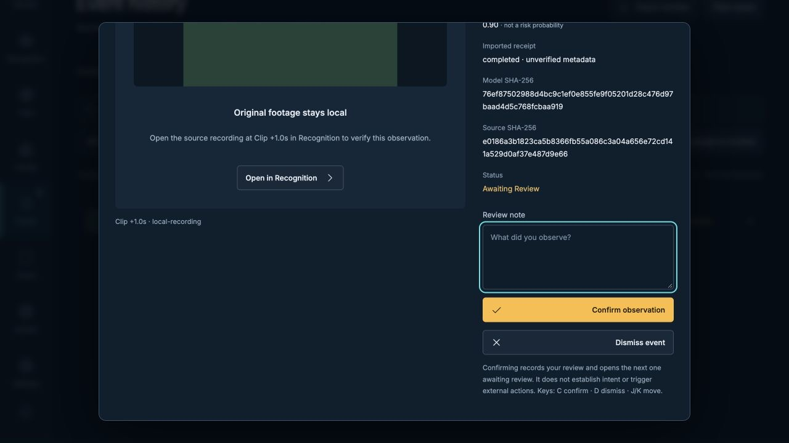

The observation and still are synthetic examples. Review the original recording
before deciding; an export is deliberate. [Review desk](review-and-events.md).

## Zones · a rule belongs to an image

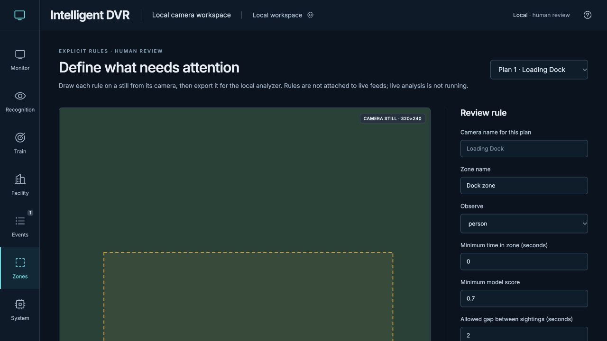

Assign the incoming still to the intended plan, draw the region, then export
analyzer rules. Image coordinates and Facility plan geometry are different.
[Zone guide](zones.md).

## Facility · build the space in layers

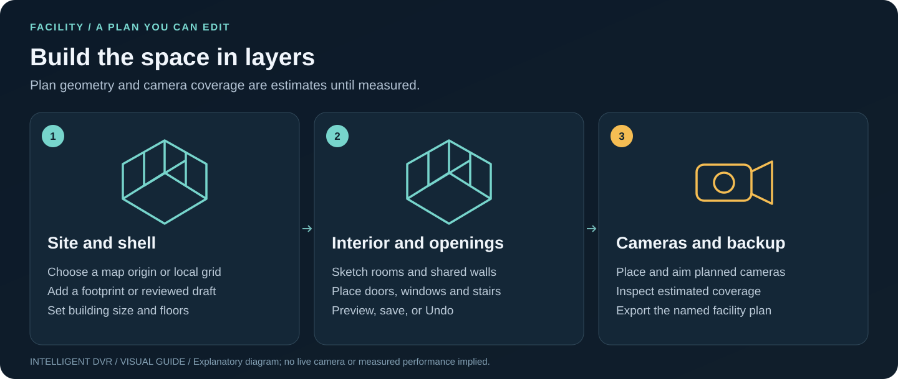

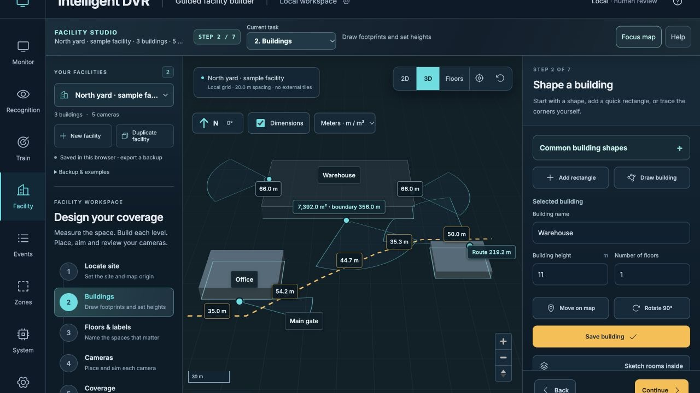

Fresh installs start blank. Use a shape or reviewed draft, then edit floors,
rooms, shared walls, doors, windows and stairs. Place planned cameras, inspect
estimated coverage, and export. [Facility handbook](facility-builder.md)
· [Saved sites](saved-facilities.md).

## System · budget, apply, measure

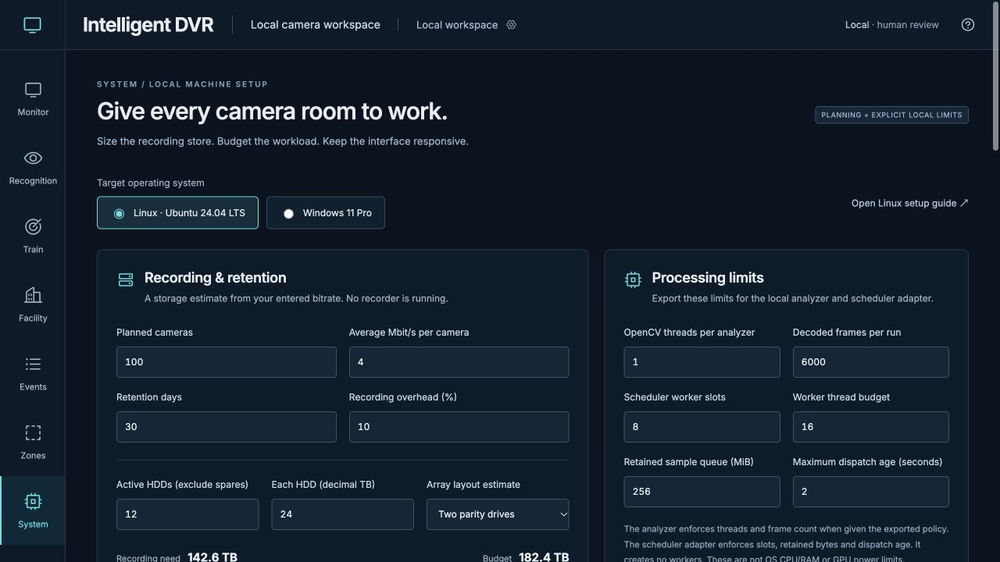

The values are entered assumptions, not detected hardware or throughput.
Apply browser limits and export supported analyzer controls separately.
[Control scopes](resource-controls.md) · [Hardware plan](hardware-guide.md).

## Image science · explicit reference, explicit limits

[Image diagnostics](facility-image-diagnostics.md) inspect pixels and exposure/detail
proxies. [Ground-plane calibration](facility-calibration.md) requires measured
references and independent checks. Neither recovers general depth or establishes
survey accuracy.

## Keep the work

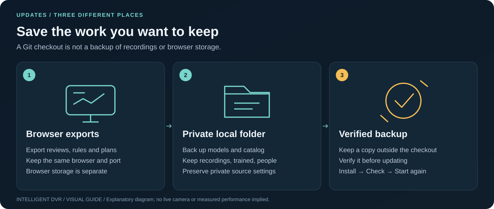

[Mac updates](setup-macos.md#preserve-data-when-updating) · [Troubleshooting](troubleshooting.md)
· [Architecture and data](architecture.md).

## Dated collections and reproduction

- [PR #61 collection](media/current/README.md): five controlled desktop/mobile
  screenshots and six schematics, with unchanged original hashes and CI provenance.
- [October 27 tour](visual-tour.md#historical-prototype-captures): generated camera
  artwork and fictional plan demonstrations, preserved as historical material.
- [This collection's manifest and procedure](media/guide/README.md): twelve actual
  browser screenshots, ten editable diagrams and one conceptual ImageGen hero.
- [Verification index](verification/README.md): revision-bound software checks,
  including their separate physical-device, quality and capacity limits.

All procedures also have text instructions and descriptive alternate text.
