# Historical visual tour

[Home](../README.md) · [Current visual atlas](visual-atlas.md) · [Media provenance](media/current/README.md) · [Product status](product-status.md)

For the latest walkthrough, including Train and the new facility tools, use the [visual handbook](how-to.md) and [current atlas](visual-atlas.md).

This page is a dated visual tour of the software **and its earlier prototype**. The PR #61 images below are genuine interface captures from a headless browser test that connected **no real cameras**. Older sample scenes are preserved in the historical section with their original fictional/animated status.

## PR #61 interface captures: map, monitor and system

| Monitor · connect only on request | Facility Studio · map-first planning |
| --- | --- |
|  |  |
| **Three intentional source choices** (webcam, configured LAN RTSP, permitted public). Preview alone is not recording or AI. [Camera setup](local-camera-feeds.md). | **Compact task chooser, one saved-site inventory, geometry tools and camera inspector.** Field optics and visibility are not certified. [Facility guide](facility-builder.md). |

| Monitor · mobile | Facility Studio · mobile | System · mobile |
| --- | --- | --- |
| 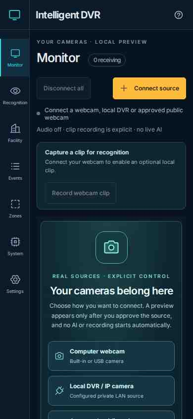 | 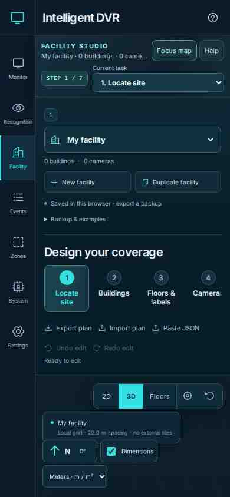 | 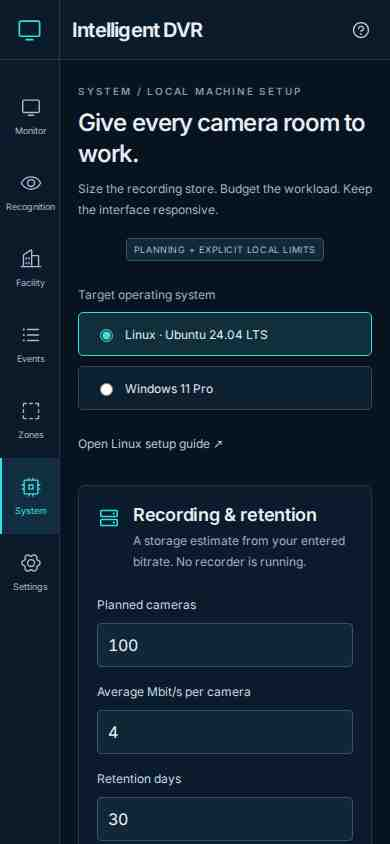 |
| No automatic stream. | Long forms still require real touch testing. | Planner, not a host performance probe. |

*Dated screenshots: [Chromium job 41263964836](https://github.com/bartytime4life/Intelligent-DVR-Tool/actions/runs/41263964836), source `9719eda`; 1440×1000 and 390×844 viewports. Full [source and file manifest](media/current/manifest.json). The successful 92 browser scenarios describe that revision and use controlled fixtures, not on-site acceptance.*

Later merged features are not pictured here: [guided training](training.md), [consent-based enrollment and possible matches](person-enrollment.md), and [Mac setup](setup-macos.md). See [product status](product-status.md) for their implementation and qualification boundaries.

## The human-controlled recording journey

**Connect, record, analyze, review, export.** Each stage is an explicit operator action. The local single-camera recorder is separate from the Monitor preview wall. A review observation is metadata, and its SHA-256 proves file correspondence, not image authenticity or the model's accuracy. [Full workflow](recording-workflow.md).

## Image science without invented certainty

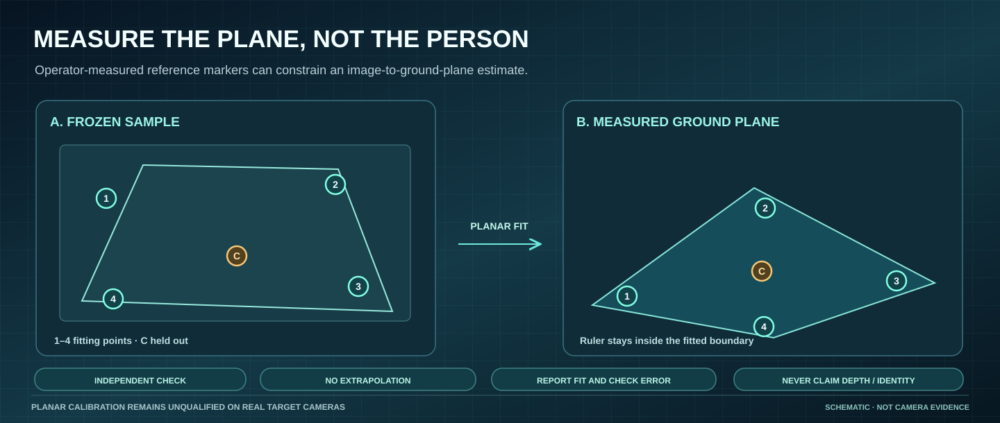

Image diagnostics expose luma, histograms, clipping proxies, Sobel edge energy and A/B differences. The experimental planar ruler requires a measured common plane, at least four fitting markers and a withheld check inside the reference hull. It is not a 3D tracker, identity system or verified optical survey. [Image lab](facility-image-diagnostics.md) · [Planar method](facility-calibration.md).

## Historical prototype captures

The images and GIFs below were taken in the **October 27, 2026 prototype**. They used **generated camera scene artwork, simulated observations and fictional buildings**. They are **not a current Monitor start screen, real live camera recording, or recognition benchmark**. Their unchanged [original provenance and hashes](media/README.md) allow readers to understand the development history.

### Archived workspace loop

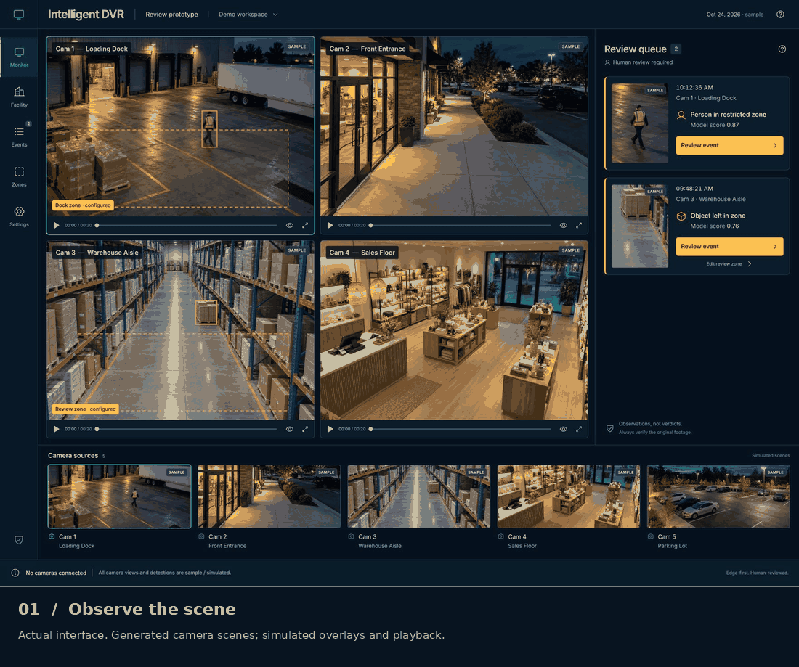

*Animation may loop; static alternatives are shown below. There is no project-controlled pause or reduced-motion behavior for GitHub's GIF renderer.*

### Historic Monitor / review / history

| Simulated camera wall | Human review dialog | Review history |
| --- | --- | --- |
| 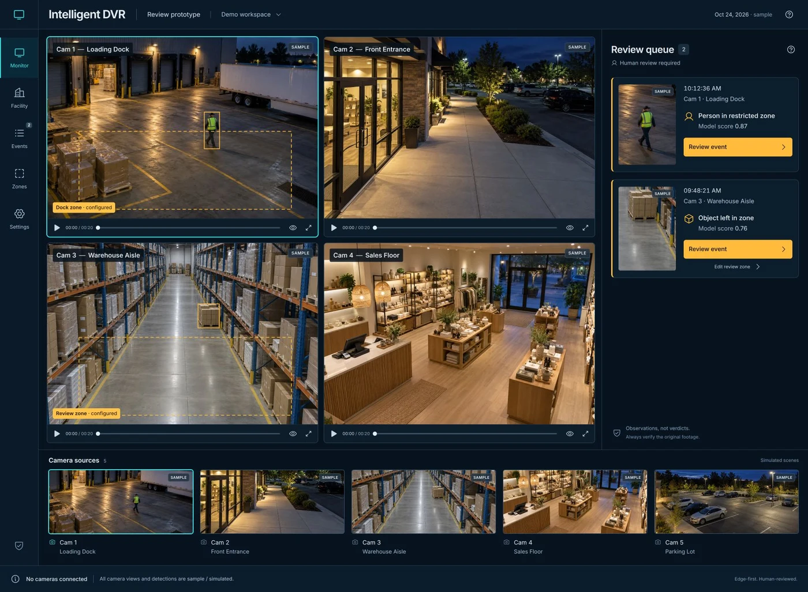 | 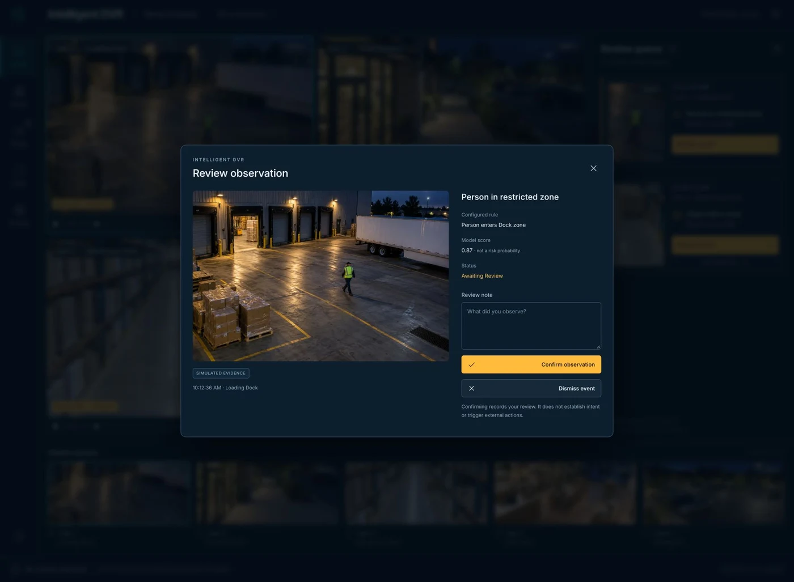 | 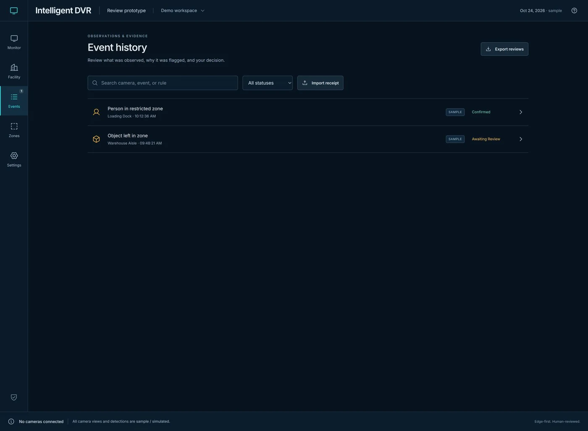 |

In this older experiment, sample scores and playback controls were interface fixtures. The present Monitor starts empty and connects only to operator-approved sources. For real evidence, compare the selected recording with its original and retain human review. [Recognition workflow](recording-recognition.md).

### Historic Zones, facility shapes and OSM starter

| Zone rules | Fictional facility | OSM draft review |
| --- | --- | --- |
| 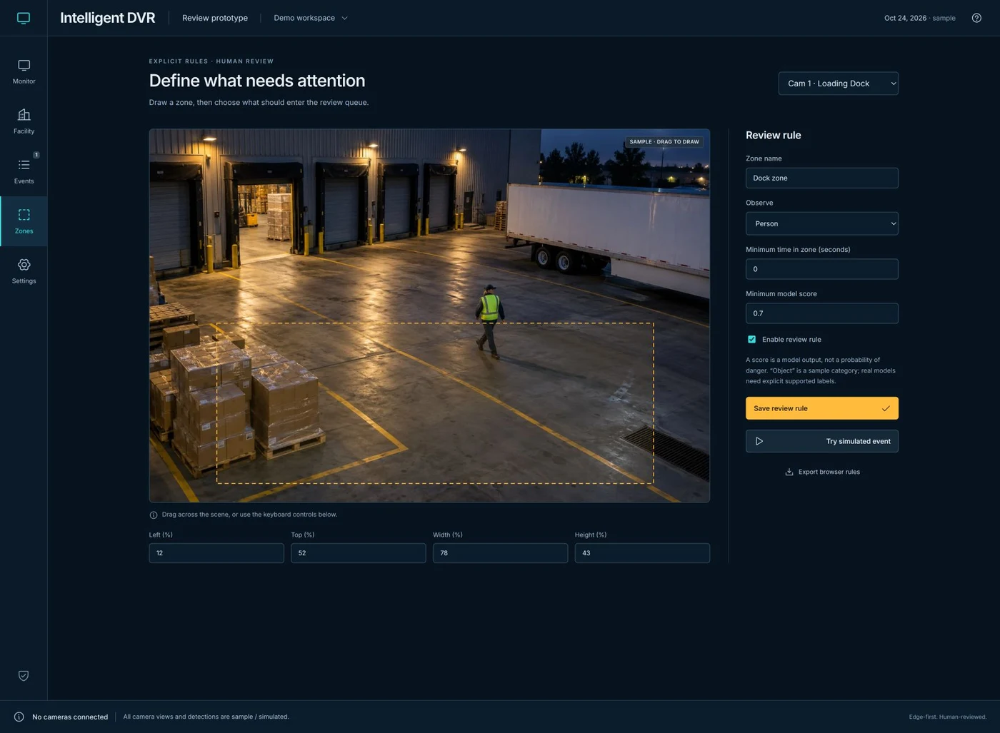 | 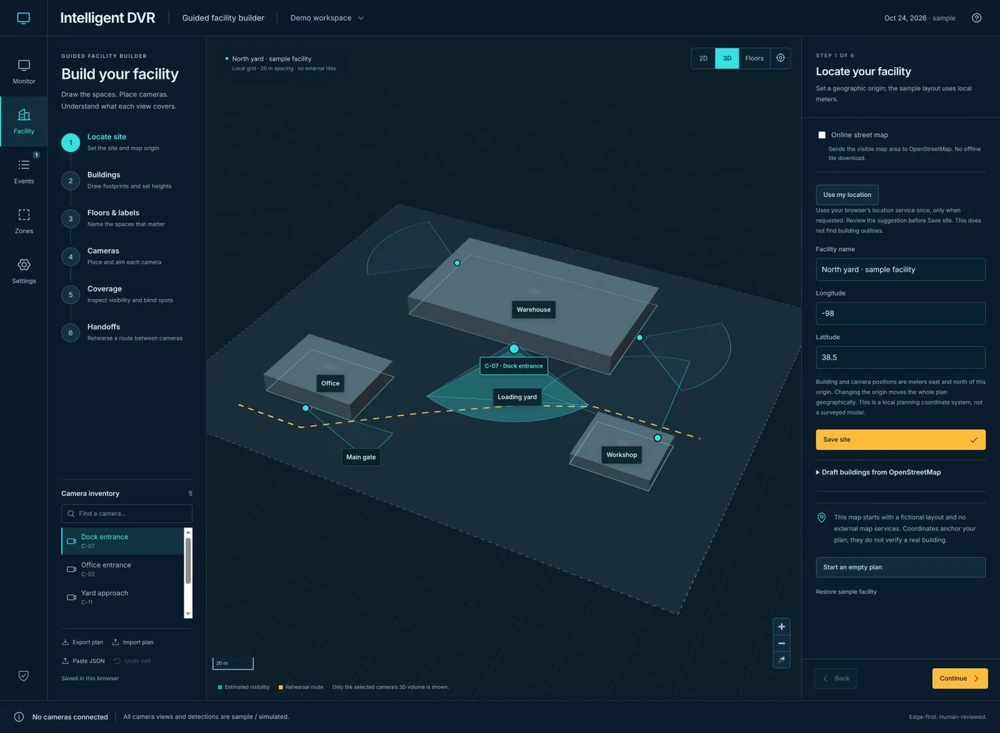 | 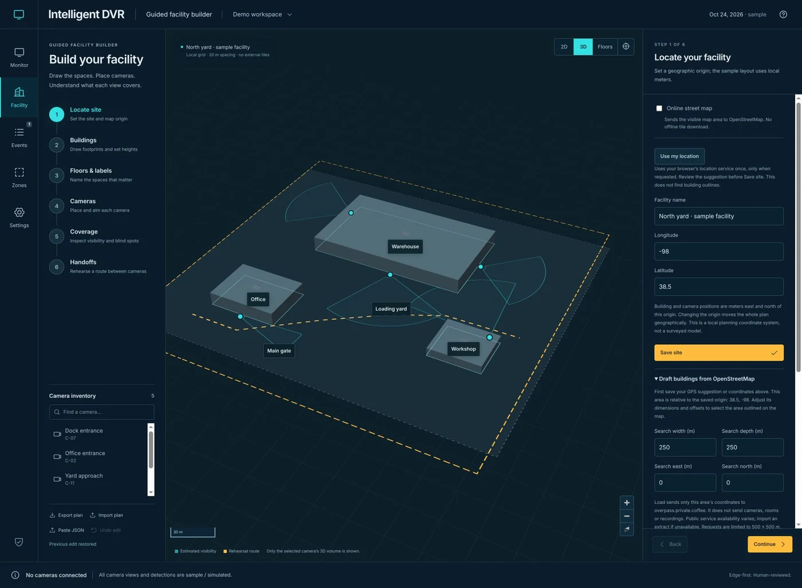 |

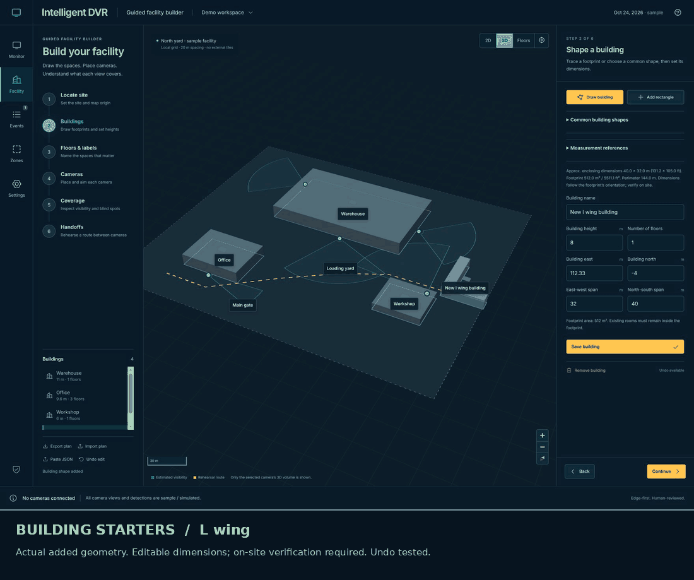

*Static [U-shaped example](media/shape-u.webp). These were plan-edit demonstrations, not surveyed architecture.*

### Simulated route and handoff

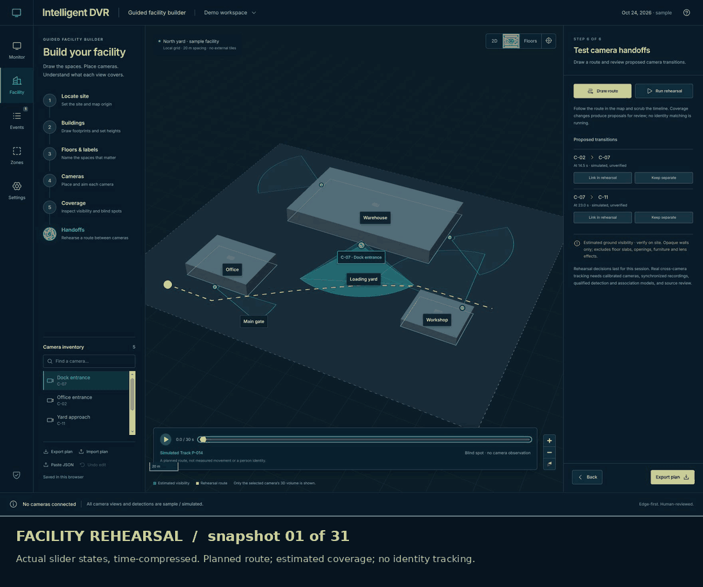

*Static [route state](media/route-15.webp). The animation accelerates 31 simulated samples of a planned route and does not establish continuous coverage, detection or camera identity association.*

## Read before deployment

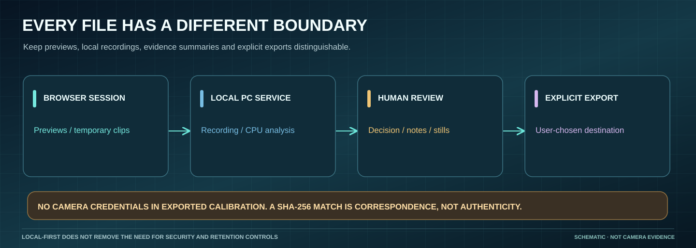

The present software can run bounded local video tasks, but real webcam/DVR compatibility, optical calibration, recognition quality, sustained recording, native performance and 100+ camera operation require **separate device and operator acceptance**. [Field runbook](field-acceptance.md) · [Evidence index](verification/README.md) · [Architecture](architecture.md) · [Project terms](../SECURITY.md).
