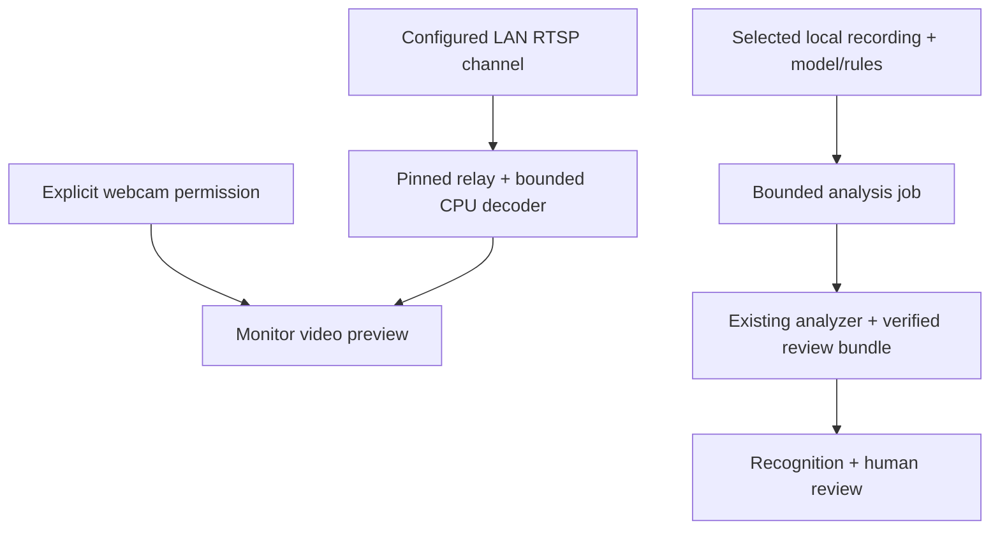
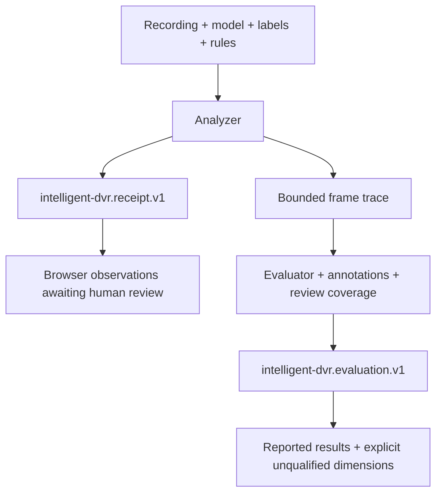
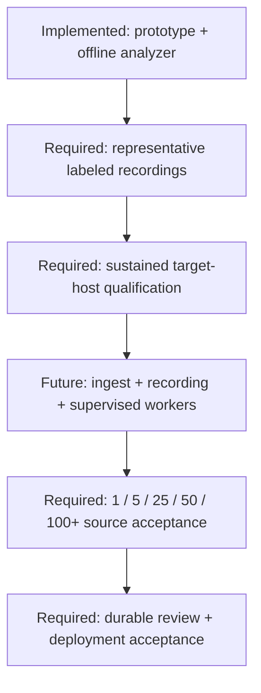

# Architecture, evidence and data

[Home](https://github.com/bartytime4life/Intelligent-DVR-Tool/wiki/Home) · [Product status](https://github.com/bartytime4life/Intelligent-DVR-Tool/wiki/Product-status) · [Edge CLI](https://github.com/bartytime4life/Intelligent-DVR-Tool/blob/main/edge/README.md) · [Security boundary](https://github.com/bartytime4life/Intelligent-DVR-Tool/blob/main/SECURITY.md)

## The current pieces

Webcam video remains in the browser. DVR previews use the optional same-computer
service and stop on disconnect, page exit, lease expiry or a processing limit.
The [feed bridge](https://github.com/bartytime4life/Intelligent-DVR-Tool/blob/main/docs/local-camera-feeds.md) does not connect to the analyzer or record
video. The [local job service](https://github.com/bartytime4life/Intelligent-DVR-Tool/blob/main/docs/local-analysis-service.md) separately connects
Recognition selections to the existing analyzer and opens source-matched results.
The optional [LAN recorder](https://github.com/bartytime4life/Intelligent-DVR-Tool/blob/main/docs/lan-recording.md) uses the same relay/decoder and
feeds verified, finalized segments into that job service. It retains matching
source/results, has explicit Start/Stop and bounded storage, and exposes gaps
between connections. The scheduler/load model remains separate preparation;
tracking and 100-camera capacity are not implied. Facility plans are metadata,
not calibrated camera feeds. The browser performs no neural-network inference.

| Component | Source | Role |
| --- | --- | --- |
| Camera previews and clips | `src/LiveMonitor.jsx`, `src/clip-capture.mjs`, `edge/local_feeds.py`, `edge/feed_worker.py` | Explicit browser webcam and LAN RTSP preview; optional video-only browser webcam clip capture; no live inference |
| LAN recording | `edge/lan_recorder.py`, `edge/segment_worker.py`, `src/LanRecorder.jsx` | Explicit one-source segment capture, bounded retention and existing CPU job dispatch; no discovery or automatic startup |
| Workspace | `src/App.jsx`, `src/data.mjs` | Review, rules, local video preview, explicit receipt import |
| Recording recognition | `src/RecognitionReview.jsx`, `src/recognition.mjs` | Explicit review bundle, original-file hash matching, paused sampled detections/counts and Event handoff; connects to the optional same-origin local job API |
| Facility model | `src/facility.mjs` | Bounded plan validation, local-meter projection, estimated visibility and rehearsal |
| Facility renderer | `src/FacilityBuilder.jsx`, `src/facility-map.mjs` | Guided controls, MapLibre and selected-camera Three.js volume |
| Map starter | `src/FacilityStarter.jsx`, `src/facility-starter.mjs` | Common shapes, dimensions, reviewed simple ways/supported outer-only relations and source records |
| Place search and services | `src/AddressSearch.jsx`, `src/facility-services.mjs` | Explicit submitted search, selectable public/local services and bounded responses |
| Local recording jobs | `edge/local_service.py`, `edge/analysis_worker.py`, `src/LocalAnalysis.jsx` | Loopback selection catalog, one isolated CPU job, bounds, progress/cancel and source-matched result opening |
| Analyzer | `edge/analyze.py`, `edge/model_profiles.py`, `edge/rules.py` | Explicit recording analysis and profile-bound decoding |
| Evaluation | `edge/evaluation.py`, `edge/evaluate.py` | Annotation matching, review coverage and timing summaries |
| Scaling preparation | `edge/scheduler.py`, `edge/capacity.py` | Fair bounded sample admission and virtual-time load simulation |

## Where data goes

| Action | Destination | Distinction |
| --- | --- | --- |
| Use sample workspace | Browser memory/localStorage | Generated artwork is not real evidence |
| Preview a local video | Local browser object URL | Preview is not analysis; no upload is implemented |
| Open recognition results + matching recording | Transient browser memory and local object URL | SHA-256 match before attachment; metadata and video never uploaded; selected observations can be explicitly imported into localStorage |
| Start local analysis job | One explicit local folder, frozen input snapshots and same-computer HTTP result transfer; optional Linux private last-job recovery | Token/Host/origin checks; opt-in bounded same-computer recording import, no cloud inference; [restart storage](https://github.com/bartytime4life/Intelligent-DVR-Tool/blob/main/docs/local-analysis-service.md#optional-linux-restart-recovery) is not continuous recording or a durable human-review database |
| Run analyzer | Explicit local output files | No camera capture or model download |
| Import receipt/plan | Browser memory/localStorage after validation | Bounds and declared fields are checked |
| Export reviews/rules/plan | Explicit browser download | User-controlled file copies |
| Enable online street map | OSM receives visible tile requests | Off by default; no bulk/offline tile downloads |
| Submit address/place search | Selected Photon public demo or configured same-origin local search receives submitted text | No request while typing; no device-position bias, camera plan or recordings sent |
| Load building drafts | Selected Private.coffee/OSM public Overpass or configured same-origin local service receives selected bounds | Explicit Load; no cameras, rooms, routes or recordings sent by the adapter |
| Open offline OSM JSON | Browser file/paste review | Does not contact a footprint provider; online tiles remain a separate choice |
| Use my location | Browser location service after a click | Review the suggestion; no continuous tracking |
| Load interface font | Bundled with the app | No external request |
| Send observations to Events from a matched recording or LAN segment | Small JPEG stills in this browser's IndexedDB | Drawn from the verified local recording; removed with their observations; never uploaded |
| Choose a webcam | The device id in this browser's localStorage | Remembered for the next connection only; no frames stored |

Local analysis does not make every optional browser asset/provider offline. Default local paths are `/geo/search` and `/geo/overpass`; the operator must configure their fixed upstream services. The Sites Worker does not implement them. Same-origin routing does not certify downstream egress, and failure never silently switches to a public provider. See [service contracts](https://github.com/bartytime4life/Intelligent-DVR-Tool/wiki/Facility-setup-reliability#local-and-offline-delivery), [SECURITY.md](https://github.com/bartytime4life/Intelligent-DVR-Tool/blob/main/SECURITY.md) and the provider disclosures.

## Evidence contracts

Source hashes bind files; they do not establish source truth, annotation correctness or signed custody. Human review confirms/dismisses an observation, not intent. Browser-local history is editable and lacks operational audit guarantees.

The YOLOX-S profile binds a selected model hash, COCO80 order and explicit preprocessing/decoding. Generic YOLOv8-style raw output is a different profile. An `.onnx` extension alone does not establish compatibility.

## Visibility is geometry

The planner estimates a pinhole view intersecting a horizontal ground plane. Wall intersections can shorten rays. The 3D volume illustrates that approximation; it does not add a calibrated optical model.

It omits slabs, doors, windows, furniture, terrain, lighting, distortion, pixel density and recognition quality. Rehearsal follows a planned route and proposes camera transitions. It performs no identity recognition or cross-camera person matching. [Detailed limits](https://github.com/bartytime4life/Intelligent-DVR-Tool/wiki/Facility-planning#visibility-model-and-evidence-limits).

## Path toward operation

Every box after the first is work needed for an operational capacity claim. This refresh introduces no production recorder, GPU worker service, multi-host inference system or authenticated review backend. [Roadmap](https://github.com/bartytime4life/Intelligent-DVR-Tool/wiki/Roadmap).

## Local machine setup and resource policy

System adds explicit setup arithmetic and browser performance preferences. A read-only `edge.host` snapshot can be imported locally without exposing a privileged host API. Exported policies are consumed by the offline analyzer for OpenCV threads and frame caps, and by a separate scheduler adapter for retained bytes, slots and dispatch age. RAM, VRAM, disk and power estimates are not native quotas. GPU presets do not change the CPU backend. See [control scopes](https://github.com/bartytime4life/Intelligent-DVR-Tool/wiki/Resource-controls), [Linux](https://github.com/bartytime4life/Intelligent-DVR-Tool/wiki/Linux-setup), [Windows](https://github.com/bartytime4life/Intelligent-DVR-Tool/wiki/Windows-setup) and [GPU planning](https://github.com/bartytime4life/Intelligent-DVR-Tool/wiki/GPU-planning).

---

[Canonical source](https://github.com/bartytime4life/Intelligent-DVR-Tool/blob/main/docs/architecture.md) · Documentation refresh: October 29, 2026.
