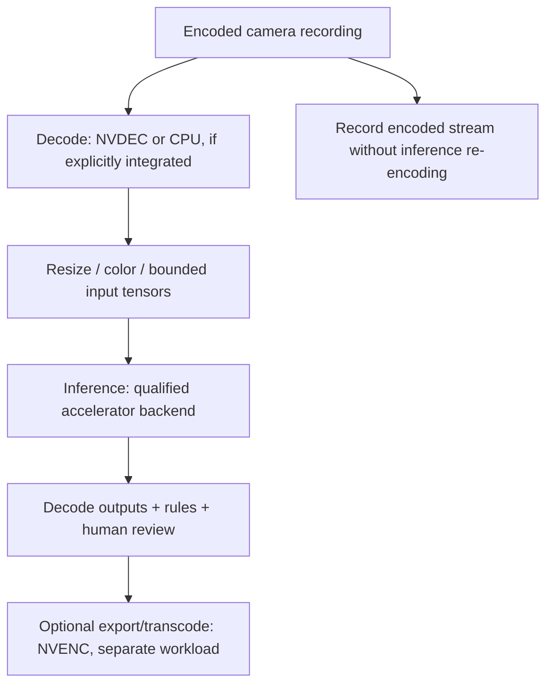

# GPU selection, VRAM and acceleration

[Guide index](https://github.com/bartytime4life/Intelligent-DVR-Tool/wiki/Guide-index) · [Visual handbook](https://github.com/bartytime4life/Intelligent-DVR-Tool/wiki/Visual-handbook) · [Screenshot atlas](https://github.com/bartytime4life/Intelligent-DVR-Tool/wiki/Visual-atlas) · [Troubleshooting](https://github.com/bartytime4life/Intelligent-DVR-Tool/wiki/Troubleshooting)


**Quick path:** Keep the CPU path working → choose an explicit acceleration candidate → compare outputs and resource use on approved recordings.

[Hardware](https://github.com/bartytime4life/Intelligent-DVR-Tool/wiki/Hardware-guide) · [Linux](https://github.com/bartytime4life/Intelligent-DVR-Tool/wiki/Linux-setup) · [Windows](https://github.com/bartytime4life/Intelligent-DVR-Tool/wiki/Windows-setup) · [Resource controls](https://github.com/bartytime4life/Intelligent-DVR-Tool/wiki/Resource-controls)

**If you already own an RTX 5080, use it for the first qualification work.** Buying a larger GPU before measuring decode, inference and memory use could spend money on the wrong bottleneck. This recommendation is an engineering judgment, not a measured performance ranking.

The analyzer defaults to **OpenCV CPU**. The explicit optional
`--backend onnxruntime-cuda` route is limited to the pinned YOLOX-S profile and
separate qualified runtime; see the [operator commands](https://github.com/bartytime4life/Intelligent-DVR-Tool/wiki/Edge-CLI#optional-explicit-cuda-backend)
and [backend verification](https://github.com/bartytime4life/Intelligent-DVR-Tool/blob/main/docs/verification/cuda-2026-10-28/README.md). System's GPU
presets remain planning controls: they install no drivers, allocate no GPU
memory and switch no inference backend. Hardware inventory alone does not prove acceleration.


## Candidate comparison

Manufacturer reference specifications checked October 27, 2026. Shipping partner cards can differ; capacities below use the vendors' advertised GB labels, while the app budgets GiB/MiB and can use reported VRAM.

| Candidate | Reference memory | Reference board power | Practical reason to qualify it |
| --- | ---: | ---: | --- |
| **GeForce RTX 5080** | 16 GB | 360 W | First candidate when already owned; measure batch/context and decode headroom before replacing it [G1] |
| **RTX PRO 4000 Blackwell, full-size** | 24 GB ECC | 140 W | Compact single-slot workstation candidate when power, space and ECC matter; not a proved cameras-per-card result [G2] |
| **RTX PRO 5000 Blackwell, 48 GB variant** | 48 GB ECC | 300 W | More VRAM for independently measured contexts/model needs; the vendor also lists a 72 GB variant, which is not this preset [G3] |
| **GeForce RTX 5090** | 32 GB | 575 W | High-draw candidate when measured acceleration justifies it; additional cooling/PSU burden, not an automatic choice [G4] |

The **RTX PRO 4000 Blackwell SFF** is a different 70 W card, despite its similar name [G5]. Do not apply the full-size 140 W preset to an SFF SKU or confuse desktop and laptop GPUs. Multi-GPU memory is normally separate per GPU; 2 × 16 GB is not automatically a single 32 GB allocation. No multi-GPU execution is implemented here.

## Three distinct GPU jobs



NVIDIA documents NVDEC decoding and NVENC encoding as separate engines/APIs [G6]. Inference uses a qualified compute backend; browser WebGL rendering is another workload. Codec/profile, resolution, frame rate, bit depth, chroma, simultaneous sessions and transfer overhead all affect capacity. Consult the vendor support matrix for the exact card/codec; do not turn NVENC session counts into an NVDEC or inference camera limit.

The proposed recorder should retain encoded source streams without unnecessary re-encoding. Analyze selected frames/substreams under a qualified policy. Changing precision, model, preprocessing, sampling or decode path requires output/quality checks.

## VRAM planning in System

The editable model is:

`contexts × (model/context MiB + scratch MiB + batch × 640 × 640 × 3 × 4 / 2²⁰) / 1024`

It adds FP32 RGB input tensors to **entered** model/context and scratch allowances, then compares the result with entered VRAM minus the display/other-workload reserve. It is not a prediction of the selected model's real allocations. Decode surfaces, activations, library workspace, allocator fragmentation, copy buffers and other applications must be measured and included in the allowances.

Increasing batch size may improve throughput while increasing memory and latency. A context per camera is not the default design: use shared bounded workers and retain per-camera ordering. A 100-camera requirement does not require 100 model replicas. Keep visible wall tiles bounded independently from analysis work.

The location selector changes the PSU allowance for this recording host: **separate analytics host** excludes GPU watts here, while **this recording host** includes the preset. Size and UPS-protect the separate analytics host independently. This is arithmetic, not a GPU power cap.

## Local inspection

With the project environment installed:

```bash
python -m edge.host --path . --gpu --output host-with-gpu-001.json
```

Use the appropriate environment interpreter from the OS guide. This explicitly opts in to a fixed read-only `nvidia-smi` name/VRAM query with a five-second timeout. No clocks, power limits, persistence mode, driver installation or camera access are changed. If the utility is missing/fails, GPU inventory stays **unknown**, not zero. Import locally in System and review before copying VRAM into the draft.

The [October 28 owner-PC trial](https://github.com/bartytime4life/Intelligent-DVR-Tool/blob/main/docs/verification/host-2026-10-28/README.md#cpu-settings-and-isolated-gpu-agreement) measured an isolated RTX 5080 CUDA candidate and bounded public-feed loads. It preserves the production CPU route and does not qualify sustained capacity or field quality.

## Qualification before GPU adoption

1. Record OS, driver, toolkit/backend versions, GPU model, usable VRAM and exact ONNX/profile/labels hashes. Use an accelerator runtime that explicitly supports the GPU architecture; ordinary OpenCV CPU wheels are not a CUDA deployment.
2. Compare CPU and candidate GPU outputs with fixed inputs, preprocessing, score semantics, class order and NMS. Use tolerances justified for the selected precision; preserve original receipts and keep the explicit CPU route available. The CUDA command never falls back silently.
3. Evaluate independent labeled recordings, including low light, occlusion and overload. Report precision/recall and reviewed false alerts separately from speed.
4. Measure decode, transfers, preprocessing, inference, postprocessing and end-to-end queue age. Track sustained VRAM, utilization, temperature, power, per-camera delivered cadence and drops, not just one inference call.
5. Ramp approved replay through 1/5/25/50/100+ sources, test worker/driver failures and a measured soak, then qualify separately authorized physical-camera ingest. Do not declare support from VRAM fit or manufacturer AI TOPS.

No GPU purchase, accelerated backend or 100-camera operating claim is made by these presets.

## Primary sources

- **G1:** [NVIDIA RTX 5080 reference specifications](https://www.nvidia.com/en-in/geforce/graphics-cards/50-series/rtx-5080/). The vendor's 850 W system recommendation is for a reference PC, not a 12-HDD DVR design.
- **G2:** [RTX PRO 4000 Blackwell data sheet](https://www.nvidia.com/content/dam/en-zz/Solutions/design-visualization/quadro-product-literature/workstation-datasheet-blackwell-rtx-pro-4000-nvidia-3662515.pdf).
- **G3:** [RTX PRO 5000 Blackwell product page](https://www.nvidia.com/en-us/products/workstations/professional-desktop-gpus/rtx-pro-5000/).
- **G4:** [NVIDIA RTX 5090 reference specifications](https://www.nvidia.com/en-us/geforce/graphics-cards/50-series/rtx-5090/).
- **G5:** [RTX PRO 4000 Blackwell SFF specifications](https://www.nvidia.com/en-us/products/workstations/professional-desktop-gpus/rtx-pro-4000-sff/).
- **G6:** [NVIDIA Video Codec SDK](https://developer.nvidia.com/video-codec-sdk), [codec support matrix](https://developer.nvidia.com/video-encode-decode-support-matrix).

---

[Canonical source](https://github.com/bartytime4life/Intelligent-DVR-Tool/blob/main/docs/gpu-planning.md) · Generated companion; dated evidence, examples and illustrations retain their labels.
