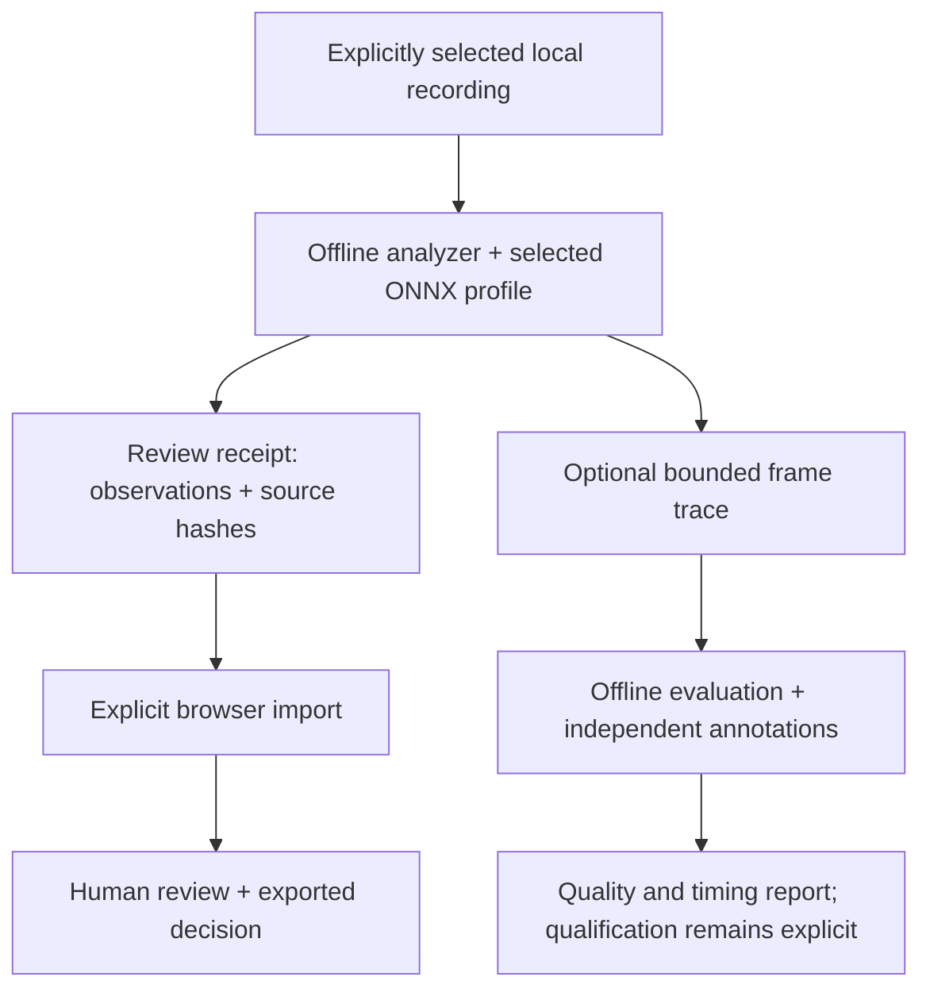

<div align="center">

# Intelligent DVR

**See the scene. Plan the space. Review the evidence.**


A local-first camera-analysis and facility-planning project from BARTA AI Solutions. **Camera access is explicit. Model observations remain subject to human review.**

*Illustration is not an application screenshot or operational evidence. For actual controlled-browser captures, see the [current visual atlas](https://github.com/bartytime4life/Intelligent-DVR-Tool/wiki/Visual-atlas).*

[Current visual atlas](https://github.com/bartytime4life/Intelligent-DVR-Tool/wiki/Visual-atlas) · [Visual tour](https://github.com/bartytime4life/Intelligent-DVR-Tool/wiki/Visual-tour) · [Install for PC testing](https://github.com/bartytime4life/Intelligent-DVR-Tool/wiki/PC-testing) · [Start here](https://github.com/bartytime4life/Intelligent-DVR-Tool/wiki/Getting-started) · [Product status](https://github.com/bartytime4life/Intelligent-DVR-Tool/wiki/Product-status) · [Wiki](https://github.com/bartytime4life/Intelligent-DVR-Tool/wiki) · [Test evidence](https://github.com/bartytime4life/Intelligent-DVR-Tool/wiki/Evidence-and-validation)

</div>

## Choose a launch path

| What you want to do | Follow |
| --- | --- |
| Install and test the actual local PC app on Linux or Windows | [Prebuilt PC kit: Install / Check / Start](https://github.com/bartytime4life/Intelligent-DVR-Tool/wiki/PC-testing) |
| Qualify a webcam, DVR, recording, recognition and recovery on real hardware | [Field acceptance runbook](https://github.com/bartytime4life/Intelligent-DVR-Tool/wiki/Field-acceptance) |
| Develop the browser-only interface | [Source-only Vite preview](#run-the-source-only-ui-preview) |

## Inside the current interface

| Monitor — explicitly connected camera sources | Facility Studio — map-first editing |
| --- | --- |
|  |  |
| [Camera connection guide](https://github.com/bartytime4life/Intelligent-DVR-Tool/wiki/Camera-sources) | [Facility and camera planning](https://github.com/bartytime4life/Intelligent-DVR-Tool/wiki/Facility-planning) |

The screenshots above come from a successful **controlled, camera-free Chromium run** at the exact tested revision; they are not live surveillance evidence. [Screenshot provenance](https://github.com/bartytime4life/Intelligent-DVR-Tool/blob/main/docs/media/current/README.md) · [Full desktop/mobile gallery](https://github.com/bartytime4life/Intelligent-DVR-Tool/wiki/Visual-atlas).

**Current software proof:** [PR #61](https://github.com/bartytime4life/Intelligent-DVR-Tool/pull/61) passed **14/14 reported CI checks** and its [browser run](https://github.com/bartytime4life/Intelligent-DVR-Tool/actions/runs/41263964836) passed **92 controlled scenarios** (65 application/Facility, 12 analysis, 13 feeds and 2 recorder). These results do not establish real-camera endurance or recognition accuracy.

**Acceptance boundary:** browser webcam and local RTSP previews, opt-in webcam clips, one LAN recording source and bounded local recording analysis are implemented. Physical-device endurance, independent detection accuracy, continuous multi-camera recording and 100-camera capacity **remain unqualified**. [Product status](https://github.com/bartytime4life/Intelligent-DVR-Tool/wiki/Product-status) · [Verification](https://github.com/bartytime4life/Intelligent-DVR-Tool/wiki/Evidence-and-validation).

**Local previews and recording review.** Monitor starts empty and offers three intentional source paths: this computer's webcam, a configured local DVR RTSP channel, or an approved public HTTPS webcam. A path opens setup but does not activate the camera. Camera previews
do not run AI. Explicit webcam clip capture now connects Monitor to local recording
import, analysis, human review and downloadable reports. Recognition provides
progress, cancellation and source-matched results. [Complete recording workflow](https://github.com/bartytime4life/Intelligent-DVR-Tool/wiki/Recording-workflow).

[Connect a webcam or DVR](https://github.com/bartytime4life/Intelligent-DVR-Tool/wiki/Camera-sources) · [Analyze a recording](https://github.com/bartytime4life/Intelligent-DVR-Tool/blob/main/docs/local-analysis-service.md) · [Record one LAN camera](https://github.com/bartytime4life/Intelligent-DVR-Tool/blob/main/docs/lan-recording.md)

**October 30 review:** 61 verified defects fixed across review continuity,
facility editing and the local service (Windows file handling, concurrent
requests, same-account API access on Linux). [What changed](https://github.com/bartytime4life/Intelligent-DVR-Tool/blob/main/docs/review-2026-10-30.md)
· [Evidence](https://github.com/bartytime4life/Intelligent-DVR-Tool/blob/main/docs/verification/review-fixes-2026-10-30/README.md). Follow-ups
merged October 31 (#47–#50): faster review with local stills and keyboard
shortcuts, zones drawn on camera stills with an analyzer-ready export, camera
planning estimates, and specific failure causes with a local diagnostic log.

**Opt-in LAN recording:** Recognition can explicitly start one configured RTSP
channel, retain bounded sampled segments, analyze finalized recordings and reopen
verified pairs. Storage pressure, retention, interrupted work and reconnects are
visible. Service restart never starts recording. This pilot reconnects between
segments; gapless archival recording and physical-camera acceptance remain open.

Physical-device compatibility, independently measured recognition quality,
tracking and **100-camera capacity remain unqualified**. Earlier generated-camera
screenshots in the [historical tour](https://github.com/bartytime4life/Intelligent-DVR-Tool/wiki/Visual-tour) document previous versions.

| Monitor | Review | Plan |
| --- | --- | --- |
| Explicit webcam / local RTSP previews, status, errors and disconnect | Source-matched recording results, human decisions, notes, export and Undo | Editable buildings, rooms and camera plans with estimated coverage |

## Historical simulated facility rehearsal

This animation records an earlier fictional facility rehearsal. It is **not** a current camera feed, live tracking or physical-site measurement. For the current planning controls, see the [tested Facility screenshot](https://raw.githubusercontent.com/bartytime4life/Intelligent-DVR-Tool/main/docs/media/current/facility-desktop.jpg) and [calibration guide](https://github.com/bartytime4life/Intelligent-DVR-Tool/wiki/Planar-calibration).


*A planned route, scrubbed across 31 captured states and played faster for this illustration. Proposed camera transitions are simulated and unverified. [Static view](https://raw.githubusercontent.com/bartytime4life/Intelligent-DVR-Tool/main/docs/media/route-15.webp) · [Visibility-model limits](https://github.com/bartytime4life/Intelligent-DVR-Tool/wiki/Facility-planning#visibility-model-and-evidence-limits).*

- **Start from a map:** submit an address/place search, use a one-shot location suggestion, pick a map pin or enter coordinates; review a rectangular or custom polygon area and supported OpenStreetMap exterior drafts (with courtyards and raised bases) before applying. Choose a disclosed public/local service or import an offline JSON file.
- **Start from a shape:** rectangle, L wing, T wing, U wing, cross, octagon or round, with editable dimensions and rotation.
- **Refine the plan:** add floors, rooms and labels; place and aim cameras; inspect estimated ground-plane visibility; undo edits and export the plan.

Footprints are approximate map geometry. Unknown heights/floors can be placeholders. Interiors are not inferred, and planning references do not establish code compliance. [Map and shape guide](https://github.com/bartytime4life/Intelligent-DVR-Tool/wiki/Maps-and-shapes) · [Address search and offline recovery](https://github.com/bartytime4life/Intelligent-DVR-Tool/wiki/Facility-setup-reliability).

## Explore image science and measured references


Facility Studio adds user-requested local frame freezing, image histograms, shadow/highlight and edge-detail proxies, A/B differences and a sampled-pixel ruler. Experimental image-to-map calibration uses explicit reference markers, independent checks and operator-selected error limits. **No real-camera calibration accuracy, 3D position, identity or optical performance is implied.**

[Image diagnostics](https://github.com/bartytime4life/Intelligent-DVR-Tool/wiki/Image-diagnostics) · [Planar calibration](https://github.com/bartytime4life/Intelligent-DVR-Tool/wiki/Planar-calibration) · [Visual guide](https://github.com/bartytime4life/Intelligent-DVR-Tool/wiki/Visual-atlas).

## Set up a Linux or Windows machine

The new **System** workspace combines recording/retention sizing, RAM and VRAM budgets, GPU candidates, startup-power arithmetic and explicit resource-policy export. Applied browser limits control visible tiles, overlay pixel scale and background sample playback. The offline analyzer accepts exported OpenCV thread and decoded-frame caps.

[Hardware and drive shortlist](https://github.com/bartytime4life/Intelligent-DVR-Tool/wiki/Hardware-guide) · [Linux setup](https://github.com/bartytime4life/Intelligent-DVR-Tool/wiki/Linux-setup) · [Windows setup](https://github.com/bartytime4life/Intelligent-DVR-Tool/wiki/Windows-setup) · [GPU planning](https://github.com/bartytime4life/Intelligent-DVR-Tool/wiki/GPU-planning) · [Control scopes](https://github.com/bartytime4life/Intelligent-DVR-Tool/wiki/Resource-controls)

## Run the source-only UI preview

Use Node.js 22 and npm. From the repository root:

```bash
npm ci
npm run dev -- --host 127.0.0.1 --port 4173
```

Open the address Vite prints. **This Vite command only starts the browser preview**; it does not start the Python camera bridge, LAN recorder or native analysis jobs. To use those features, follow the [PC test-kit launcher](https://github.com/bartytime4life/Intelligent-DVR-Tool/wiki/PC-testing). **Monitor**, **Facility**, **Events**, **Zones**, **System** and **Settings** are the workspace areas. Start with the [five-minute walkthrough](https://github.com/bartytime4life/Intelligent-DVR-Tool/wiki/Getting-started).

The browser prototype needs no subscription, paid inference, API key, camera credentials or remote backend. Review decisions, rules and plans save in this browser's localStorage; they are editable and can be lost when storage is cleared. Export anything you need to keep. The interface font is bundled; explicitly enabled online maps are the external requests. [Data boundaries](https://github.com/bartytime4life/Intelligent-DVR-Tool/wiki/Architecture-and-data#where-data-goes).

## Owner-PC qualification follow-up

The [October 28 PC report](https://github.com/bartytime4life/Intelligent-DVR-Tool/blob/main/docs/verification/host-2026-10-28/README.md) records an isolated RTX 5080 trial, short public-feed loads up to 30 active sources and a 300-image person reference benchmark, including two rejected quality experiments. Recordings/images stayed local. This documents local experiments and unpublished work; it does not ship a GPU backend, establish field accuracy or qualify 100 cameras.

## Claims you can check

| Claim | Evidence | Boundary |
| --- | --- | --- |
| Review, facility and System logic checks | **46 frontend + 4 packaging tests passed** on each platform | [Audited baseline](https://github.com/bartytime4life/Intelligent-DVR-Tool/blob/main/docs/verification/facility-2026-10-27/README.md) binds results to commit `82c862c68735720b8840461fc624e8dbe148a53a` |
| Python rules, evaluation, resource policy and synthetic inference checks | **Linux: 66 passed. Windows: 63 passed, 3 Linux-only skips** | Synthetic native-inference checks do not establish recognition quality |
| Facility browser scenarios | **6 passed** in a separate Chromium job | Recorded geometry and mocked services; no live-provider or novice-user qualification |
| The production package builds | Passed on Linux and Windows at that baseline | Vite reports a large lazy-loaded facility bundle; no load-time claim follows |
| A pretrained YOLOX-S artifact previously ran through compatibility probes | [October 26 model report](https://github.com/bartytime4life/Intelligent-DVR-Tool/blob/main/docs/model-qualification-20261026.md) and JSON receipts | Historical synthetic-input/recording smoke tests; no recognition-quality result |
| The scheduler can be exercised with 100 synthetic source IDs | [Fresh load-model reports](https://github.com/bartytime4life/Intelligent-DVR-Tool/blob/main/docs/verification/2026-10-27/README.md) | Virtual time, assumed service costs and synthetic payloads; no camera throughput measured |

The [verification index](https://github.com/bartytime4life/Intelligent-DVR-Tool/wiki/Evidence-and-validation) keeps the historical October 27 audited application baseline (**116 passing tests on Linux; 113 on Windows with 3 skips**) alongside newer, separately scoped tests. The six browser scenarios are reported separately. [Machine-setup evidence](https://github.com/bartytime4life/Intelligent-DVR-Tool/blob/main/docs/verification/hardware-2026-10-27/README.md) and [earlier documentation-refresh evidence](https://github.com/bartytime4life/Intelligent-DVR-Tool/blob/main/docs/verification/2026-10-27/README.md) retain their original revisions and counts. **No detector weights or representative recordings are bundled.**

## From a recording to evidence


**New: recording recognition review.** Add `--review-output` to the local analyzer,
then open **Recognition** to match the original recording by SHA-256, inspect
sampled person/object boxes and scene counts, and send rule observations to Events.
[Run the complete pilot](https://github.com/bartytime4life/Intelligent-DVR-Tool/blob/main/docs/recording-recognition.md). This is offline analysis;
physical-device compatibility and independent recognition-quality qualification remain open.



The browser does not run the detector. Imported observations never borrow the generated sample images. The evaluator's report is a different schema from the browser's review receipt. [Architecture](https://github.com/bartytime4life/Intelligent-DVR-Tool/wiki/Architecture-and-data) · [Offline CLI](https://github.com/bartytime4life/Intelligent-DVR-Tool/blob/main/edge/README.md) · [Evaluation guide](https://github.com/bartytime4life/Intelligent-DVR-Tool/blob/main/docs/offline-evaluation.md).

## Build toward 100 cameras


**At least 100 simultaneously active cameras is the owner's requirement.** The bounded scheduler, fair dispatch, stale/drop accounting and deterministic load model prepare that work. The one-camera RTSP recording pilot is separate from the scheduler; multi-camera recording, integrated continuous inference and distributed workers still need implementation and field qualification.

Connection count, recording continuity, analysis cadence and visible browser tiles are separate workloads. [Scaling plan](https://github.com/bartytime4life/Intelligent-DVR-Tool/blob/main/docs/performance-100-cameras.md) · [Evidence-led roadmap](https://github.com/bartytime4life/Intelligent-DVR-Tool/wiki/Roadmap).

## Documentation map

| I want to… | Read |
| --- | --- |
| Check implemented, simulated and pending scope | [Product status](https://github.com/bartytime4life/Intelligent-DVR-Tool/wiki/Product-status) |
| See what the program does now | [Visual atlas with current screenshots](https://github.com/bartytime4life/Intelligent-DVR-Tool/wiki/Visual-atlas) |
| Inspect the historic interface exhibit | [Dated visual tour](https://github.com/bartytime4life/Intelligent-DVR-Tool/wiki/Visual-tour) |
| Try the prototype and preserve my work | [Getting started](https://github.com/bartytime4life/Intelligent-DVR-Tool/wiki/Getting-started) |
| Qualify a real webcam, DVR, recording and AI review | [Field-acceptance runbook](https://github.com/bartytime4life/Intelligent-DVR-Tool/wiki/Field-acceptance) |
| Draw buildings and place cameras | [Facility builder](https://github.com/bartytime4life/Intelligent-DVR-Tool/wiki/Facility-planning) |
| Use maps, dimensions and common shapes | [Map starter](https://github.com/bartytime4life/Intelligent-DVR-Tool/wiki/Maps-and-shapes) |
| Understand evidence, storage and trust boundaries | [Architecture](https://github.com/bartytime4life/Intelligent-DVR-Tool/wiki/Architecture-and-data) |
| Analyze an approved recording locally | [Edge CLI](https://github.com/bartytime4life/Intelligent-DVR-Tool/blob/main/edge/README.md) |
| Evaluate quality and false alerts | [Offline evaluation](https://github.com/bartytime4life/Intelligent-DVR-Tool/blob/main/docs/offline-evaluation.md) |
| Reproduce the published checks | [Verification index](https://github.com/bartytime4life/Intelligent-DVR-Tool/wiki/Evidence-and-validation) |
| Understand implementation priorities | [Roadmap](https://github.com/bartytime4life/Intelligent-DVR-Tool/wiki/Roadmap) |

## Checks and project terms

```bash
npm run build
npm test
npm run test:sites
python3 -m unittest discover -s tests -p 'test_*.py'
python3 scripts/check-docs.py
```

Install `edge/requirements-test.txt` in an isolated Python environment to enable synthetic native-inference integration tests. Without them, those cases are explicitly skipped. Restricted runners can use the [single-process Node commands](https://github.com/bartytime4life/Intelligent-DVR-Tool/blob/main/docs/verification/2026-10-27/README.md#reproduce).

This repository does **not** currently assign a software license. No open-source licensing grant is implied by public availability. [Third-party notices](https://github.com/bartytime4life/Intelligent-DVR-Tool/blob/main/docs/third-party-notices.md) cover separately licensed components and model sources; [SECURITY.md](https://github.com/bartytime4life/Intelligent-DVR-Tool/blob/main/SECURITY.md) describes the prototype boundary. Historical documentation imagery is generated sample artwork; the current Monitor starts empty and uses explicitly connected sources.


---

[Canonical source](https://github.com/bartytime4life/Intelligent-DVR-Tool/blob/main/README.md) · Generated from the checked documentation source; historical and schematic images are labeled.
